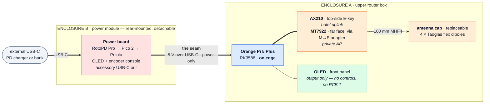

<div align="center">

# Vezha — Fabrication Brief

### Handheld travel router · two enclosures · one PCB

**This repo is a design brief, not a product.**
It exists so a mechanical designer and a PCB designer can build the
physical hardware. It is not documentation for using a finished device —
there isn't one yet.

<br>

[](#scope-of-work)
[](#decision-status)
[](handoff/)
[](docs/01-architecture.md)
[](docs/02-enclosure-a-upper.md)
[](docs/03-enclosure-b-lower.md)
[](docs/02-enclosure-a-upper.md#the-display)
[](docs/05-power-board.md)
[](LICENSE.md)

[](docs/02-enclosure-a-upper.md)
[](docs/02-enclosure-a-upper.md)
[](docs/01-architecture.md#radio-topology)
[](docs/01-architecture.md#radio-topology)
[](#the-hard-requirement)
[](docs/04-antennas.md)
[](docs/02-enclosure-a-upper.md#thermal)

[](docs/05-power-board.md)
[](docs/05-power-board.md)
[](docs/05-power-board.md)
[](docs/01-architecture.md#no-controls-in-v1)
[](docs/05-power-board.md)
[](docs/07-bom.md)

[](https://github.com/ParkWardRR/vezha/commits/main)
[](https://github.com/ParkWardRR/vezha/issues)
[](https://github.com/ParkWardRR/vezha)

</div>

---

> [!IMPORTANT]
> **Read this first.** Every part number, price, and dimension here is a
> *candidate* unless marked otherwise. Nothing has been bought, printed, or
> bench-tested. Panel cutouts come from current manufacturer drawings, never
> from the nominal figures quoted here. Where a document says a value is
> unverified, it means exactly that — **do not design against it.**

## Start here

**Designing the enclosure? → [handoff/](handoff/)** — the phased plan, both
briefs, and every dimension with its provenance.

**Everyone else → [docs/01-architecture.md](docs/01-architecture.md)** — the
system split, radio topology, and power path. Everything else assumes it.

## Scope of work

A **two-piece** handheld router: two enclosures, one PCB, designed together.

| | Deliverable | Contents | Status |
|---|---|---|---|
| **A** | **Upper router box** | Orange Pi 5 Plus **on edge**, both Wi-Fi radios, M→E adapter, storage, **40 mm fan**, **OLED front panel**, **replaceable antenna cap**, closed foot | **In design** — [handoff](handoff/) |
| **B** | **Power module** — mounts on **Enclosure A's rear face** | Power board **plus the OLED + encoder console** — detachable | Ready to design |
| **2** | **Power board** | Carrier for RotoPD Pro + Pico 2 + Pololu regulator | Spec ready |
| ~~**1**~~ | ~~Front control board~~ | **Retired in v1** — [the scope cut](docs/01-architecture.md#no-controls-in-v1) | Design complete, not built |

> [!NOTE]
> **v1 has a display but no controls in the router box.** An **OLED** on the
> front face, output only — no keys, nav wheel, toggle or RGB indicators, and
> **no front control board.** Configuration is the **web UI**. The power
> module keeps its own OLED and encoder, showing **power and PD state only.**
> [01 · No controls in v1](docs/01-architecture.md#no-controls-in-v1)

**The governing rule:** both radios and all antennas stay in Enclosure A, so
**the power box detaches without disturbing any PCIe or antenna connection.**
**Only 5 V power crosses the seam, over USB-C** — no signal, no telemetry.

## How the four deliverables fit together



Everything that transmits lives in **A**. **B** only makes 5 V and hands it
over. Detail — including the double-sided radio stack — is in
[01-architecture.md](docs/01-architecture.md).

## The hard requirement

**Two independent Wi-Fi radios, both on 5 GHz, at the same time** — a 5 GHz
upstream client *and* a 5 GHz downstream private AP, concurrently.

A 2.4 + 5 GHz split does not meet it. A shared-radio repeater does not meet
it. This single requirement is why there are two M.2 cards on opposite faces
of the board, four antennas, and a thermal case nobody has measured.

## Radio topology

The thing most likely to be got wrong:

| Radio | Role | Socket |
|---|---|---|
| **Intel AX210** | Hotel uplink | Orange Pi **top-side M.2 E-key**, directly |
| **MT7922 / RZ616** | Private AP | **Underside M-key** → **M→E adapter** → adapter's E-key |

One radio sits on each **face** of the Orange Pi; the second hangs off an
adapter. With the board **standing on edge** both stacks grow into the case
**depth**, and the published 100 × 75 mm figure excludes heatsink, fan,
adapter, and cable bends.

## Power path

```
external USB-C charger
  → RotoPD Pro        PD negotiation, switched output
  → Pololu D42V55F5   regulated 5 V
  → USB-C seam        5 V power only
  → Orange Pi         dedicated USB-C power input
```

The **Pico 2 sits beside that path, not in it** — it controls the RotoPD Pro
over I²C and gates the router rail. It is powered from the RotoPD's auxiliary
5 V into VSYS, **never** from the Pololu rail it may be needed to bring up.

## Block schematics

> [!NOTE]
> These are **one-page views of the net-by-net schematic documents**, using the
> same reference designators and values. They show blocks, nets and the rules
> that must survive layout — not footprints or pin numbers. **No EDA file
> exists yet, and nothing here has been built or measured.** Where the drawing
> and the document disagree, the document wins.

### Power board — *the only board in v1*


Schematic: **[11-pcb-2-schematic.md](docs/06-power-board-schematic.md)** ·
requirements: **[05-power-board.md](docs/05-power-board.md)**. The two rules the
drawing exists to make unmissable: the bare buck **defaults on** — the module
pulls EN to VIN through 1 MΩ, so **R1 at 1.5 kΩ** has to impose off — and
**the accessory port never sees raw VBUS_PD**, which on a 240 W EPR part
reaches 48 V.

*PCB 1's block schematic (`docs/img/pcb-1-block-schematic.svg`) and its
documents are retired with the board — see
[the v1 scope cut](docs/01-architecture.md#no-controls-in-v1).*

## The dimensions nobody should guess

These decide **whether the two boxes actually close.**

1. ~~CentyLab RotoPD Pro mounting pattern, outline and height~~ — **resolved
   2026-11-18 from the vendor's published KiCad and STEP files**, no physical
   part needed
2. **M.2 adapter stack height** — adapter + card + mated antenna plugs — *Enclosure A*
3. **Mated USB-C plug clearance** — plug *and* cable bend — *both*
4. **The fan-to-heatsink clearance gap** — "small" is the only spec, and it is a depth term — *Enclosure A*
5. **The SBC's mechanical drawing** — hole pattern and port positions. **Not a
   measurement; a [file nobody has opened](https://drive.google.com/file/d/1rW0tlabPHQ-_rhFcBBpHRGK9TQmT1JEP/view)**

> [!WARNING]
> **The Enclosure A depth budget does not currently close.** Both M.2 stacks,
> the board, the heatsink, the fan and the panel share one axis, landing at
> **≈ 51–57 mm** against a 30 mm placeholder. Item 2 above is the biggest soft
> term and **it is answerable today** — the board is on the desk with its
> cards installed.
> [Handoff · the depth budget](handoff/README.md#03--run-the-depth-budget--it-does-not-close)

Canonical copy, with the reasoning:
[01 · The dimensions](docs/01-architecture.md#the-dimensions-nobody-should-guess).
Procedure: [10 · Measurement protocol](docs/10-measurement-protocol.md).

## Documents

### [handoff/](handoff/) — the enclosure and PCB handoff

**Where the active design work is being executed.** Self-contained enough to
work from, and linked back into `docs/` for the reasoning.

| | Document | Contents |
|---|---|---|
| **→** | **[The phased plan](handoff/README.md)** | Phases 0–4 with gates, deliverables and links. **Start here if you are building the thing** |
| | [Brief · upright case](handoff/01-brief-upright-case.md) | The original enclosure brief, verbatim |
| | [Brief · antenna cap](handoff/02-brief-antenna-cap.md) | The cap follow-up, verbatim |
| | [Parts, dimensions and links](handoff/03-parts-and-dimensions.md) | Every figure, tagged verified / published / supplied / guess |

### docs/ — the design record

Ten live documents, numbered in reading order. Retired work is kept but moved
out of the path.

| | Document | For | Contents |
|---|---|---|---|
| **01** | **[Architecture](docs/01-architecture.md)** | **Everyone** | The split, radio topology, power path, decision status. **Read first.** |
| **02** | [Enclosure A — upper](docs/02-enclosure-a-upper.md) | Mechanical | Contents and mounting, the on-edge board, the display, the fan, the antenna cap, USB-C inlet, thermal |
| **03** | [Enclosure B — lower](docs/03-enclosure-b-lower.md) | Mechanical | Power box contents, Pico mounting options, sizing, wall openings |
| **04** | [Antennas](docs/04-antennas.md) | RF + mechanical | The antenna cap, datasheet figures for the ordered part, candidates and gain, tri-band clarification, RF bench test |
| **05** | [Power board — requirements](docs/05-power-board.md) | PCB | What the board must do: module interfaces, the rules that must survive layout, headroom, measurement plan |
| **06** | [Power board — schematic](docs/06-power-board-schematic.md) | PCB | Net-by-net, every passive calculated or simulated, Pico 2 pin map |
| **07** | [BOM](docs/07-bom.md) | Procurement | Every part with status, JLCPCB codes, and what is unresolved |
| **08** | [Sourcing](docs/08-sourcing.md) | Procurement | JLCPCB/LCSC lookup method |
| **09** | [Software & bring-up](docs/09-software-and-bringup.md) | **Software** | The only live software doc — captive portal, VPN, uplink recovery, and the bring-up order. **Nothing implemented** |
| **10** | [Measurement protocol](docs/10-measurement-protocol.md) | Mechanical | The dimensions still unknown, how to take them, the thermal-stack and drawing-retrieval items, and the M.2 adapter assessment |

**[docs/retired/](docs/retired/)** — the display, PCB 1 requirements, the PCB 1
schematic, and the original project handoff. Complete work, kept so a v2 panel
inherits it rather than rediscovering it. Three things there outlived their
documents: the corrected RC debounce window, the 40-pin header map, and the
original brief's ask for physical radio controls — the one requirement v1
does not meet.

**[sim/](sim/)** — ngspice decks. `01`–`06` back the power-board schematic;
`sim/retired/` holds the three PCB 1 decks.

## Decision status

**[01 · Decision status](docs/01-architecture.md#decision-status) is canonical** —
edit it there, not here. The headlines:

| | |
|---|---|
| **Settled · system** | Two enclosures, one PCB. Both radios and all antennas in Enclosure A. AX210 top-side E-key, second radio on a far-face M→E adapter. Power-only seam over USB-C. |
| **Settled · Enclosure A** | SBC **on edge**, 40-pin header at the bottom · **OLED front panel**, output only · all antennas in the **replaceable top cap** · **active cooling** (NF-A4x10 5V over a 50 × 46 × 12.6 mm heatsink, ≈ 27 mm stack) · **closed stable foot**, no header access · **power module mounts on the rear** |
| **Settled · power** | **U3 = Pololu `D42V55F5` #5571** · RotoPD screw terminal removed · accessory port config A · RotoPD geometry 24.40 × 35.80 mm · Pico gates EN from the RotoPD aux rail · the OLED + encoder console stays on the power board |
| **Ordered** | Taoglas **FXP830.24.0100B** flex dipoles |
| **Blocking** | **The seam loop resistance** (a decision, not a measurement — see below) · **the Enclosure A depth budget**, at ≈ 51–57 mm against a 30 mm placeholder · **the SBC mechanical drawing**, never retrieved |
| **Open** | OLED model and size, panel-to-host wiring, fan speed control, vent pattern, how the on-edge board is retained, rear-face allocation, heatsink SKU, second radio part, antenna coordinates and port map, seam USB-C receptacle and cable, Pico mounting, power source |

> [!CAUTION]
> **The seam is over budget as specified, and the regulator can no longer
> absorb it.** The 5.3 V part would have bought 97.8 mΩ of headroom, but the
> Orange Pi's USB-C port takes a **fixed 5 V** and its vendor warns that above
> 5 V damages the board — so U3 is pinned at 5.0 V and the budget is pinned at
> **25 mΩ** for the entire round trip. One USB-C mated pair is **30–40 mΩ on
> its own.**
>
> This is the project's biggest open technical item. The levers, with costs —
> paralleling all four VBUS and GND contacts, a short captive cable, measuring
> the Pi's real peak draw, questioning the 4.75 V target, or moving the
> regulator into Enclosure A — are in
> [06 · What is actually left to pull on](docs/06-power-board-schematic.md#what-is-actually-left-to-pull-on).

## License

[Blue Oak Model License 1.0.0](LICENSE.md) — SPDX `BlueOak-1.0.0`. A
plain-language permissive license with an explicit patent grant and liability
disclaimer.

Blue Oak covers *software*. Once the STLs and PCB design files exist, a
hardware license such as CERN-OHL-S or CERN-OHL-P would fit those better — the
two can coexist, scoped by directory.
