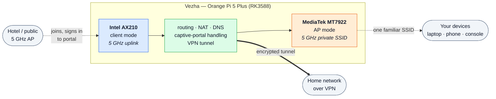

# Vezha

### Your network, wherever you land.

**A handheld travel router that carries your home network with you.**
One radio joins the hotel Wi-Fi. The other broadcasts your own private
5 GHz network. Your devices never notice the difference.

 

---

> [!WARNING]
> **This repo is a design, not a build.** Nothing here has been assembled,
> measured, or bench-tested. There is no confirmed dual-radio result, no
> frozen BOM, no runtime measurement, and no working VPN or captive-portal
> implementation. Part numbers, prices, and layouts are candidates to
> re-verify — not selections. See [Project status](#project-status).

## The problem

Every hotel, rental, and conference network means setting up each device
again: joining the SSID, clicking through a captive portal, losing the
printers and shares and hostnames you had at home. Devices that can't easily
run a VPN client — a work laptop with locked-down MDM, a streaming stick, a
console — are stuck on the hotel's network with whoever else is on it.

Vezha puts one box between your devices and that mess. It deals with the
hotel network once. Your devices join one familiar private SSID, everywhere,
and reach home through a tunnel the router maintains on their behalf.

## The hard requirement

**Two independent Wi-Fi radios, both on 5 GHz, at the same time** — a 5 GHz
upstream client *and* a 5 GHz downstream private AP running concurrently.

This is the constraint that rules out most off-the-shelf travel routers and
most single-card builds:

- A 2.4 GHz + 5 GHz split does **not** meet the goal — it leaves the private
  network on the slow, congested band.
- A shared-radio repeater does **not** meet the goal — it halves throughput
  and ties the private SSID's fate to the uplink.

Everything else in this project is downstream of that one requirement.

## How it works

The private SSID is deliberately **independent of uplink recovery**: when the
hotel link drops, re-authenticates, or gets swapped for a different network,
your devices stay associated and don't need to be touched.

## Hardware

| Part | Choice | Status |
|---|---|---|
| Host | Orange Pi 5 Plus (RK3588) | Leading platform — not purchased |
| Uplink radio | Intel AX210 (Wi-Fi 6E) | **On hand**, role assigned |
| AP radio | MediaTek MT7922 / AMD RZ616 | Candidate — 5 GHz AP operation unvalidated |
| Antennas | 4 × Taoglas FXP830 flex, 2 per radio | Candidate — [comparison](docs/antennas.md) |
| Power | USB-C PD → regulated 5 V | Profile and converter unresolved |
| Storage | eMMC | Discussed, unconfirmed |
| Controls | `AIRPLANE` toggle + 3 keys + ANO wheel | [Designed](docs/controls.md), not ordered |
| Enclosure | Custom 3D-printed, replaceable top cap | Not designed |

> [!NOTE]
> 6 GHz AP operation is **not** assumed. The AX210 and MT7922 are 6E-capable
> parts, but AP-mode 6 GHz depends on kernel, firmware, and regulatory domain
> — it's a thing to verify, not a feature to plan around.

## Documentation

| Page | What's in it |
|---|---|
| **[handoff.md](docs/handoff.md)** | The master document — goal, hardware status, power budget, software plans, enclosure notes, ordered next work |
| **[antennas.md](docs/antennas.md)** | Antenna comparison with published dBi, enclosure layout sketch, and the bench test that decides whether the uplink needs external antennas |
| **[controls.md](docs/controls.md)** | Front faceplate — `AIRPLANE` toggle, three action keys and ANO wheel, full control BOM, JLCPCB assembly caveats, mechanical test coupon |
| **[parts-sourcing.md](docs/parts-sourcing.md)** | JLCPCB/LCSC part lookup method and components checked so far |

## Project status

| Milestone | State |
|---|---|
| Both PCIe cards enumerate simultaneously | ❌ Not tested |
| Simultaneous 5 GHz client + AP passing traffic | ❌ Not tested |
| Captive portal login / reconnect / VPN recovery | ❌ Not implemented |
| Power measured at the board, battery runtime | ❌ Not measured |
| RF compared open / closed / in-hand | ❌ Not measured |
| Enclosure and BOM frozen | ❌ Not frozen |

### Roadmap

1. **Verify the parts.** Confirm what's on hand and how both PCIe cards
   connect. Verify both enumerate at once.
2. **Bring up the radios.** Boot Armbian Minimal, AX210 in client mode,
   MT7922 in AP mode, real client traffic with both links on 5 GHz. Record
   kernel, firmware, country setting, channels, stability.
3. **Make it survive travel.** Captive-portal login, reconnect, VPN recovery.
   Verify the private SSID stays up when the uplink drops.
4. **Measure it.** Power at the board, battery runtime, RF with the enclosure
   open, closed, and held normally.
5. **Freeze it.** Enclosure and parts list only after the above. Touchscreen,
   physical controls, and Wi-Fi surveying come afterward.

Full detail behind each step is in [handoff.md](docs/handoff.md).

## Design principles

- **Treat suggestions as candidates, not purchases.** Nothing moves from
  "discussed" to "chosen" without a bench result behind it.
- **Catalog specs are not measurements.** Published antenna gain, connector
  ratings, and battery capacity figures describe a part in isolation, not this
  build.
- **The private network is the product.** Uplink churn is an implementation
  detail that should never reach the client devices.
- **Verify before machining.** Panel cutouts come from current manufacturer
  drawings, never from nominal dimensions.

## License

[Blue Oak Model License 1.0.0](LICENSE.md) — SPDX `BlueOak-1.0.0`.

A plain-language permissive license: do what you like with it, contributors
get an explicit patent grant and a liability disclaimer. Comparable in effect
to MIT or Apache-2.0, written to be readable.

Blue Oak covers *software*. If the enclosure STLs and PCB design files become
the substantial part of this repo, a hardware license such as CERN-OHL-S or
CERN-OHL-P would fit those better — the two can coexist, scoped by directory.

---

<b>Vezha</b> — your network, wherever you land.

