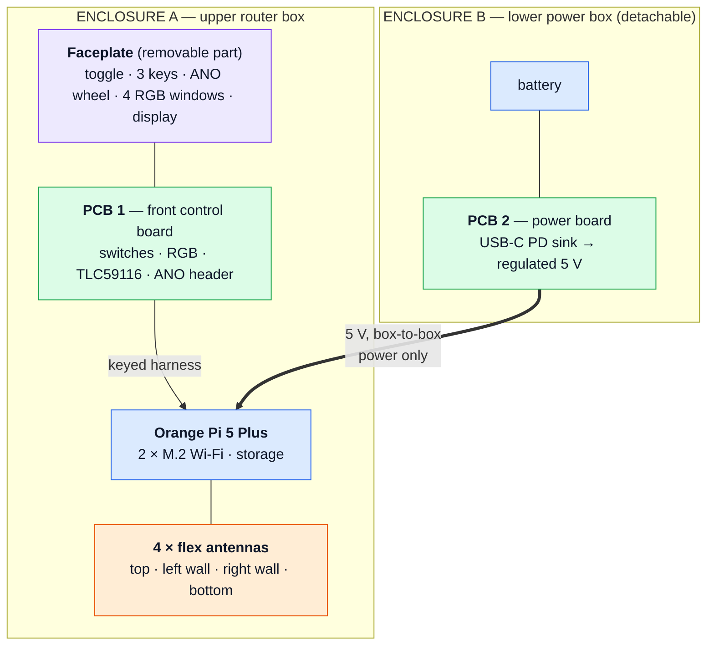

# Vezha — Fabrication Brief

### Handheld travel router · two enclosures · two PCBs

**This repo is a design brief, not a product.**
It exists so a mechanical designer and a PCB designer can build the
physical hardware. It is not documentation for using a finished device —
there isn't one yet.

 

---

> [!IMPORTANT]
> **Read this first.** Every part number, price, and dimension in this repo is
> a *candidate*, not a verified selection. Nothing has been bought, printed,
> or bench-tested. Panel cutouts must come from current manufacturer drawings,
> never from the nominal figures quoted here. Where a document says a value is
> unverified, it means exactly that — do not design against it.

## Scope of work

Two enclosures and two PCBs, designed to go together.

### Enclosures

| | Enclosure | Contents | Notes |
|---|---|---|---|
| **A** | **Upper router box** | Orange Pi 5 Plus, two M.2 Wi-Fi cards, four internal antennas, storage, display, front faceplate with all controls and indicators | Carries everything electronic except power. The **faceplate is removable** and is its own part. |
| **B** | **Lower power box** | Battery / USB-C PD input, power conversion to regulated 5 V | **Detachable from A.** No controls, no indicators, no radios mount here. |

The two boxes stack into one handheld unit. **Nothing from the upper box may
depend on the lower box being attached** beyond power.

### PCBs

| | Board | Function | Lives in |
|---|---|---|---|
| **1** | **Front control board** | APEM 6C switches (3 populated of 5), four RGB indicators, TI TLC59116 I²C LED driver, landing pads for the NKK toggle leads, STEMMA QT header to the ANO wheel, one keyed harness connector to the Orange Pi | Enclosure **A**, on standoffs behind the faceplate |
| **2** | **Power board** | USB-C PD sink and negotiation, conversion to regulated 5 V, box-to-box power interconnect | Enclosure **B** |

> [!NOTE]
> Board 1 is specified in detail in [controls.md](docs/controls.md) and is
> ready to design against. Board 2 is scoped in [power.md](docs/power.md) but
> **blocked** — its design cannot start until the system's actual current draw
> is measured. Enclosure B's dimensions are an output of that work, not an
> input.

## What the device does

Enough context to make the mechanical decisions make sense.

Vezha is a battery-powered travel router. One Wi-Fi card joins the hotel or
public network as a client; the second broadcasts a private network for the
owner's own devices. **Both must operate on 5 GHz simultaneously** — that
single requirement is why there are two M.2 cards, four antennas, and a
thermal problem worth taking seriously.

## Constraints that drive the design

These are the requirements most likely to be violated by a reasonable-looking
design, so they are called out rather than left in the detail docs.

| # | Constraint | Consequence for the build |
|---|---|---|
| 1 | **Two M.2 PCIe Wi-Fi cards must fit and enumerate together** | Slot/adapter topology and physical clearance are unresolved. This is the first thing to confirm, before any shell geometry. |
| 2 | **Four internal antennas, two per radio, kept apart** | Antennas go inside the *narrow walls* — top edge, left wall, right wall, bottom edge. Broad screen and back faces stay clear. Do not bunch all four under one cap to simplify routing. |
| 3 | **Antenna leads are 100 mm** | Mock up cable routes **before** fixing board and antenna positions. The leads may not reach every corner. |
| 4 | **No metal or carbon-filled filament in antenna zones** | Keep antennas away from display, battery, and heatsink. Target ~20 mm from the main ground plane where practical. |
| 5 | **Display mounts on its own bracket** | Pressing a button must not flex the display mount or load its ribbon. |
| 6 | **Display opening separate from control openings** | A display change must not force a new button PCB. |
| 7 | **Toggle clamps to the faceplate, not the PCB** | Its solder lugs run as leads to PCB 1. For a printed prototype, use a thin mounting land or metal insert — do not assume its nut clears the full printed wall. |
| 8 | **Indicator light must not leak** | RGB light goes through a flush diffuser above each label, with opaque walls between indicators. Keycaps stay opaque. No glow around the cap. |
| 9 | **Low power, no dedicated cooling preferred** | Hardware selection favours parts that do not need active cooling — but two 6E radios under simultaneous load is an untested thermal case. |

## Document map

| Document | For whom | Contents |
|---|---|---|
| **[controls.md](docs/controls.md)** | **PCB + mechanical** | The most complete spec here. Faceplate concept, control BOM with exact part numbers, switch/cap/toggle mounting, RGB indicator design and driver, JLCPCB assembly caveats, test coupons. |
| **[antennas.md](docs/antennas.md)** | **Mechanical** | Antenna candidates with published gain, the four-position internal layout with a sketch, wall/clearance rules, and the RF bench test that must pass before the enclosure is frozen. |
| **[power.md](docs/power.md)** | **PCB 2 + mechanical** | What the power board must do, what it has to power, why its design is blocked on measurement, and the box-to-box interconnect requirements. |
| **[handoff.md](docs/handoff.md)** | Background | Project-wide state: hardware status, power budget, software plans, open questions. Start here for *why*, not *what to build*. |
| **[parts-sourcing.md](docs/parts-sourcing.md)** | Procurement | How to query JLCPCB/LCSC for availability and price, and parts checked so far. |

## What is decided vs open

**Decided enough to design around**

- Two enclosures (upper router box + detachable power box), two PCBs
- Removable faceplate as a separate part
- Control set: locking `AIRPLANE` toggle, three action keys (`LINK`, `MAC`,
  `★`), ANO navigation wheel
- One RGB indicator per control, lit through the faceplate, not the keycap
- Four internal flex antennas, two per radio, in the narrow walls

**Open — do not design against these yet**

- M.2 slot topology and whether both cards physically fit
- Final antenna SKU and geometry
- USB-C PD profile, converter, battery, and therefore the size of Enclosure B
- Display model, and whether it gains real menus (which would change the
  control layout)
- Thermal solution
- JLCPCB assembly sourcing for the 6C switches, the TLC59116, and the RGB LEDs

## Ground rules

1. **Coupons before parts.** Print a faceplate coupon with the wheel opening,
   two cap openings (one flush, one recessed), and one light pipe. Check the
   optics in a dark room *and* in daylight before ordering the real faceplate.
2. **Drawings, not nominals.** Every panel cutout comes from the current
   manufacturer drawing. The NKK toggle's Ø6.5 mm and the 6C's 8 × 8 × 2.5 mm
   body are **not** cutout dimensions.
3. **Choose optics and LED together.** They set the standoff height, so they
   cannot be picked after the stack is frozen.
4. **Confirm sourcing in the assembly quote**, not from a datasheet link.
5. **Freeze the enclosure last.** The RF bench test in
   [antennas.md](docs/antennas.md) can still move antenna positions, and
   antenna positions move walls.

## License

[Blue Oak Model License 1.0.0](LICENSE.md) — SPDX `BlueOak-1.0.0`. A
plain-language permissive license with an explicit patent grant and liability
disclaimer.

Blue Oak covers *software*. Once the STLs and PCB design files exist, a
hardware license such as CERN-OHL-S or CERN-OHL-P would fit those better — the
two can coexist, scoped by directory.
