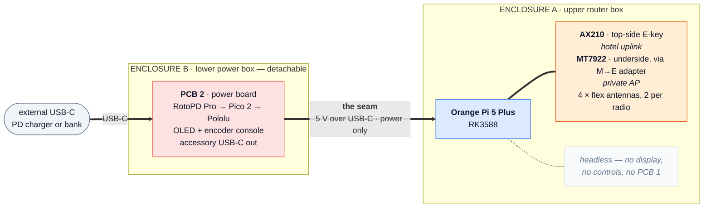

<div align="center">

# Vezha — Fabrication Brief

### Handheld travel router · two enclosures · one PCB

**This repo is a design brief, not a product.**
It exists so a mechanical designer and a PCB designer can build the
physical hardware. It is not documentation for using a finished device —
there isn't one yet.

<br>

[](#scope-of-work)
[](#decision-status)
[](docs/01-architecture.md)
[](docs/02-enclosure-a-upper.md)
[](docs/03-enclosure-b-lower.md)
[](docs/retired/pcb-1-front-control.md)
[](docs/05-pcb-2-power.md)
[](LICENSE.md)

[](docs/02-enclosure-a-upper.md)
[](docs/02-enclosure-a-upper.md)
[](docs/01-architecture.md#radio-topology)
[](docs/01-architecture.md#radio-topology)
[](#the-hard-requirement)
[](docs/04-antennas.md)

[](docs/05-pcb-2-power.md)
[](docs/05-pcb-2-power.md)
[](docs/05-pcb-2-power.md)
[](docs/01-architecture.md#the-v1-scope-cut)
[](docs/05-pcb-2-power.md)
[](docs/07-bom.md)

[](https://github.com/ParkWardRR/vezha/commits/main)
[](https://github.com/ParkWardRR/vezha/issues)
[](https://github.com/ParkWardRR/vezha)

</div>

---

> [!IMPORTANT]
> **Read this first.** Every part number, price, and dimension here is a
> *candidate* unless marked otherwise. Nothing has been bought, printed, or
> bench-tested. Panel cutouts come from current manufacturer drawings, never
> from the nominal figures quoted here. Where a document says a value is
> unverified, it means exactly that — **do not design against it.**

## Start here

**→ [docs/01-architecture.md](docs/01-architecture.md)** — the system split,
radio topology, and power path. Everything else assumes it.

## Scope of work

A **two-piece** handheld router: two enclosures, one PCB, designed together.

| | Deliverable | Contents | Status |
|---|---|---|---|
| **A** | **Upper router box** | Orange Pi 5 Plus, both Wi-Fi radios, M→E adapter, four antennas, storage. **Headless — sealed shell, no panel** | Ready to design |
| **B** | **Lower power box** | PCB 2 only — detachable | Blocked on 3 measurements |
| **2** | **Power board** | Carrier for RotoPD Pro + Pico 2 + Pololu regulator | Spec ready |
| ~~**1**~~ | ~~Front control board~~ | **Retired in v1** — [the scope cut](docs/01-architecture.md#the-v1-scope-cut) | Design complete, not built |

> [!NOTE]
> **v1 has no display and no controls in the router box.** The e-paper panel,
> three keys, nav wheel, toggle and RGB indicators were all specified, sourced
> and simulated — then cut for scope on 2026-11-18. The router's entire UI is
> the **web UI**; the only hardware panel in the product is PCB 2's OLED and
> encoder, in the power box, and it can show **power and PD state only.**
> Reasoning and what it buys: [01 · The v1 scope cut](docs/01-architecture.md#the-v1-scope-cut).

**The governing rule:** both radios and all antennas stay in Enclosure A, so
**the power box detaches without disturbing any PCIe or antenna connection.**
**Only 5 V power crosses the seam, over USB-C** — no signal, no telemetry.

## How the four deliverables fit together



Everything that transmits lives in **A**. **B** only makes 5 V and hands it
over. Detail — including the double-sided radio stack — is in
[01-architecture.md](docs/01-architecture.md).

## The hard requirement

**Two independent Wi-Fi radios, both on 5 GHz, at the same time** — a 5 GHz
upstream client *and* a 5 GHz downstream private AP, concurrently.

A 2.4 + 5 GHz split does not meet it. A shared-radio repeater does not meet
it. This single requirement is why there are two M.2 cards on opposite faces
of the board, four antennas, and a thermal case nobody has measured.

## Radio topology

The thing most likely to be got wrong:

| Radio | Role | Socket |
|---|---|---|
| **Intel AX210** | Hotel uplink | Orange Pi **top-side M.2 E-key**, directly |
| **MT7922 / RZ616** | Private AP | **Underside M-key** → **M→E adapter** → adapter's E-key |

One radio sits **above** the Orange Pi; the other hangs **below** it on an
adapter. The board cannot mount flat against a floor or a lid, and the
published 100 × 75 mm figure excludes heatsink, adapter, and cable bends.

## Power path

```
external USB-C charger
  → RotoPD Pro        PD negotiation, switched output
  → Pololu D42V55F5   regulated 5 V
  → USB-C seam        5 V power only
  → Orange Pi         dedicated USB-C power input
```

The **Pico 2 sits beside that path, not in it** — it controls the RotoPD Pro
over I²C and gates the router rail. It is powered from the RotoPD's auxiliary
5 V into VSYS, **never** from the Pololu rail it may be needed to bring up.

## Block schematics

> [!NOTE]
> These are **one-page views of the net-by-net schematic documents**, using the
> same reference designators and values. They show blocks, nets and the rules
> that must survive layout — not footprints or pin numbers. **No EDA file
> exists yet, and nothing here has been built or measured.** Where the drawing
> and the document disagree, the document wins.

### PCB 2 — power board — *the only board in v1*


Schematic: **[11-pcb-2-schematic.md](docs/06-pcb-2-schematic.md)** ·
requirements: **[05-pcb-2-power.md](docs/05-pcb-2-power.md)**. The two rules the
drawing exists to make unmissable: the bare buck **defaults on** — the module
pulls EN to VIN through 1 MΩ, so **R1 at 1.5 kΩ** has to impose off — and
**the accessory port never sees raw VBUS_PD**, which on a 240 W EPR part
reaches 48 V.

*PCB 1's block schematic (`docs/img/pcb-1-block-schematic.svg`) and its
documents are retired with the board — see
[the v1 scope cut](docs/01-architecture.md#the-v1-scope-cut).*

## The three dimensions nobody should guess

These decide **whether the two boxes actually close.** Measurements to take,
not values to look up:

1. **CentyLab RotoPD Pro** mounting pattern, outline, and height — *Enclosure B*
2. **Underside adapter stack height** — adapter + card + mated antenna plugs — *Enclosure A*
3. **Mated USB-C plug clearance** — plug *and* cable bend — *both*

Canonical copy, with the reasoning:
[01 · The three dimensions](docs/01-architecture.md#the-three-dimensions-nobody-should-guess).

## Documents

Nine live documents, numbered in reading order. Retired work is kept but moved
out of the path.

| | Document | For | Contents |
|---|---|---|---|
| **01** | **[Architecture](docs/01-architecture.md)** | **Everyone** | The split, radio topology, power path, the v1 scope cut, decision status. **Read first.** |
| **02** | [Enclosure A — upper](docs/02-enclosure-a-upper.md) | Mechanical | Contents and mounting, the double-sided board problem, antenna zones, USB-C inlet, thermal |
| **03** | [Enclosure B — lower](docs/03-enclosure-b-lower.md) | Mechanical | Power box contents, Pico mounting options, sizing, wall openings |
| **04** | [Antennas](docs/04-antennas.md) | RF + mechanical | Four placements with orientation, candidates and gain, tri-band clarification, RF bench test |
| **05** | [PCB 2 — requirements](docs/05-pcb-2-power.md) | PCB | What the board must do: module interfaces, the rules that must survive layout, headroom, measurement plan |
| **06** | [PCB 2 — schematic](docs/06-pcb-2-schematic.md) | PCB | Net-by-net, every passive calculated or simulated, Pico 2 pin map |
| **07** | [BOM](docs/07-bom.md) | Procurement | Every part with status, JLCPCB codes, and what is unresolved |
| **08** | [Sourcing](docs/08-sourcing.md) | Procurement | JLCPCB/LCSC lookup method |
| **09** | [Background](docs/09-background.md) | Context | Original handoff and what v1 gives up. Partly superseded — kept for the *why* |

**[docs/retired/](docs/retired/)** — the display, PCB 1 requirements and PCB 1
schematic, cut from v1 on 2026-11-18. Complete work, kept so a v2 panel
inherits it. Two findings there outlived the board: the corrected RC debounce
window, and the 40-pin header map, which stays valid regardless.

**[sim/](sim/)** — ngspice decks. `01`–`06` back the PCB 2 schematic;
`sim/retired/` holds the three PCB 1 decks.

## Decision status

**[01 · Decision status](docs/01-architecture.md#decision-status) is canonical** —
edit it there, not here. The headlines:

| | |
|---|---|
| **Settled** | Two enclosures, one PCB. Both radios and all antennas in Enclosure A. AX210 top-side E-key, second radio on an underside M→E adapter. RotoPD Pro → Pololu → USB-C seam → Orange Pi, with the Pico beside that path gating EN. Enclosure A is headless. |
| **Blocking** | **RotoPD Pro physical envelope** (blocks Enclosure B) · **which regulator**, `D42V55F5` vs `D42V55F5.3`, blocked on the Orange Pi's maximum input voltage · which M→E adapter, and whether it routes PCIe |
| **Open** | Second radio part and height, antenna connector type, seam USB-C part, thermal solution, final antenna SKU, power source, how Enclosure A opens for service |

> [!CAUTION]
> **IR drop binds before the 3 A advertisement limit.** One USB-C mated pair is
> 30–40 mΩ against a 25 mΩ budget at the 5.0 V regulator's low corner — so
> "measure and hope it is under 3 A" does not settle the seam.
> [01 · The 5 V seam problem](docs/01-architecture.md#the-5-v-seam-problem).

## Ground rules

1. **Measure mated hardware.** Size both boxes around connectors *with* their
   cables, not around PCB footprints.
2. **Drawings, not nominals.** A published body size is never a cutout
   dimension.
3. **Confirm sourcing in the assembly quote**, not from a datasheet link.
4. **Freeze the enclosures last.** The RF test in
   [06](docs/04-antennas.md) can still move antenna positions, and antenna
   positions move walls.
5. **Scope cuts go in the docs, not the bin.** Retired work keeps its document
   with a banner saying what was learned —
   [04](docs/retired/pcb-1-front-control.md), [10](docs/retired/display-epaper.md) and
   [12](docs/retired/pcb-1-schematic.md) are the worked examples.

*Rules about faceplate coupons, plunger lengths and LED optics retired with
PCB 1. They are preserved in [04](docs/retired/pcb-1-front-control.md) should a
front panel return.*

## License

[Blue Oak Model License 1.0.0](LICENSE.md) — SPDX `BlueOak-1.0.0`. A
plain-language permissive license with an explicit patent grant and liability
disclaimer.

Blue Oak covers *software*. Once the STLs and PCB design files exist, a
hardware license such as CERN-OHL-S or CERN-OHL-P would fit those better — the
two can coexist, scoped by directory.
