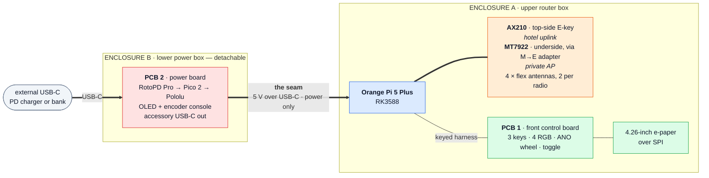

<div align="center">

# Vezha — Fabrication Brief

### Handheld travel router · two enclosures · two PCBs

**This repo is a design brief, not a product.**
It exists so a mechanical designer and a PCB designer can build the
physical hardware. It is not documentation for using a finished device —
there isn't one yet.

<br>

[](#scope-of-work)
[](#decision-status)
[](docs/01-architecture.md)
[](docs/02-enclosure-a-upper.md)
[](docs/03-enclosure-b-lower.md)
[](docs/04-pcb-1-front-control.md)
[](docs/05-pcb-2-power.md)
[](LICENSE.md)

[](docs/02-enclosure-a-upper.md)
[](docs/02-enclosure-a-upper.md)
[](docs/01-architecture.md#radio-topology)
[](docs/01-architecture.md#radio-topology)
[](#the-hard-requirement)
[](docs/06-antennas.md)

[](docs/05-pcb-2-power.md)
[](docs/05-pcb-2-power.md)
[](docs/05-pcb-2-power.md)
[](docs/04-pcb-1-front-control.md)
[](docs/04-pcb-1-front-control.md#rgb-indicators)
[](docs/07-bom.md)

[](https://github.com/ParkWardRR/vezha/commits/main)
[](https://github.com/ParkWardRR/vezha/issues)
[](https://github.com/ParkWardRR/vezha)

</div>

---

> [!IMPORTANT]
> **Read this first.** Every part number, price, and dimension here is a
> *candidate* unless marked otherwise. Nothing has been bought, printed, or
> bench-tested. Panel cutouts come from current manufacturer drawings, never
> from the nominal figures quoted here. Where a document says a value is
> unverified, it means exactly that — **do not design against it.**

## Start here

**→ [docs/01-architecture.md](docs/01-architecture.md)** — the system split,
radio topology, and power path. Everything else assumes it.

## Scope of work

A **two-piece** handheld router: two enclosures, two PCBs, designed together.

| | Deliverable | Contents | Status |
|---|---|---|---|
| **A** | **Upper router box** | Orange Pi 5 Plus, both Wi-Fi radios, M→E adapter, four antennas, storage, display, removable faceplate | Ready to design |
| **B** | **Lower power box** | PCB 2 only — detachable | Blocked on 3 measurements |
| **1** | **Front control board** | 3 key switches, 4 RGB indicators + TLC59116 driver, toggle landing, ANO header, harness to the Pi | Spec ready |
| **2** | **Power board** | Carrier for RotoPD Pro + Pico 2 + Pololu regulator | Spec ready |

**The governing rule:** both radios and all antennas stay in Enclosure A, so
**the power box detaches without disturbing any PCIe or antenna connection.**
**Only 5 V power crosses the seam, over USB-C** — no signal, no telemetry.

## How the four deliverables fit together



Everything that transmits lives in **A**. **B** only makes 5 V and hands it
over. Detail — including the double-sided radio stack — is in
[01-architecture.md](docs/01-architecture.md).

## The hard requirement

**Two independent Wi-Fi radios, both on 5 GHz, at the same time** — a 5 GHz
upstream client *and* a 5 GHz downstream private AP, concurrently.

A 2.4 + 5 GHz split does not meet it. A shared-radio repeater does not meet
it. This single requirement is why there are two M.2 cards on opposite faces
of the board, four antennas, and a thermal case nobody has measured.

## Radio topology

The thing most likely to be got wrong:

| Radio | Role | Socket |
|---|---|---|
| **Intel AX210** | Hotel uplink | Orange Pi **top-side M.2 E-key**, directly |
| **MT7922 / RZ616** | Private AP | **Underside M-key** → **M→E adapter** → adapter's E-key |

One radio sits **above** the Orange Pi; the other hangs **below** it on an
adapter. The board cannot mount flat against a floor or a lid, and the
published 100 × 75 mm figure excludes heatsink, adapter, and cable bends.

## Power path

```
external USB-C charger
  → RotoPD Pro        PD negotiation, switched output
  → Pololu D42V55F5   regulated 5 V
  → USB-C seam        5 V power only
  → Orange Pi         dedicated USB-C power input
```

The **Pico 2 sits beside that path, not in it** — it controls the RotoPD Pro
over I²C and gates the router rail. It is powered from the RotoPD's auxiliary
5 V into VSYS, **never** from the Pololu rail it may be needed to bring up.

## Block schematics

> [!NOTE]
> These are **one-page views of the net-by-net schematic documents**, using the
> same reference designators and values. They show blocks, nets and the rules
> that must survive layout — not footprints or pin numbers. **No EDA file
> exists yet, and nothing here has been built or measured.** Where the drawing
> and the document disagree, the document wins.

### PCB 1 — front control board


Schematic: **[12-pcb-1-schematic.md](docs/12-pcb-1-schematic.md)** ·
requirements: **[04-pcb-1-front-control.md](docs/04-pcb-1-front-control.md)**.
Every placed part now has an LCSC code. The one thing still blocking layout is
the **Orange Pi 5 Plus 40-pin map**, which no authoritative source has yet
produced — doc 12 specifies the host interface by function instead.

### PCB 2 — power board


Schematic: **[11-pcb-2-schematic.md](docs/11-pcb-2-schematic.md)** ·
requirements: **[05-pcb-2-power.md](docs/05-pcb-2-power.md)**. The two rules the
drawing exists to make unmissable: the bare buck **defaults on** — the module
pulls EN to VIN through 1 MΩ, so **R1 at 1.5 kΩ** has to impose off — and
**the accessory port never sees raw VBUS_PD**, which on a 240 W EPR part
reaches 48 V.

## The three dimensions nobody should guess

These decide **whether the two boxes actually close.** Measurements to take,
not values to look up:

1. **CentyLab RotoPD Pro** mounting pattern, outline, and height
2. **Underside adapter stack height** — adapter + card + mated antenna plugs
3. **Mated power connector clearance** — connector *and* cable bend

## Documents

| | Document | For | Contents |
|---|---|---|---|
| **01** | **[Architecture](docs/01-architecture.md)** | **Everyone** | The split, radio topology, power path, decision status. **Read first.** |
| **02** | [Enclosure A — upper](docs/02-enclosure-a-upper.md) | Mechanical | Contents and mounting, the double-sided board problem, antenna zones, faceplate, seam, thermal |
| **03** | [Enclosure B — lower](docs/03-enclosure-b-lower.md) | Mechanical | Power box contents, Pico mounting options, sizing, USB-C input |
| **04** | [PCB 1 — front control](docs/04-pcb-1-front-control.md) | PCB + mechanical | Switches, caps, toggle, ANO wheel, RGB indicators and driver, assembly caveats, test coupons |
| **05** | [PCB 2 — power](docs/05-pcb-2-power.md) | PCB | Carrier wiring, the three rules that must survive layout, headroom, measurement plan |
| **06** | [Antennas](docs/06-antennas.md) | RF + mechanical | Four placements with orientation, candidates and gain, tri-band clarification, RF bench test |
| **07** | [BOM](docs/07-bom.md) | Procurement | Every part with status, price, and what is unresolved |
| **08** | [Sourcing](docs/08-sourcing.md) | Procurement | JLCPCB/LCSC lookup method |
| **09** | [Background](docs/09-background.md) | Context | Original handoff. Partly superseded — kept for the *why* |
| **10** | [Display](docs/10-display.md) | Mechanical + software | 4.26" e-paper: dimensions, SPI wiring, refresh discipline, what it does to the UI |
| **11** | [PCB 2 — schematic](docs/11-pcb-2-schematic.md) | PCB | Net-by-net power board, every passive calculated or simulated, Pico 2 pin map |
| **12** | [PCB 1 — schematic](docs/12-pcb-1-schematic.md) | PCB | Net-by-net front panel, reference designators, host interface, simulation results |

## Decision status

**Settled — design against these**

- Two enclosures, two PCBs, power-only seam
- Both radios and all antennas in Enclosure A
- AX210 top-side E-key; second radio on an underside M→E adapter
- RotoPD Pro → Pololu → detachable connector → Orange Pi
- Pico 2 controller, powered from RotoPD auxiliary via VSYS
- Four internal flex antennas, two per radio, inside the narrow walls
- Controls: locking `AIRPLANE` toggle, three keys, ANO wheel, one RGB
  indicator per control lit through the faceplate
- Display: Waveshare 4.26" e-paper over SPI, no touch — [10](docs/10-display.md)

**Open — do not design against these**

- Second radio part and height; antenna connector type unconfirmed
- Which M→E adapter (must route PCIe)
- RotoPD Pro physical envelope — **blocks Enclosure B**
- Seam USB-C part; whether the Pi stays under USB-C's 3 A limit at 5 V
- Thermal solution, final antenna SKU
- Power source: external bank vs. internal cell
- **Key switch termination** — SMD 6C (hot air) vs through-hole Multimec 5G
  (iron, new caps, +3.9 mm stack) vs C&K (machine-placed, lighter touch).
  [04](docs/04-pcb-1-front-control.md#why-this-switch)
- RGB LED part and optic — the last unsourced part on PCB 1

## Ground rules

1. **Coupons before parts.** Print a faceplate coupon with the wheel opening,
   two cap openings (flush and recessed), and one light pipe. Check optics in
   a dark room *and* daylight before ordering the real faceplate.
2. **Drawings, not nominals.** The NKK toggle's Ø6.5 mm and the 6C's
   8 × 8 × 2.5 mm body are **not** cutout dimensions.
3. **Choose optics and LED together** — they set standoff height.
4. **Measure mated hardware.** Size both boxes around connectors *with* their
   cables, not around PCB footprints.
5. **Confirm sourcing in the assembly quote**, not from a datasheet link.
6. **Freeze the enclosures last.** The RF test in
   [06](docs/06-antennas.md) can still move antenna positions, and antenna
   positions move walls.

## License

[Blue Oak Model License 1.0.0](LICENSE.md) — SPDX `BlueOak-1.0.0`. A
plain-language permissive license with an explicit patent grant and liability
disclaimer.

Blue Oak covers *software*. Once the STLs and PCB design files exist, a
hardware license such as CERN-OHL-S or CERN-OHL-P would fit those better — the
two can coexist, scoped by directory.
