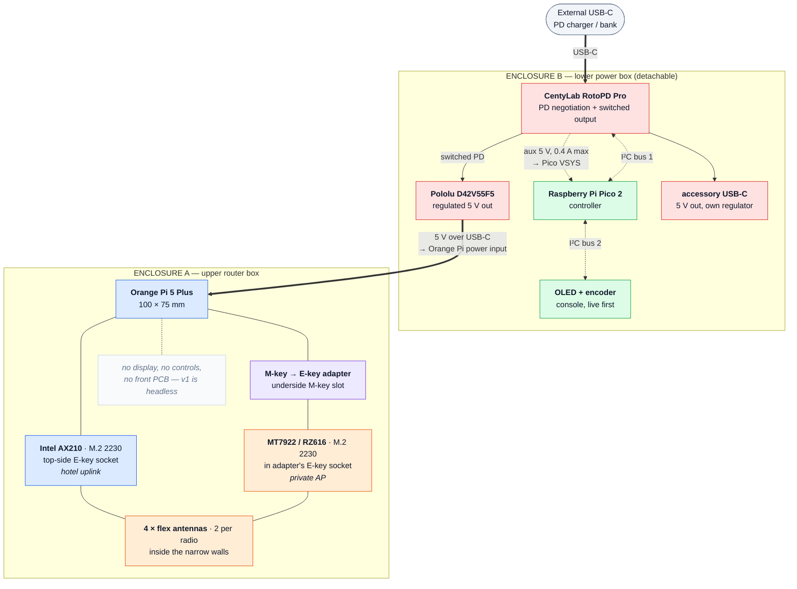

# 01 · System Architecture

How Vezha is divided into two enclosures and one PCB, what crosses between
them, and which decisions are settled.

> [!IMPORTANT]
> Read this before any other document. Everything downstream assumes this
> split.

## The split

A compact **two-piece** travel router.

|  | Enclosure | Holds | Detachable? |
| --- | --- | --- | --- |
| **A** | **Upper router box** | Orange Pi 5 Plus, both Wi-Fi radios, the M-key→E-key adapter, all four antennas, storage. **No display, no controls, no front PCB.** | No — this is the router |
| **B** | **Lower power box** | Power board: Raspberry Pi Pico 2, CentyLab RotoPD Pro, Pololu 5 V regulator, OLED console, push encoder, accessory USB-C out | **Yes** |

**The governing rule:** both radios and all antennas stay in the upper
enclosure, so **the power box comes off without disturbing any PCIe or
antenna connection.** **Only 5 V power crosses the seam**, over USB-C.

> [!NOTE]
> **Enclosure A is headless; Enclosure B carries the only panel.** The power board drives
> an OLED and a push encoder, and the Pico boots before the Orange Pi, so that
> console is live first *and* is the sole piece of hardware UI in the product.
> This was an open question that blocked both front panels; **the v1 scope cut
> settled it** — see below.

## The v1 scope cut

**2026-11-18. Vezha v1 has no display and no controls in Enclosure A.** The
upper box is a sealed enclosure holding the SBC, the radios, the antennas and a
USB-C power inlet. Its entire user interface is the web UI.

This retired four documents' worth of settled design — the e-paper panel
([10](retired/display-epaper.md)), the front control board ([04](retired/pcb-1-front-control.md))
and its finished schematic ([12](retired/pcb-1-schematic.md)), plus simulation decks
`sim/11`, `sim/12` and `sim/13`. None of it was wrong. It was cut for scope.

**How it got here**, briefly, because the reasoning constrains v2:

1. The 4.26" e-paper was chosen for status-at-rest — it holds an image with
   power removed at `<0.01 µA`. But a 4 s full refresh and a ≥ 180 s minimum
   interval cannot drive a scroll wheel, so the UI had to be paged rather than
   scrolled, and the RGB indicators became the only live layer.
2. A monochrome OLED was considered **alongside** the e-paper, to be that live
   layer: zero extra host pins on the existing I²C bus, and the two panels have
   complementary failure modes — e-paper is damaged by dynamic use and by being
   left energised, OLED by static images.
3. Going **OLED-only** was then considered. It retires the e-paper's 0–50 °C
   limit outright (the panel in Adafruit 5297 is rated −40 to +70 °C
   operating), but costs 7–13× the active area, and a Wi-Fi join QR for a
   strong passphrase needs ≥ 0.5 mm per module — marginal at the 5297's
   20.076 × 20.076 mm.
4. **v1 drops the panel entirely.** If the real interaction model is "configure
   over the web UI", every one of the above is a cost with no matching benefit.

**What the cut buys:**

| | Before | v1 |
|---|---|---|
| Deliverables | 2 enclosures, 2 PCBs | **2 enclosures, 1 PCB** |
| Enclosure A footprint driver | The display's 107 × 64 mm driver board | The Orange Pi's 100 × 75 mm and the antennas |
| Enclosure A Z stack | Faceplate + plungers + PCB 1 + glass + driver board + SBC + underside M.2 stack | Shell + SBC + underside M.2 stack |
| Host 40-pin header | 9 pins SPI + 2 I²C + 4–5 GPIO | **Nothing attached** |
| Front-panel current across the seam | ~120 mA worst case | **0 mA** |
| Highest-risk mechanical item | Printed plungers against 0.35 mm travel | *(gone — no faceplate openings)* |

**What the cut costs:** no at-rest status indication of any kind — a wedged
boot looks identical to a working one from outside the case. No hardware radio
cut; `AIRPLANE` becomes software-only. The `★` key's Wi-Fi join QR has nowhere
to live, so it becomes a printed label inside the case, or nothing.

**For v2**, the retired documents are kept rather than deleted. Their findings
are summarised in the banner at the top of each.



## Radio topology

This is the part most likely to be got wrong, because the two radios attach
to the Orange Pi in **different ways on opposite faces of the board.**

| Radio | Role | Socket | Path |
| --- | --- | --- | --- |
| **Intel AX210** | Hotel / public uplink | Orange Pi **top-side M.2 E-key** socket, directly | Wi-Fi over PCIe; Bluetooth over USB |
| **MT7922 / RZ616** | Private AP | **Underside M-key** slot → **M-key-to-E-key adapter** → adapter's E-key socket | PCIe, through the adapter. **Bluetooth does not come with it** — see below |

> [!IMPORTANT]
> **Two consequences of putting a radio in the M-key slot**, added
> 2026-11-18 once the socket specs were confirmed:
>
> - **It forecloses NVMe storage.** The Orange Pi has exactly one M-key
>   socket and this uses it, so eMMC is a requirement rather than a
>   preference.
> - **Bluetooth does not travel over an M-key adapter.** The M.2 M-key
>   connector carries no USB 2.0 — that is an E-key signal — so adapters
>   bring it out on a separate flying cable. For v1 that is acceptable,
>   because this radio is the private AP and the AX210 in the native E-key
>   socket handles Bluetooth. But the second radio's Bluetooth will not work
>   unless that cable is routed somewhere, and the cable itself lands inside
>   the enclosure whose thickness already binds.
>
> Also counter-intuitive: the **adapter path is the faster slot.** The M-key
> socket is PCIe 3.0 ×4 and the native E-key is PCIe 2.0 ×1, so the private
> AP sits behind the better link. Neither limits Wi-Fi 6E. Details in
> [10](10-measurement-protocol.md#what-the-board-actually-provides).

Consequences for Enclosure A:

- **Clearance is needed on both faces of the Orange Pi.** One radio sits above
  the board, one hangs below it on an adapter.
- The 100 × 75 mm published board size **excludes** the heatsink, the adapter,
  and cable bends. Do not lay out to it.
- The host accepting 2280 modules tells you **nothing** about the adapter's
  size or the installed stack height.
- Pick a specific adapter **that routes PCIe** — not all do — then measure it
  with the card and antenna plugs installed.

## Power path

One path, in one direction:

```
external USB-C charger
   → RotoPD Pro (negotiates PD, switched output)
      → Pololu D42V55F5 (regulated 5 V)
         → USB-C cable across the enclosure seam
            → Orange Pi dedicated USB-C power input
```

The **Pico 2 sits beside that path, not in it.** It controls the RotoPD Pro
over 3.3 V I²C and gates the router rail.

### Two rules that must survive layout

1. **Power the Pico from the RotoPD Pro's auxiliary 5 V output, into the Pico's
   VSYS input — not from the Pololu rail.** The Pico may be required to help
   bring that rail up; it cannot depend on it. The auxiliary output is rated
   **0.4 A continuous** and is for the controller only, never the Orange Pi.
2. **The Pico verifies an adequate PD contract before enabling the router
   rail.** Bringing up the Orange Pi on an inadequate contract is the failure
   this architecture exists to prevent.

### Headroom is not proven

- The Orange Pi specifies **5 V at 4 A**.
- The Pololu's **6 A** figure is a *typical maximum*, not a guarantee — and
  certainly not inside a sealed compact enclosure.

Measure voltage **at the Orange Pi** during cold boot, with both radios
active, and with the intended USB load applied. See
[05-power-board.md](05-power-board.md).

## Crossing the seam

**5 V power only, over USB-C.** Nothing else.

| Crosses | Does not cross |
|---|---|
| 5 V, GND | UART, I²C, any signal, RF |

Enclosure B presents a **USB-C power output**. A short cable runs to the
Orange Pi's **dedicated USB-C power input**. That is the entire interface
between the two boxes.

> [!NOTE]
> **Simplified deliberately.** An earlier revision ran UART telemetry across
> the seam, which turned a power lead into a hot-pluggable interface needing a
> custom 7-contact connector with staggered pin lengths and a detect
> interlock. That is removed. The cost is stated under
> [What dropping telemetry costs](#what-dropping-telemetry-costs).

### Why USB-C does the job

Going to a standard connector removes three problems rather than solving them:

- **No exposed-contact hazard.** A USB-C receptacle's contacts are recessed.
  Separating the boxes does not leave 4 A on open metal, so no detect pin and
  no contact interlock are needed.
- **Source detection replaces DETECT.** Presenting Rp on CC1/CC2 and applying
  VBUS only once a sink's Rd is seen is the standard doing the same job.
- **No sequencing problem.** With no signal pins, there is no case where
  ground opens while a logic line is still connected.
- Keyed, latching and commodity by definition.

### The 5 V seam problem

The simplification does not make this easier, and it is worse than it first
looked. There are **two** constraints, and the binding one is not the obvious
one.

#### Constraint 1 — the advertisement limit

> [!CAUTION]
> **USB-C advertises at most 3 A at 5 V.** The Orange Pi 5 Plus is specified at
> **5 V / 4 A**. A standards-compliant USB-C source cannot offer that.

> [!NOTE]
> **The front panel no longer competes for this budget.** Earlier revisions
> charged **~120 mA** against the seam for PCB 1's four RGB indicators — about
> 4 % of the 3 A ceiling, on top of the board's own draw. With
> [the v1 scope cut](#the-v1-scope-cut) that load is **zero**, and everything
> crossing the seam now goes to the SBC and its USB peripherals.
>
> *(An earlier figure of ~240 mA appeared here. It assumed 20 mA per channel;
> `REXT` was later set to 1.87 kΩ for 10 mA, halving it. Both are now moot.)*

#### Constraint 2 — IR drop, which binds first

> [!CAUTION]
> **The Pololu D42V55F5 is a fixed 5.0 V part with ±3 % accuracy — 4.85 V at
> its worst corner.** To still deliver the USB minimum of **4.75 V** at the
> Orange Pi, the entire round-trip loop may be no more than **25 mΩ**.
>
> **One USB-C mated pair is typically 30–40 mΩ on its own**, before any cable
> or trace. In the worst tolerance corner the 5.0 V part cannot meet spec
> through a USB-C seam at 4 A **at all.**

Loop-resistance allowance to hold 4.75 V at the Pi (`sim/04-router-rail-drop.cir`):

| Regulator output | Headroom | @ 4 A | @ 3 A | @ 2 A |
|---|---|---|---|---|
| **5.0 V −3 % = 4.85 V** | 100 mV | **25.0 mΩ** | **33.3 mΩ** | 50.0 mΩ |
| 5.0 V nominal | 250 mV | 62.5 mΩ | 83.3 mΩ | 125.0 mΩ |
| **5.3 V −3 % = 5.141 V** | 391 mV | **97.8 mΩ** | 130.3 mΩ | 195.5 mΩ |
| 5.3 V nominal | 550 mV | 137.5 mΩ | 183.3 mΩ | 275.0 mΩ |

Note the 3 A column: **dropping to 3 A does not rescue the 5.0 V part.** It
buys 33.3 mΩ, still inside the range a mated pair consumes by itself.

#### The regulator choice

Neither fixed part is clean:

| Part | Low corner | High corner | Problem |
|---|---|---|---|
| **D42V55F5** (#5571) — 5.0 V ← **chosen** | 4.85 V → **25 mΩ** | 5.15 V | Cannot make the loop budget at 4 A — but it is the only part the Pi's input allows |
| ~~**D42V55F5.3** (#5572) — 5.3 V~~ **ruled out** | 5.141 V → **97.8 mΩ** | **5.459 V** no-load | The Orange Pi's USB-C input is fixed 5 V; the vendor warns above 5 V damages the board |

Same family, same footprint, same pinout — so this is a part-number decision,
not a layout one.

**Decided 2026-11-18: the 5.0 V part (#5571).** This document previously
leaned toward the 5.3 V #5572, reasoning that USB-C `vSafe5V` is specified as
**4.75–5.5 V**, so a compliant sink must tolerate 5.459 V. It then named the
exact risk that would overturn that:

> *"that the Orange Pi's USB-C input is a plain 5 V rail wearing a USB-C
> connector rather than a compliant sink."*

**That is what it is.** The Orange Pi wiki states the board's USB-C power port
**does not negotiate PD and accepts a fixed 5 V only**, and warns that *an
adapter with an output above 5 V will damage the board*. `vSafe5V` does not
apply, because the port is not a USB sink. The 5.3 V part is out — its
no-load high corner of 5.459 V goes into an input the vendor says 5 V damages
above.

> [!CAUTION]
> **This settles the part and not the problem.** With U3 fixed at 5.0 V, the
> 25 mΩ loop budget is fixed with it — and one USB-C mated pair is 30–40 mΩ
> on its own. **The seam is now the binding constraint**, and the "if both
> fail" fallback below is no longer hypothetical.

One of the two gating measurements is also retired by this. The Orange Pi's
maximum input voltage is answered — it is 5 V, full stop. What remains worth
measuring is **peak current at the Orange Pi**, because the budget scales
directly with it and 4 A is a vendor maximum rather than an observed figure.

**The fallback is now live.** A USB-C seam carrying 4 A within spec was
already marginal; with the regulator pinned it is over budget as specified.
The levers, with their costs — from paralleling all four VBUS and GND
contacts, through a short captive cable, to moving the regulator into
Enclosure A and sending PD voltage across the seam instead — are laid out in
[06 · What is actually left to pull on](06-power-board-schematic.md#what-is-actually-left-to-pull-on).
The last of those reopens the "5 V only" rule this simplification closed, and
is worth knowing about before the shells are cut.

### What dropping telemetry costs

The Pico can no longer read router status, so **the power board's OLED shows power and
PD state only** — input voltage, negotiated contract, rail status, fault
reason. It cannot show uplink or client information.

That was an acceptable trade when Enclosure A had its own UI to fall back on.
**Under [the v1 scope cut](#the-v1-scope-cut) it is sharper than that:** the
the power board's console is the product's *only* hardware interface, and it still cannot
see anything the router knows. Input voltage, PD contract, rail status and
fault reason are the complete set of things v1 can display.

Everything about the router — uplink state, clients, throughput, radio
configuration — is reachable only over the web UI, which means **only when the
router is up and you are already associated with it.** That is the v1 bargain,
and it is worth being deliberate about: the telemetry footprint below is what
makes it reversible.

**Reserve an unpopulated 3-pin footprint** on the power board for TX/RX/GND. If
telemetry is wanted later it is a cable, not a board respin.

## The dimensions nobody should guess

These determine **whether the two boxes actually close.** They are
measurements to take, not values to look up — with one exception, below.

1. ~~**CentyLab RotoPD Pro mounting pattern**, outline and height~~ —
   **resolved 2026-11-18 without measuring.** CentyLab publish the KiCad
   board and a STEP assembly, so the outline, hole pattern, connector
   positions and every component height came out of the files.
   [06 · U1 mechanical](06-power-board-schematic.md#u1--rotopd-pro-mechanical--resolved-from-the-vendor-repo)
2. **Underside adapter stack height** — adapter + card + mated antenna plugs
3. **Mated USB-C plug clearance** — plug *and* cable bend

> [!TIP]
> **Check the vendor's repository before scheduling a measurement.** This
> document had concluded the RotoPD figures needed "the `.kicad_pcb` or the
> physical board, not another email." That was correct — and the
> `.kicad_pcb` was public the whole time. Procedure for the remaining two:
> [10 · Measurement protocol](10-measurement-protocol.md).

## Decision status

**Settled — design against these**

- **Two enclosures, one PCB** — power-only seam over USB-C
- Both radios and all antennas in Enclosure A
- AX210 in the top-side E-key socket; second radio on an adapter underneath
- Power chain: RotoPD Pro → Pololu → **USB-C seam** → Orange Pi
- Pico 2 as controller, powered from RotoPD auxiliary via VSYS
- Buck defaults off; Pico validates the PD contract, asserts EN, confirms PG
- Accessory USB-C output gets its **own regulator**, never raw PD VBUS
- No signal crosses the seam; telemetry footprint reserved but unpopulated
- Four internal flex antennas, two per radio, inside the narrow walls
- **Enclosure A is headless in v1** — no display, no controls, no PCB 1. The
  product ships **two enclosures and one PCB.** See
  [the v1 scope cut](#the-v1-scope-cut).
- **The OLED and encoder live on the power board, in Enclosure B** — previously the
  open question that blocked both front panels. **Confirmed 2026-11-18**: the
  console stays, so J4 and J5 exist and Enclosure B's lid needs a display
  window and a shaft opening.
  [03 · The console](03-enclosure-b-lower.md#the-console--decided)
- **U3 is the 5.0 V Pololu `D42V55F5` (#5571).** Decided 2026-11-18, forced by
  the Orange Pi's fixed-5 V USB-C input rather than chosen on merit. It does
  **not** settle the seam — see [below](#the-5-v-seam-problem).
  [06 · U3 is the 5.0 V part](06-power-board-schematic.md#u3-is-the-50-v-part)
- **The RotoPD's VBUS screw terminal is removed**, with heavy wire soldered to
  its pads. It was the tallest item on the module at 11.60 mm.
  [03 · The VBUS screw terminal](03-enclosure-b-lower.md#the-vbus-screw-terminal)
- **Enclosure A opens as a perimeter band with both broad faces as separate
  plates**, the SBC mounted to the base plate. The narrow walls, which carry
  all four antenna zones, are never opened.
  [02 · How it opens](02-enclosure-a-upper.md#how-it-opens--decided)
- **Accessory port runs config A** — 36 kΩ / 22.6 kΩ, 1.06–1.23 A. Promoting to
  config B after the thermal measurement is three 0603 swaps on identical
  footprints, so it does not gate ordering.
- **RotoPD Pro geometry is known**: 24.40 × 35.80 mm, 2 × M2.5 18.00 mm apart.
  Taken from the vendor's published KiCad and STEP files, not measured.
  [06 · U1 mechanical](06-power-board-schematic.md#u1--rotopd-pro-mechanical--resolved-from-the-vendor-repo)

**Open — do not design against these**

- Second radio: MT7922/RZ616 in 2230 is a *candidate*, height unconfirmed.
  Verify its antenna connector type and 5 GHz AP operation on the target Linux
  image first.
- **The seam loop resistance.** This is now the binding technical problem,
  and it is a decision rather than a measurement. With U3 fixed at 5.0 V the
  budget is 25 mΩ for the whole round trip, and one USB-C mated pair is
  30–40 mΩ on its own. Levers and their costs:
  [06 · What is actually left to pull on](06-power-board-schematic.md#what-is-actually-left-to-pull-on)
- Specific M-key-to-E-key adapter — **candidate proposed 2026-11-18**, the
  Sintech M-key to A/E-key card. Routes PCIe ×1, but brings USB 2.0 out on a
  separate flying cable, so the second radio's Bluetooth needs that cable
  routed or it does not work.
  [10 · Candidate](10-measurement-protocol.md#candidate-sintech-m-key-to-ae-key-adapter)
- **Pico mounting: castellated or socketed** — worth revisiting now. With the
  screw terminal gone and the RotoPD at 4.70 mm, the encoder sets Enclosure
  B's height, so socketing the Pico may cost nothing
- Power source: external bank vs. internal cell, and therefore whether
  Enclosure B ever contains a battery
- ~~Which enclosure's front panel carries the OLED and encoder~~ — **settled
  2026-11-18:** Enclosure B, because Enclosure A no longer has a front panel.
- ~~Display model~~ — **retired 2026-11-18.** There is no display in Enclosure
  A. The Waveshare 4.26" e-paper (SKU `26376`) was chosen on 2026-11-17 and cut
  the next day; [10](retired/display-epaper.md) is kept for the analysis.
- Thermal solution, final antenna SKU
- ~~How Enclosure A opens for service~~ — **settled 2026-11-18**, see the
  settled list above
- ~~JLCPCB assembly sourcing for PCB 1 parts~~ — moot. PCB 1 is not built.
  Sourcing work is preserved in [08](08-sourcing.md#looked-up-so-far).

## Where to go next

| You are doing | Read |
| --- | --- |
| Upper enclosure | [02](02-enclosure-a-upper.md) · [06](04-antennas.md) |
| Lower enclosure | [03](03-enclosure-b-lower.md) · [05](05-power-board.md) |
| Power board — **the only PCB in v1** | [05](05-power-board.md) — requirements · [11](06-power-board-schematic.md) — schematic |
| Ordering parts | [07](07-bom.md) · [08](08-sourcing.md) |
| Project context | [09](09-software-and-bringup.md) |
| *Retired — kept for v2* | [04](retired/pcb-1-front-control.md) · [10](retired/display-epaper.md) · [12](retired/pcb-1-schematic.md) |
