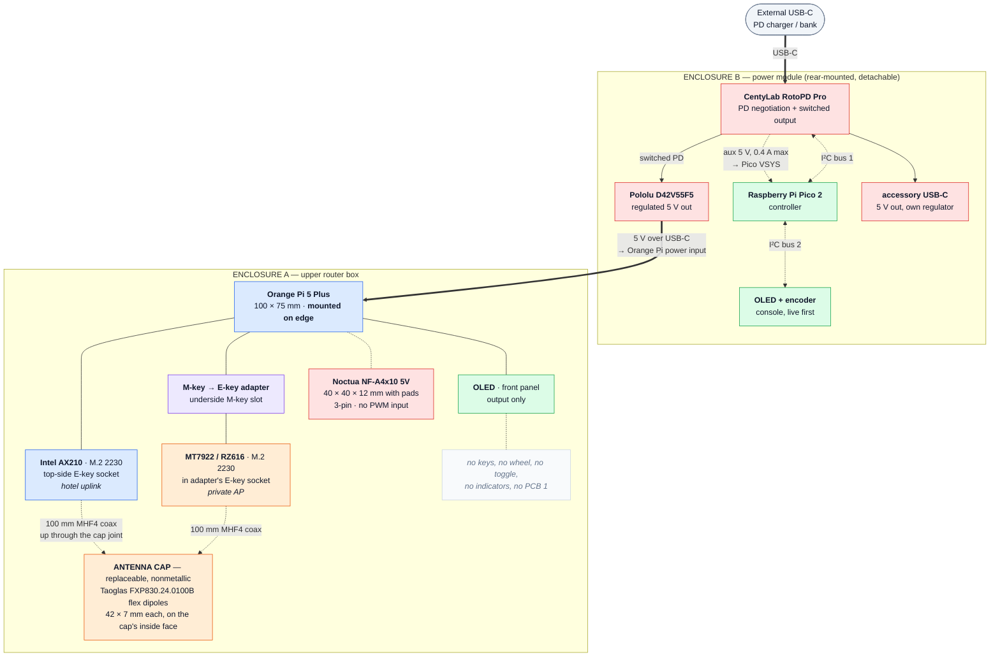

# 01 · System Architecture

How Vezha is divided into two enclosures and one PCB, what crosses between
them, and which decisions are settled.

> [!IMPORTANT]
> Read this before any other document. Everything downstream assumes this
> split.

## The split

A compact **two-piece** travel router.

|  | Enclosure | Holds | Detachable? |
| --- | --- | --- | --- |
| **A** | **Upper router box** | Orange Pi 5 Plus **on edge**, both Wi-Fi radios, the M-key→E-key adapter, storage, a **40 mm fan**, an **OLED front panel**, and a **replaceable antenna cap on top** carrying all the antenna elements | No — this is the router |
| **B** | **Power module** — mounts on **Enclosure A's rear face** | Power board: Raspberry Pi Pico 2, CentyLab RotoPD Pro, Pololu 5 V regulator, OLED console, push encoder, accessory USB-C out | **Yes** |

**The governing rule:** both radios and all antennas stay in the upper
enclosure, so **the power box comes off without disturbing any PCIe or
antenna connection.** **Only 5 V power crosses the seam**, over USB-C.

> [!NOTE]
> **Both boxes have an OLED, and neither has controls in the router.** The
> power board drives an OLED and a push encoder, and the Pico boots before the
> Orange Pi, so that console is live first. Enclosure A has its own **OLED
> front panel** — [output only](#no-controls-in-v1), no keys, wheel, toggle or
> indicators.

## Enclosure A at a glance

| | |
|---|---|
| **SBC** | Orange Pi 5 Plus, **mounted on edge**, 40-pin header at the bottom |
| **Radios** | AX210 in the native top-side E-key; second radio on a far-face M→E adapter |
| **Antennas** | All elements in the **replaceable top cap** |
| **Display** | **OLED** on the front face — output only |
| **Cooling** | **Active** — Noctua NF-A4x10 5V plus a 50 × 46 × 12.6 mm heatsink |
| **Bottom** | **Closed, stable foot.** No opening, no header access |
| **Rear** | Service panel, cap screw ears, and the power module |

Detail: [02 · Enclosure A](02-enclosure-a-upper.md). Build plan:
[the handoff](../handoff/README.md).

### What on-edge mounting means

**Both board faces are vertical, so both M.2 stacks grow into the case
depth** rather than one of them setting the box's thickness. The stack height
is measured once, for both faces together.

It leaves two things open. **How the board is retained** — an edge bracket, a
slot in the band, or a carrier on one broad face — and **the depth budget**,
which does not currently close:
[handoff · depth budget](../handoff/README.md#03--run-the-depth-budget--it-does-not-currently-close).

## No controls in v1

**Enclosure A has a display but no controls.** No keys, no nav wheel, no
toggle, no RGB indicators, **no front control board.** The OLED is an output
surface hanging off the host, not a PCB — the product ships **two enclosures
and one PCB.**

Configuration is the **web UI**. The power module keeps its own OLED and push
encoder, which show **power and PD state only** — that console cannot see
anything the router knows, because no signal crosses between the boxes.

The front control board was specified, sourced and simulated before being
cut. Its work is kept rather than deleted, so a v2 panel inherits it:
[PCB 1](retired/pcb-1-front-control.md) ·
[its schematic](retired/pcb-1-schematic.md) ·
[the e-paper analysis](retired/display-epaper.md).

**What the cut costs:** no at-rest status — an OLED shows nothing with the
power off, so a wedged boot and a powered-down box look identical from
outside. No hardware radio cut; `AIRPLANE` is software-only.



## Radio topology

This is the part most likely to be got wrong, because the two radios attach
to the Orange Pi in **different ways on opposite faces of the board.**

| Radio | Role | Socket | Path |
| --- | --- | --- | --- |
| **Intel AX210** | Hotel / public uplink | Orange Pi **top-side M.2 E-key** socket, directly | Wi-Fi over PCIe; Bluetooth over USB |
| **MT7922 / RZ616** | Private AP | **Underside M-key** slot → **M-key-to-E-key adapter** → adapter's E-key socket | PCIe, through the adapter. **Bluetooth does not come with it** — see below |

> [!IMPORTANT]
> **Two consequences of putting a radio in the M-key slot**, added
> 2026-11-18 once the socket specs were confirmed:
>
> - **It forecloses NVMe storage.** The Orange Pi has exactly one M-key
>   socket and this uses it, so eMMC is a requirement rather than a
>   preference.
> - **Bluetooth does not travel over an M-key adapter.** The M.2 M-key
>   connector carries no USB 2.0 — that is an E-key signal — so adapters
>   bring it out on a separate flying cable. For v1 that is acceptable,
>   because this radio is the private AP and the AX210 in the native E-key
>   socket handles Bluetooth. But the second radio's Bluetooth will not work
>   unless that cable is routed somewhere, and the cable itself lands inside
>   the enclosure whose thickness already binds.
>
> Also counter-intuitive: the **adapter path is the faster slot.** The M-key
> socket is PCIe 3.0 ×4 and the native E-key is PCIe 2.0 ×1, so the private
> AP sits behind the better link. Neither limits Wi-Fi 6E. Details in
> [10](10-measurement-protocol.md#what-the-board-actually-provides).

Consequences for Enclosure A:

- **Clearance is needed on both faces of the Orange Pi.** One radio sits on one
  face, the other hangs off the opposite face on an adapter. **With the board
  [on edge](#what-on-edge-mounting-means) both of those are now horizontal
  growth**, so the two stacks add into one plan dimension instead of setting
  the box's thickness.
- The 100 × 75 mm published board size **excludes** the heatsink, the adapter,
  the fan and cable bends. Do not lay out to it.
- The host accepting 2280 modules tells you **nothing** about the adapter's
  size or the installed stack height.
- Pick a specific adapter **that routes PCIe** — not all do — then measure it
  with the card and antenna plugs installed.
- **The antenna leads now run upward to the cap, not outward to the walls.**
  They are 100 mm and the two radios are on opposite faces, so the lead from
  the far face has to cross the board's thickness *and* reach the cap. This is
  the routing case most likely to come up short — see
  [04 · The cap](04-antennas.md#the-antenna-cap).

### The alternate board, and why it is not a drop-in

An **Orange Pi 5** (not Plus), **revision V1.3.2**, has been requested as an
alternate. Published model footprint is **100 × 62 mm** against the 5 Plus's
100 × 75 mm — 13 mm narrower, which on an edge-mounted board comes straight
off the box's depth.

> [!CAUTION]
> **Do not treat this as a smaller 5 Plus.** The radio topology in this
> document depends on the 5 Plus having **both** an M.2 M-key socket *and* a
> native top-side M.2 E-key socket. Published specifications for the Orange Pi
> 5 describe a **single M.2 M-key socket and no native E-key**. If that holds
> for V1.3.2, the AX210 has nowhere to go and **the two-radio topology has to be
> redesigned, not adjusted** — which would put [the hard
> requirement](#radio-topology) itself back in play.
>
> **No revision-specific drawing has been obtained**, and the 100 × 62 mm
> figure is the published *model* footprint, not a V1.3.2 drawing. Settle the
> socket question before the footprint one; the footprint only matters if the
> board can host the radios at all.

## Power path

One path, in one direction:

```
external USB-C charger
   → RotoPD Pro (negotiates PD, switched output)
      → Pololu D42V55F5 (regulated 5 V)
         → USB-C cable across the enclosure seam
            → Orange Pi dedicated USB-C power input
```

The **Pico 2 sits beside that path, not in it.** It controls the RotoPD Pro
over 3.3 V I²C and gates the router rail.

### Two rules that must survive layout

1. **Power the Pico from the RotoPD Pro's auxiliary 5 V output, into the Pico's
   VSYS input — not from the Pololu rail.** The Pico may be required to help
   bring that rail up; it cannot depend on it. The auxiliary output is rated
   **0.4 A continuous** and is for the controller only, never the Orange Pi.
2. **The Pico verifies an adequate PD contract before enabling the router
   rail.** Bringing up the Orange Pi on an inadequate contract is the failure
   this architecture exists to prevent.

### Headroom is not proven

- The Orange Pi specifies **5 V at 4 A**.
- The Pololu's **6 A** figure is a *typical maximum*, not a guarantee — and
  certainly not inside a sealed compact enclosure.

Measure voltage **at the Orange Pi** during cold boot, with both radios
active, and with the intended USB load applied. See
[05-power-board.md](05-power-board.md).

## Crossing the seam

**5 V power only, over USB-C.** Nothing else.

| Crosses | Does not cross |
|---|---|
| 5 V, GND | UART, I²C, any signal, RF |

Enclosure B presents a **USB-C power output**. A short cable runs to the
Orange Pi's **dedicated USB-C power input**. That is the entire interface
between the two boxes.

> [!NOTE]
> **Simplified deliberately.** An earlier revision ran UART telemetry across
> the seam, which turned a power lead into a hot-pluggable interface needing a
> custom 7-contact connector with staggered pin lengths and a detect
> interlock. That is removed. The cost is stated under
> [What dropping telemetry costs](#what-dropping-telemetry-costs).

### Why USB-C does the job

Going to a standard connector removes three problems rather than solving them:

- **No exposed-contact hazard.** A USB-C receptacle's contacts are recessed.
  Separating the boxes does not leave 4 A on open metal, so no detect pin and
  no contact interlock are needed.
- **Source detection replaces DETECT.** Presenting Rp on CC1/CC2 and applying
  VBUS only once a sink's Rd is seen is the standard doing the same job.
- **No sequencing problem.** With no signal pins, there is no case where
  ground opens while a logic line is still connected.
- Keyed, latching and commodity by definition.

### The 5 V seam problem

The simplification does not make this easier, and it is worse than it first
looked. There are **two** constraints, and the binding one is not the obvious
one.

#### Constraint 1 — the advertisement limit

> [!CAUTION]
> **USB-C advertises at most 3 A at 5 V.** The Orange Pi 5 Plus is specified at
> **5 V / 4 A**. A standards-compliant USB-C source cannot offer that.

> [!NOTE]
> **What the front panel costs this budget is small; the fan is the real
> item.** There is no PCB 1 and no RGB indicator array, so the only loads on
> this side are the OLED — milliamps — and the fan.
>
> **The fan runs continuously and its input current has not been retrieved**
> from Noctua's specification page. Fold it into the peak-current measurement
> rather than assuming it is negligible —
> [02 · Thermal](02-enclosure-a-upper.md#thermal).

#### Constraint 2 — IR drop, which binds first

> [!CAUTION]
> **The Pololu D42V55F5 is a fixed 5.0 V part with ±3 % accuracy — 4.85 V at
> its worst corner.** To still deliver the USB minimum of **4.75 V** at the
> Orange Pi, the entire round-trip loop may be no more than **25 mΩ**.
>
> **One USB-C mated pair is typically 30–40 mΩ on its own**, before any cable
> or trace. In the worst tolerance corner the 5.0 V part cannot meet spec
> through a USB-C seam at 4 A **at all.**

Loop-resistance allowance to hold 4.75 V at the Pi (`sim/04-router-rail-drop.cir`):

| Regulator output | Headroom | @ 4 A | @ 3 A | @ 2 A |
|---|---|---|---|---|
| **5.0 V −3 % = 4.85 V** | 100 mV | **25.0 mΩ** | **33.3 mΩ** | 50.0 mΩ |
| 5.0 V nominal | 250 mV | 62.5 mΩ | 83.3 mΩ | 125.0 mΩ |
| **5.3 V −3 % = 5.141 V** | 391 mV | **97.8 mΩ** | 130.3 mΩ | 195.5 mΩ |
| 5.3 V nominal | 550 mV | 137.5 mΩ | 183.3 mΩ | 275.0 mΩ |

Note the 3 A column: **dropping to 3 A does not rescue the 5.0 V part.** It
buys 33.3 mΩ, still inside the range a mated pair consumes by itself.

#### The regulator choice

Neither fixed part is clean:

| Part | Low corner | High corner | Problem |
|---|---|---|---|
| **D42V55F5** (#5571) — 5.0 V ← **chosen** | 4.85 V → **25 mΩ** | 5.15 V | Cannot make the loop budget at 4 A — but it is the only part the Pi's input allows |
| ~~**D42V55F5.3** (#5572) — 5.3 V~~ **ruled out** | 5.141 V → **97.8 mΩ** | **5.459 V** no-load | The Orange Pi's USB-C input is fixed 5 V; the vendor warns above 5 V damages the board |

Same family, same footprint, same pinout — so this is a part-number decision,
not a layout one.

**Decided 2026-11-18: the 5.0 V part (#5571).** This document previously
leaned toward the 5.3 V #5572, reasoning that USB-C `vSafe5V` is specified as
**4.75–5.5 V**, so a compliant sink must tolerate 5.459 V. It then named the
exact risk that would overturn that:

> *"that the Orange Pi's USB-C input is a plain 5 V rail wearing a USB-C
> connector rather than a compliant sink."*

**That is what it is.** The Orange Pi wiki states the board's USB-C power port
**does not negotiate PD and accepts a fixed 5 V only**, and warns that *an
adapter with an output above 5 V will damage the board*. `vSafe5V` does not
apply, because the port is not a USB sink. The 5.3 V part is out — its
no-load high corner of 5.459 V goes into an input the vendor says 5 V damages
above.

> [!CAUTION]
> **This settles the part and not the problem.** With U3 fixed at 5.0 V, the
> 25 mΩ loop budget is fixed with it — and one USB-C mated pair is 30–40 mΩ
> on its own. **The seam is now the binding constraint**, and the "if both
> fail" fallback below is no longer hypothetical.

One of the two gating measurements is also retired by this. The Orange Pi's
maximum input voltage is answered — it is 5 V, full stop. What remains worth
measuring is **peak current at the Orange Pi**, because the budget scales
directly with it and 4 A is a vendor maximum rather than an observed figure.

**The fallback is now live.** A USB-C seam carrying 4 A within spec was
already marginal; with the regulator pinned it is over budget as specified.
The levers, with their costs — from paralleling all four VBUS and GND
contacts, through a short captive cable, to moving the regulator into
Enclosure A and sending PD voltage across the seam instead — are laid out in
[06 · What is actually left to pull on](06-power-board-schematic.md#what-is-actually-left-to-pull-on).
The last of those reopens the "5 V only" rule this simplification closed, and
is worth knowing about before the shells are cut.

### What dropping telemetry costs

The Pico can no longer read router status, so **the power board's OLED shows power and
PD state only** — input voltage, negotiated contract, rail status, fault
reason. It cannot show uplink or client information.

That was an acceptable trade when Enclosure A had its own UI to fall back on.
**Under [the v1 scope cut](#no-controls-in-v1) it is sharper than that:** the
the power board's console is the product's *only* hardware interface, and it still cannot
see anything the router knows. Input voltage, PD contract, rail status and
fault reason are the complete set of things v1 can display.

Everything about the router — uplink state, clients, throughput, radio
configuration — is reachable only over the web UI, which means **only when the
router is up and you are already associated with it.** That is the v1 bargain,
and it is worth being deliberate about: the telemetry footprint below is what
makes it reversible.

**Reserve an unpopulated 3-pin footprint** on the power board for TX/RX/GND. If
telemetry is wanted later it is a cable, not a board respin.

## The dimensions nobody should guess

These determine **whether the two boxes actually close.** They are
measurements to take, not values to look up — with one exception, below.

1. **M.2 stack height** — adapter + card + mated antenna plugs + coax bend.
   On an [edge-mounted board](#what-on-edge-mounting-means) it sets case
   depth, and it is the largest untrusted term in that budget
2. **Mated USB-C plug clearance** — plug *and* cable bend
3. **The installed thermal envelope.** A
   **50 × 46 × 12.6 mm** figure has been supplied for the heatsink, and a
   **40 × 40 × 12 mm** fan sits somewhere against it.
   Whether those two numbers are independent or one contains the other is
   unknown, and it is the difference between a 12.6 mm and a 24.6 mm thermal
   stack. [02 · Thermal](02-enclosure-a-upper.md#thermal)
4. **The SBC's mechanical drawing.** A vendor mechanical
   reference exists and **has not been retrieved**:
   [Google Drive](https://drive.google.com/file/d/1rW0tlabPHQ-_rhFcBBpHRGK9TQmT1JEP/view).
   It is the authority for hole pattern and connector positions, both of which
   an edge mount needs and neither of which the 100 × 75 mm figure gives.

> [!NOTE]
> **Item 4 is the cheapest of them and nobody has opened it.** The RotoPD
> envelope came out of a published file rather than a measurement, and this
> repo already wrote down that lesson as *"check the vendor's repository
> before scheduling a measurement."* The same move is available here.

> [!TIP]
> **Check the vendor's repository before scheduling a measurement.** The
> RotoPD envelope came out of published KiCad and STEP files rather than
> calipers. The same move is available for item 4. Procedure for the rest:
> [10 · Measurement protocol](10-measurement-protocol.md).

## Decision status

**Settled — design against these**

*System*
- **Two enclosures, one PCB** — power-only seam over USB-C
- Both radios and all antennas in Enclosure A
- AX210 in the top-side E-key socket; second radio on a far-face adapter
- No signal crosses the seam; telemetry footprint reserved but unpopulated

*Enclosure A*
- **The SBC mounts on edge**, 40-pin header at the bottom.
  [What that means](#what-on-edge-mounting-means)
- **The bottom is a closed, stable foot** — no opening, no header access
- **The power module mounts on Enclosure A's rear face**
- **An OLED front panel**, output only. Model not fixed; Adafruit 5297 is the
  candidate. [02 · The display](02-enclosure-a-upper.md#the-display)
- **No controls and no PCB 1** — [why](#no-controls-in-v1)
- **Taoglas FXP830.24.0100B flex dipoles in the replaceable top cap.** The
  part is **ordered**. [04 · The antenna cap](04-antennas.md#the-antenna-cap)
- **Active cooling** — Noctua NF-A4x10 5V, 40 × 40 × **12 mm** installed, plus
  a 50 × 46 × 12.6 mm heatsink. [02 · Thermal](02-enclosure-a-upper.md#thermal)
- **Opens as a perimeter band with both broad faces as separate plates.**
  [02 · How it opens](02-enclosure-a-upper.md#how-it-opens)

*Power*
- Power chain: RotoPD Pro → Pololu → **USB-C seam** → Orange Pi
- Pico 2 as controller, powered from RotoPD auxiliary via VSYS
- Buck defaults off; Pico validates the PD contract, asserts EN, confirms PG
- Accessory USB-C output gets its **own regulator**, never raw PD VBUS
- **The OLED and encoder console live on the power board**, so J4 and J5 exist
  and the module needs a display window and a shaft opening.
  [03 · The console](03-enclosure-b-lower.md#the-console--decided)
- **U3 is the 5.0 V Pololu `D42V55F5` (#5571)**, forced by the Orange Pi's
  fixed-5 V USB-C input. It does **not** settle the seam —
  see [below](#the-5-v-seam-problem).
  [06 · U3](06-power-board-schematic.md#u3-is-the-50-v-part)
- **The RotoPD's VBUS screw terminal is removed**, with heavy wire soldered to
  its pads. [03](03-enclosure-b-lower.md#the-vbus-screw-terminal)
- **Accessory port runs config A** — 36 kΩ / 22.6 kΩ, 1.06–1.23 A. Promoting
  to config B is three 0603 swaps, so it does not gate ordering.
- **RotoPD Pro geometry**: 24.40 × 35.80 mm, 2 × M2.5 18.00 mm apart, from the
  vendor's published files.
  [06 · U1 mechanical](06-power-board-schematic.md#u1--rotopd-pro-mechanical--resolved-from-the-vendor-repo)

**Open — do not design against these**

*Blocking*
- **The seam loop resistance.** A decision rather than a measurement. With U3
  at 5.0 V the budget is 25 mΩ round trip, and one USB-C mated pair is
  30–40 mΩ on its own.
  [06 · What is left to pull on](06-power-board-schematic.md#what-is-actually-left-to-pull-on)
- **The Enclosure A depth budget**, which lands at ≈ 37–51 mm against a 30 mm
  placeholder.
  [Handoff](../handoff/README.md#03--run-the-depth-budget--it-does-not-currently-close)
- **The SBC mechanical drawing**, never retrieved. Hole pattern and port
  positions both depend on it.

*Enclosure A*
- **OLED model and size**, driven by whether a Wi-Fi join QR must render on it
- **How the panel reaches the host** — I²C plus 3.3 V off the 40-pin header;
  no pin map specified
- **Where the fan connects, and whether its speed can be controlled.** 3-pin
  with a tachometer and **no PWM input**
- **Vent pattern and airflow direction** — the
  [last design step](../handoff/README.md#phase-5--ventilation-and-airflow)
- **How the on-edge board is retained**
- **Rear-face allocation** — service panel, cap screw ears, fan exhaust and
  the power module all want the same surface
- **Heatsink SKU.** The 50 × 46 × 12.6 mm figure is supplied, with no drawing,
  and it is not known whether it includes the fan
- **Antenna element coordinates, spacing and port map.** The part is ordered
  but **the quantity was not recorded**
- **Which SBC** — 5 Plus, or the Orange Pi 5 V1.3.2.
  [Not a drop-in](#the-alternate-board-and-why-it-is-not-a-drop-in)
- Second radio: MT7922/RZ616 in 2230 is a *candidate*, height unconfirmed.
  Verify antenna connector type and 5 GHz AP operation on the target image
- Specific M-key-to-E-key adapter — the Sintech card is the candidate. Routes
  PCIe ×1, but brings USB 2.0 out on a flying cable, so the second radio's
  Bluetooth needs that cable routed or it does not work.
  [10 · Candidate](10-measurement-protocol.md#candidate-sintech-m-key-to-ae-key-adapter)

*Power*
- **Pico mounting: castellated or socketed.** With the screw terminal gone and
  the RotoPD at 4.70 mm, the encoder sets the module's height, so socketing
  may cost nothing
- Power source: external bank vs. internal cell

## Where to go next

| You are doing | Read |
| --- | --- |
| Upper enclosure | [02](02-enclosure-a-upper.md) · [06](04-antennas.md) |
| Power module | [03](03-enclosure-b-lower.md) · [05](05-power-board.md) |
| Power board — **the only PCB in v1** | [05](05-power-board.md) — requirements · [11](06-power-board-schematic.md) — schematic |
| Ordering parts | [07](07-bom.md) · [08](08-sourcing.md) |
| Project context | [09](09-software-and-bringup.md) |
| *Retired — kept for v2* | [04](retired/pcb-1-front-control.md) · [10](retired/display-epaper.md) · [12](retired/pcb-1-schematic.md) |
