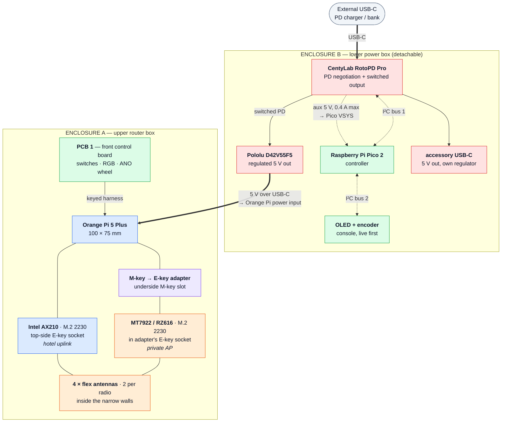

# 01 · System Architecture

How Vezha is divided into two enclosures and two PCBs, what crosses between
them, and which decisions are settled.

> [!IMPORTANT]
> Read this before any other document. Everything downstream assumes this
> split.

## The split

A compact **two-piece** travel router.

|  | Enclosure | Holds | Detachable? |
| --- | --- | --- | --- |
| **A** | **Upper router box** | Orange Pi 5 Plus, both Wi-Fi radios, the M-key→E-key adapter, all four antennas, storage, display, faceplate with controls and indicators | No — this is the router |
| **B** | **Lower power box** | PCB 2: Raspberry Pi Pico 2, CentyLab RotoPD Pro, Pololu 5 V regulator, OLED console, push encoder, accessory USB-C out | **Yes** |

**The governing rule:** both radios and all antennas stay in the upper
enclosure, so **the power box comes off without disturbing any PCIe or
antenna connection.** **Only 5 V power crosses the seam**, over USB-C.

> [!WARNING]
> **Enclosure B also carries a console.** PCB 2 drives an OLED and a push
> encoder, and the Pico boots before the Orange Pi so that console is live
> first. Whether that console is *additional to* or *replaces* the controls in
> Enclosure A is **unresolved** — see
> [05 · Unresolved conflicts](05-pcb-2-power.md#previously-flagged-conflicts--both-resolved).
> Do not lay out either front panel until it is settled.



## Radio topology

This is the part most likely to be got wrong, because the two radios attach
to the Orange Pi in **different ways on opposite faces of the board.**

| Radio | Role | Socket | Path |
| --- | --- | --- | --- |
| **Intel AX210** | Hotel / public uplink | Orange Pi **top-side M.2 E-key** socket, directly | Wi-Fi over PCIe; Bluetooth over USB |
| **MT7922 / RZ616** | Private AP | **Underside M-key** slot → **M-key-to-E-key adapter** → adapter's E-key socket | PCIe, through the adapter |

Consequences for Enclosure A:

- **Clearance is needed on both faces of the Orange Pi.** One radio sits above
  the board, one hangs below it on an adapter.
- The 100 × 75 mm published board size **excludes** the heatsink, the adapter,
  and cable bends. Do not lay out to it.
- The host accepting 2280 modules tells you **nothing** about the adapter's
  size or the installed stack height.
- Pick a specific adapter **that routes PCIe** — not all do — then measure it
  with the card and antenna plugs installed.

## Power path

One path, in one direction:

```
external USB-C charger
   → RotoPD Pro (negotiates PD, switched output)
      → Pololu D42V55F5 (regulated 5 V)
         → USB-C cable across the enclosure seam
            → Orange Pi dedicated USB-C power input
```

The **Pico 2 sits beside that path, not in it.** It controls the RotoPD Pro
over 3.3 V I²C and gates the router rail.

### Two rules that must survive layout

1. **Power the Pico from the RotoPD Pro's auxiliary 5 V output, into the Pico's
   VSYS input — not from the Pololu rail.** The Pico may be required to help
   bring that rail up; it cannot depend on it. The auxiliary output is rated
   **0.4 A continuous** and is for the controller only, never the Orange Pi.
2. **The Pico verifies an adequate PD contract before enabling the router
   rail.** Bringing up the Orange Pi on an inadequate contract is the failure
   this architecture exists to prevent.

### Headroom is not proven

- The Orange Pi specifies **5 V at 4 A**.
- The Pololu's **6 A** figure is a *typical maximum*, not a guarantee — and
  certainly not inside a sealed compact enclosure.

Measure voltage **at the Orange Pi** during cold boot, with both radios
active, and with the intended USB load applied. See
[05-pcb-2-power.md](05-pcb-2-power.md).

## Crossing the seam

**5 V power only, over USB-C.** Nothing else.

| Crosses | Does not cross |
|---|---|
| 5 V, GND | UART, I²C, any signal, RF |

Enclosure B presents a **USB-C power output**. A short cable runs to the
Orange Pi's **dedicated USB-C power input**. That is the entire interface
between the two boxes.

> [!NOTE]
> **Simplified deliberately.** An earlier revision ran UART telemetry across
> the seam, which turned a power lead into a hot-pluggable interface needing a
> custom 7-contact connector with staggered pin lengths and a detect
> interlock. That is removed. The cost is stated under
> [What dropping telemetry costs](#what-dropping-telemetry-costs).

### Why USB-C does the job

Going to a standard connector removes three problems rather than solving them:

- **No exposed-contact hazard.** A USB-C receptacle's contacts are recessed.
  Separating the boxes does not leave 4 A on open metal, so no detect pin and
  no contact interlock are needed.
- **Source detection replaces DETECT.** Presenting Rp on CC1/CC2 and applying
  VBUS only once a sink's Rd is seen is the standard doing the same job.
- **No sequencing problem.** With no signal pins, there is no case where
  ground opens while a logic line is still connected.
- Keyed, latching and commodity by definition.

### The 5 V seam problem

The simplification does not make this easier, and it is worse than it first
looked. There are **two** constraints, and the binding one is not the obvious
one.

#### Constraint 1 — the advertisement limit

> [!CAUTION]
> **USB-C advertises at most 3 A at 5 V.** The Orange Pi 5 Plus is specified at
> **5 V / 4 A**. A standards-compliant USB-C source cannot offer that.

> [!WARNING]
> **The indicators are not a rounding error.** PCB 1's four RGB indicators draw
> **~240 mA worst case** with all 12 TLC59116 channels lit
> (`sim/12-led-driver-thermal.cir`). They hang off the Orange Pi's 5 V, so that
> current crosses the seam *on top of* the board's own draw — about **8 % of
> the 3 A ceiling** before any USB peripheral is counted.

#### Constraint 2 — IR drop, which binds first

> [!CAUTION]
> **The Pololu D42V55F5 is a fixed 5.0 V part with ±3 % accuracy — 4.85 V at
> its worst corner.** To still deliver the USB minimum of **4.75 V** at the
> Orange Pi, the entire round-trip loop may be no more than **25 mΩ**.
>
> **One USB-C mated pair is typically 30–40 mΩ on its own**, before any cable
> or trace. In the worst tolerance corner the 5.0 V part cannot meet spec
> through a USB-C seam at 4 A **at all.**

Loop-resistance allowance to hold 4.75 V at the Pi (`sim/04-router-rail-drop.cir`):

| Regulator output | Headroom | @ 4 A | @ 3 A | @ 2 A |
|---|---|---|---|---|
| **5.0 V −3 % = 4.85 V** | 100 mV | **25.0 mΩ** | **33.3 mΩ** | 50.0 mΩ |
| 5.0 V nominal | 250 mV | 62.5 mΩ | 83.3 mΩ | 125.0 mΩ |
| **5.3 V −3 % = 5.141 V** | 391 mV | **97.8 mΩ** | 130.3 mΩ | 195.5 mΩ |
| 5.3 V nominal | 550 mV | 137.5 mΩ | 183.3 mΩ | 275.0 mΩ |

Note the 3 A column: **dropping to 3 A does not rescue the 5.0 V part.** It
buys 33.3 mΩ, still inside the range a mated pair consumes by itself.

#### The regulator choice

Neither fixed part is clean:

| Part | Low corner | High corner | Problem |
|---|---|---|---|
| **D42V55F5** (#5571) — 5.0 V | 4.85 V → **25 mΩ** | 5.15 V | Cannot make the loop budget at 4 A |
| **D42V55F5.3** (#5572) — 5.3 V | 5.141 V → **97.8 mΩ** | **5.459 V** no-load | Above the 5.25 V some sinks tolerate |

Same family, same footprint, same pinout — so this is a part-number decision,
not a layout one.

**Leaning toward the 5.3 V part (#5572)**, on this reasoning: USB-C `vSafe5V`
is specified as **4.75–5.5 V**, so a *compliant* USB-C sink must tolerate
5.459 V. The risk is narrow and specific — that the Orange Pi's USB-C input is
a plain 5 V rail wearing a USB-C connector rather than a compliant sink.

> [!IMPORTANT]
> **Two measurements now gate this, not one:**
>
> 1. **Peak current at the Orange Pi** — board **plus** indicators plus USB load
> 2. **The Orange Pi 5 Plus's absolute maximum input voltage** — this decides
>    whether 5.459 V is safe, and therefore which regulator is correct
>
> Until both exist, do not order either regulator.

**If both fail**, the honest fallback is that a USB-C seam cannot carry 4 A
within spec, and the power seam goes back to a connector with lower contact
resistance and fatter conductors. That reopens a decision this simplification
closed — worth knowing before the shells are cut.

### What dropping telemetry costs

The Pico can no longer read router status, so **the PCB 2 OLED shows power and
PD state only** — input voltage, negotiated contract, rail status, fault
reason. It cannot show uplink or client information.

That is an acceptable trade, and it has a useful side effect: it removes the
overlap between the two user interfaces. The router UI lives in Enclosure A
(e-paper display, ANO wheel, three keys — see [10](10-display.md)); the power
console lives in Enclosure B and is clearly a power console.

**Reserve an unpopulated 3-pin footprint** on PCB 2 for TX/RX/GND. If
telemetry is wanted later it is a cable, not a board respin.

## The three dimensions nobody should guess

These determine **whether the two boxes actually close.** They are measurements
to take, not values to look up:

1. **CentyLab RotoPD Pro mounting pattern** — and its outline and height
2. **Underside adapter stack height** — adapter + card + mated antenna plugs
3. **Mated power connector clearance** — connector *and* cable bend

## Decision status

**Settled — design against these**

- Two enclosures, two PCBs, **power-only seam over USB-C**
- Both radios and all antennas in Enclosure A
- AX210 in the top-side E-key socket; second radio on an adapter underneath
- Power chain: RotoPD Pro → Pololu → detachable connector → Orange Pi
- Pico 2 as controller, powered from RotoPD auxiliary via VSYS
- Buck defaults off; Pico validates the PD contract, asserts EN, confirms PG
- Accessory USB-C output gets its **own regulator**, never raw PD VBUS
- No signal crosses the seam; telemetry footprint reserved but unpopulated
- Four internal flex antennas, two per radio, inside the narrow walls

**Open — do not design against these**

- Second radio: MT7922/RZ616 in 2230 is a *candidate*, height unconfirmed.
  Verify its antenna connector type and 5 GHz AP operation on the target Linux
  image first.
- Specific M-key-to-E-key adapter
- Power source: external bank vs. internal cell, and therefore whether
  Enclosure B ever contains a battery
- **Which enclosure's front panel carries the OLED and encoder** — blocks both
- 
- ~~Display model~~ — **settled 2026-11-17:** Waveshare 4.26" e-paper, SKU
  `26376`, SPI. See [10-display.md](10-display.md). Its 0–50 °C operating range
  and 4 s refresh are now build constraints.
- Thermal solution, final antenna SKU
- ~~JLCPCB assembly sourcing for several PCB 1 parts~~ — checked 2026-11-17, see
  [08](08-sourcing.md#looked-up-so-far). Driver yes, switch no. The switch's
  SMD-vs-through-hole decision is the live one:
  [04](04-pcb-1-front-control.md#why-this-switch).

## Where to go next

| You are doing | Read |
| --- | --- |
| Upper enclosure | [02](02-enclosure-a-upper.md) · [06](06-antennas.md) |
| Lower enclosure | [03](03-enclosure-b-lower.md) · [05](05-pcb-2-power.md) |
| Front control board | [04](04-pcb-1-front-control.md) |
| Power board | [05](05-pcb-2-power.md) — requirements · [11](11-pcb-2-schematic.md) — schematic |
| Ordering parts | [07](07-bom.md) · [08](08-sourcing.md) |
| Project context | [09](09-background.md) |
