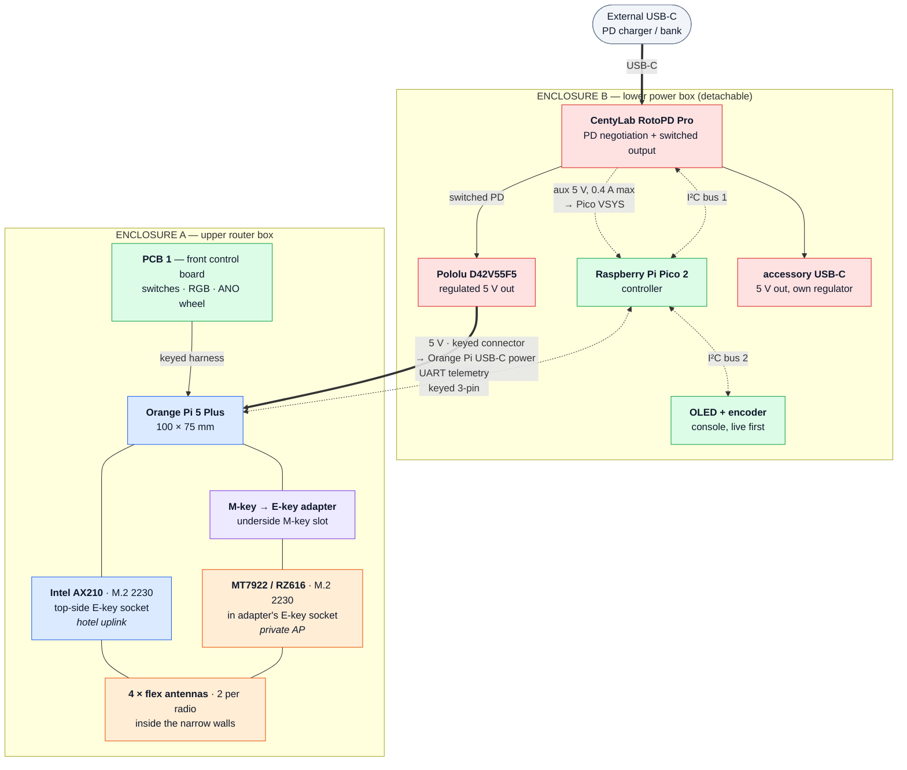

# 01 · System Architecture

How Vezha is divided into two enclosures and two PCBs, what crosses between
them, and which decisions are settled.

> [!IMPORTANT]
> Read this before any other document. Everything downstream assumes this
> split.

## The split

A compact **two-piece** travel router.

| | Enclosure | Holds | Detachable? |
|---|---|---|---|
| **A** | **Upper router box** | Orange Pi 5 Plus, both Wi-Fi radios, the M-key→E-key adapter, all four antennas, storage, display, faceplate with controls and indicators | No — this is the router |
| **B** | **Lower power box** | PCB 2: Raspberry Pi Pico 2, CentyLab RotoPD Pro, Pololu 5 V regulator, OLED console, push encoder, accessory USB-C out | **Yes** |

**The governing rule:** both radios and all antennas stay in the upper
enclosure, so **the power box comes off without disturbing any PCIe or
antenna connection.** Only power and telemetry cross the seam — never RF.

> [!WARNING]
> **Enclosure B also carries a console.** PCB 2 drives an OLED and a push
> encoder, and the Pico boots before the Orange Pi so that console is live
> first. Whether that console is *additional to* or *replaces* the controls in
> Enclosure A is **unresolved** — see
> [05 · Unresolved conflicts](05-pcb-2-power.md#unresolved-conflicts).
> Do not lay out either front panel until it is settled.



## Radio topology

This is the part most likely to be got wrong, because the two radios attach
to the Orange Pi in **different ways on opposite faces of the board.**

| Radio | Role | Socket | Path |
|---|---|---|---|
| **Intel AX210** | Hotel / public uplink | Orange Pi **top-side M.2 E-key** socket, directly | Wi-Fi over PCIe; Bluetooth over USB |
| **MT7922 / RZ616** | Private AP | **Underside M-key** slot → **M-key-to-E-key adapter** → adapter's E-key socket | PCIe, through the adapter |

Consequences for Enclosure A:

- **Clearance is needed on both faces of the Orange Pi.** One radio sits above
  the board, one hangs below it on an adapter.
- The 100 × 75 mm published board size **excludes** the heatsink, the adapter,
  and cable bends. Do not lay out to it.
- The host accepting 2280 modules tells you **nothing** about the adapter's
  size or the installed stack height.
- Pick a specific adapter **that routes PCIe** — not all do — then measure it
  with the card and antenna plugs installed.

## Power path

One path, in one direction:

```
external USB-C charger
   → RotoPD Pro (negotiates PD, switched output)
      → Pololu D42V55F5 (regulated 5 V)
         → keyed 2-pin connector across the enclosure seam
            → Orange Pi dedicated USB-C power input
```

The **Pico 2 sits beside that path, not in it.** It controls the RotoPD Pro
over 3.3 V I²C and gates the router rail.

### Two rules that must survive layout

1. **Power the Pico from the RotoPD Pro's auxiliary 5 V output, into the Pico's
   VSYS input — not from the Pololu rail.** The Pico may be required to help
   bring that rail up; it cannot depend on it. The auxiliary output is rated
   **0.4 A continuous** and is for the controller only, never the Orange Pi.
2. **The Pico verifies an adequate PD contract before enabling the router
   rail.** Bringing up the Orange Pi on an inadequate contract is the failure
   this architecture exists to prevent.

### Headroom is not proven

- The Orange Pi specifies **5 V at 4 A**.
- The Pololu's **6 A** figure is a *typical maximum*, not a guarantee — and
  certainly not inside a sealed compact enclosure.

Measure voltage **at the Orange Pi** during cold boot, with both radios
active, and with the intended USB load applied. See
[05-pcb-2-power.md](05-pcb-2-power.md).

## Crossing the seam

> [!IMPORTANT]
> **Revised twice.** The seam was originally power-only. PCB 2's UART
> telemetry link means signal crosses too — and that changes the connector
> from a power lead into a hot-pluggable interface with a sequencing problem.

### One connector, not two

**Use a single combined connector.** Two separate connectors on a box that
detaches as a normal operation means a user can mate one and not the other,
and gives the mechanical design two alignment problems instead of one.

The signal here is low-speed telemetry. There is no crosstalk argument for
separating it from the 5 V pins.

### Contact map

**Seven contacts**, with **three different lengths** to force the mating order:

| # | Signal | Length | Why |
|---|---|---|---|
| 1 | **GND** | **Long** | Mates first, breaks last |
| 2 | +5 V | Medium | |
| 3 | +5 V | Medium | Two pins share the current |
| 4 | UART TX | Short | Signal mates last, breaks first |
| 5 | UART RX | Short | |
| 6 | **GND** | **Long** | Return current matches the two +5 V pins; a GND at each end survives angled separation |
| 7 | **DETECT** | **Shortest** | Tied to GND inside Enclosure A. Breaks before anything else |

An eighth contact as a spare costs little and is worth having.

### Why the staggered lengths matter

> [!CAUTION]
> **Ground must make first and break last.** If GND opens while TX or RX is
> still connected, return current finds its way through the UART pins' ESD
> diodes. That damages both ends.

Staggering gives the correct order automatically:

```
connect:     GND  →  +5 V  →  TX/RX  →  DETECT
disconnect:  DETECT  →  TX/RX  →  +5 V  →  GND
```

### DETECT is a safety interlock, not a convenience

This is the part that matters most.

Enclosure B is the powered box. Without a detect contact, **separating the
boxes leaves 4 A available on exposed metal** — a short across those contacts
in a bag is a real hazard.

> [!CAUTION]
> **The Pico must not assert the buck's EN unless Enclosure A is detected
> present.** The gate is now two conditions, not one: an adequate PD contract
> **and** a present enclosure. See
> [05 · Boot sequence](05-pcb-2-power.md#boot-sequence).

Because DETECT is the shortest contact, it opens *before* the power pins on
separation, so the rail is already shutting down as the boxes part.

### Mating style

| Option | Use | Trade-off |
|---|---|---|
| **Spring-loaded (pogo) contact array** — *recommended* | Production intent | Blind-mates as the boxes stack; no dangling cable; pin length is how the staggering is achieved. Needs alignment features in both shells and good print tolerance. |
| **Captive short cable + latching connector** — e.g. Molex Micro-Fit 3.0, 6–8 circuit | **Rev A prototype** | Tolerant of sloppy 3D-printed tolerances. **No contact sequencing** — all pins are the same length, so DETECT and series resistors carry the whole burden. Keyed by housing. |

Start on the cable for Rev A. Blind-mate alignment in a printed enclosure is
genuinely hard, and discovering that after committing the shells is expensive.

**Put the spring pins on Enclosure A and the flat pads on Enclosure B.**
Enclosure A has no power source of its own, so its pins are dead metal when
detached; Enclosure B's pads are flush and de-energised by the DETECT
interlock. Both sides fail safe.

### Electrical details

- **No level shifting.** Pico and Orange Pi UART are both 3.3 V.
- **Series resistors, 100–330 Ω, on TX and RX.** If the Orange Pi is ever
  powered directly through its own USB-C input while Enclosure B is detached,
  its TX can backfeed into an unpowered Pico. The resistors cap that fault
  current.
- **TVS diodes on TX, RX and +5 V** at the Enclosure A entry. Exposed contacts
  on a handheld are an ESD path.
- **Mechanical retention is the enclosure latch, not the connector.** No
  connector should be the thing holding the two boxes together.
- Expect contact bounce during mating — firmware must resync rather than
  assume a clean stream.

**No RF crosses the boundary.** The detach rule still holds: the power box
comes off without disturbing any PCIe or antenna connection.

## The three dimensions nobody should guess

These determine **whether the two boxes actually close.** They are measurements
to take, not values to look up:

1. **CentyLab RotoPD Pro mounting pattern** — and its outline and height
2. **Underside adapter stack height** — adapter + card + mated antenna plugs
3. **Mated power connector clearance** — connector *and* cable bend

## Decision status

**Settled — design against these**

- Two enclosures, two PCBs, power-only seam
- Both radios and all antennas in Enclosure A
- AX210 in the top-side E-key socket; second radio on an adapter underneath
- Power chain: RotoPD Pro → Pololu → detachable connector → Orange Pi
- Pico 2 as controller, powered from RotoPD auxiliary via VSYS
- Buck defaults off; Pico validates the PD contract, asserts EN, confirms PG
- Accessory USB-C output gets its **own regulator**, never raw PD VBUS
- Four internal flex antennas, two per radio, inside the narrow walls

**Open — do not design against these**

- Second radio: MT7922/RZ616 in 2230 is a *candidate*, height unconfirmed.
  Verify its antenna connector type and 5 GHz AP operation on the target Linux
  image first.
- Specific M-key-to-E-key adapter
- Power source: external bank vs. internal cell, and therefore whether
  Enclosure B ever contains a battery
- **Which enclosure's front panel carries the OLED and encoder** — blocks both
- Display model, thermal solution, final antenna SKU
- JLCPCB assembly sourcing for several PCB 1 parts

## Where to go next

| You are doing | Read |
|---|---|
| Upper enclosure | [02](02-enclosure-a-upper.md) · [06](06-antennas.md) |
| Lower enclosure | [03](03-enclosure-b-lower.md) · [05](05-pcb-2-power.md) |
| Front control board | [04](04-pcb-1-front-control.md) |
| Power board | [05](05-pcb-2-power.md) |
| Ordering parts | [07](07-bom.md) · [08](08-sourcing.md) |
| Project context | [09](09-background.md) |
