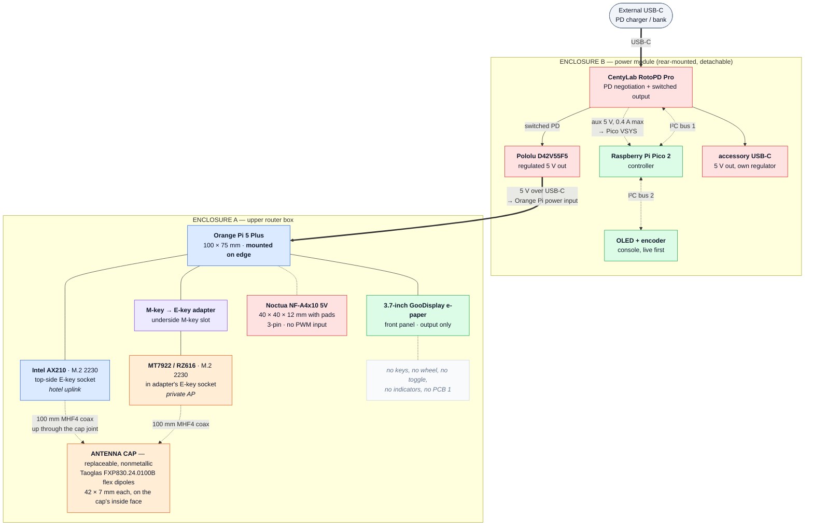

# 01 · System Architecture

How Vezha is divided into two enclosures and one PCB, what crosses between
them, and which decisions are settled.

> [!IMPORTANT]
> Read this before any other document. Everything downstream assumes this
> split.

## The split

A compact **two-piece** travel router.

|  | Enclosure | Holds | Detachable? |
| --- | --- | --- | --- |
| **A** | **Upper router box** | Orange Pi 5 Plus **mounted on edge**, both Wi-Fi radios, the M-key→E-key adapter, storage, a **40 mm fan**, a **3.7" GooDisplay e-paper front panel**, and a **replaceable antenna cap on top** carrying all the antenna elements | No — this is the router |
| **B** | **Power module** — **rear-mounted** (changed 2026-11-23; it was a lower box, but Enclosure A's bottom is now a closed foot) | Power board: Raspberry Pi Pico 2, CentyLab RotoPD Pro, Pololu 5 V regulator, OLED console, push encoder, accessory USB-C out | **Yes** |

**The governing rule:** both radios and all antennas stay in the upper
enclosure, so **the power box comes off without disturbing any PCIe or
antenna connection.** **Only 5 V power crosses the seam**, over USB-C.

> [!NOTE]
> **Enclosure A has a display again, and Enclosure B keeps its console.** The
> power board drives an OLED and a push encoder, and the Pico boots before the
> Orange Pi, so that console is live first. As of **2026-11-23** it is no longer
> the *only* hardware UI: Enclosure A regains a **3.7" GooDisplay e-paper front
> panel** — see [the 2026-11-23 revision](#the-2026-11-23-revision).
>
> **The controls did not come back.** No keys, no nav wheel, no toggle, no RGB
> indicators, no PCB 1. The e-paper is an **output surface only.**

## The 2026-11-23 revision

**Five changes, and three of them reverse decisions recorded below.** Where
this section and anything later in the repo disagree, **this section wins.**

| | Change | Supersedes |
|---|---|---|
| **1** | **The SBC mounts on edge**, not flat on standoffs | The flat-mount assumption behind [02 · How it opens](02-enclosure-a-upper.md#how-it-opens--reasoning-superseded-2026-11-23) |
| **2** | **A 3.7" GooDisplay e-paper front panel returns to Enclosure A** | [The v1 scope cut](#the-v1-scope-cut)'s display half |
| **3** | **All antenna elements move into the replaceable top cap**, above the SBC | The four narrow-wall positions in [04](04-antennas.md) |
| **4** | **Active cooling is planned** — a Noctua NF-A4x10 5V | "whether active cooling is needed" as an open question |
| **5** | **The Taoglas FXP830.24.0100B is ordered** | Its 🔵 Candidate status in [07](07-bom.md) |
| **6** | **Enclosure A's bottom is a closed, stable foot** — no opening, **no 40-pin header access.** The **power module moves to the rear face** | The bottom-mating assumption in [03](03-enclosure-b-lower.md) |
| **7** | **Ventilation is an explicit final design step**, after the internal layout and rear module are settled | Vents as an afterthought of the shell |

**What did *not* change.** The controls stayed cut — no keys, no nav wheel, no
toggle, no RGB indicators, **no PCB 1.** The product is still **two enclosures
and one PCB**; the e-paper is an output surface hanging off the host, not a
board. Everything in [the v1 scope cut](#the-v1-scope-cut) about the control
surface still holds. Only the display came back.

> [!WARNING]
> **Three of these reopen questions this repo had closed, and the reasoning
> that closed them is no longer load-bearing.** Specifically: the top cap was
> made removable because the narrow walls carried the antennas and the broad
> faces did not — **that is now inverted.** The box was a sealed shell because
> there was nothing to see and nothing to cool — **it now needs a display
> window and at least two fan openings.** Re-read
> [02](02-enclosure-a-upper.md) with that in mind rather than trusting its
> settled list.

### What on-edge mounting changes

This is the quietest of the five and the one with the widest blast radius.

**It dissolves the double-sided problem.** Flat-mounted, one radio sat above
the board and one hung below, so the underside M.2 stack set the box's
thickness and the SBC had to float on standoffs tall enough to clear it. On
edge, **both faces are vertical and both stacks grow sideways into the same
plan dimension.** The stack height stops being a thickness problem and becomes
a width one, measured once for both faces together.

**But it reopens how the board is retained.** [02](02-enclosure-a-upper.md)
decided the SBC mounts to the base plate, so pulling the base exposed the
underside stack and both sets of MHF4 connectors at once. **An on-edge board
cannot mount to the base plate that way.** It needs an edge bracket, a slot in
the band, or a carrier on one broad face — and whichever is chosen has to keep
the service property the original decision was made for.

**It also puts the connector edge somewhere new.** The 5 Plus's ports all sit
on the board edges; standing the board up decides which edge faces the floor,
which faces the display, and which faces the antenna cap. **Nothing in this
repo has fixed that rotation yet**, and the USB-C power inlet, the fan opening
and the 100 mm antenna leads all depend on it. It is the first thing the
mechanical designer should pin down.

## The v1 scope cut

> [!IMPORTANT]
> **Partly superseded on 2026-11-23.** The display is back — a 3.7" GooDisplay
> e-paper, in Enclosure A. See [the 2026-11-23 revision](#the-2026-11-23-revision).
> **The rest of this section stands**: the controls, the front control board and
> its schematic are still cut, and the reasoning below is why. It is kept
> unedited because it is also the record of *how* the display was argued, which
> is what the new panel has to answer to.

**2026-11-18. Vezha v1 has no display and no controls in Enclosure A.** The
upper box is a sealed enclosure holding the SBC, the radios, the antennas and a
USB-C power inlet. Its entire user interface is the web UI.

This retired four documents' worth of settled design — the e-paper panel
([10](retired/display-epaper.md)), the front control board ([04](retired/pcb-1-front-control.md))
and its finished schematic ([12](retired/pcb-1-schematic.md)), plus simulation decks
`sim/11`, `sim/12` and `sim/13`. None of it was wrong. It was cut for scope.

**How it got here**, briefly, because the reasoning constrains v2:

1. The 4.26" e-paper was chosen for status-at-rest — it holds an image with
   power removed at `<0.01 µA`. But a 4 s full refresh and a ≥ 180 s minimum
   interval cannot drive a scroll wheel, so the UI had to be paged rather than
   scrolled, and the RGB indicators became the only live layer.
2. A monochrome OLED was considered **alongside** the e-paper, to be that live
   layer: zero extra host pins on the existing I²C bus, and the two panels have
   complementary failure modes — e-paper is damaged by dynamic use and by being
   left energised, OLED by static images.
3. Going **OLED-only** was then considered. It retires the e-paper's 0–50 °C
   limit outright (the panel in Adafruit 5297 is rated −40 to +70 °C
   operating), but costs 7–13× the active area, and a Wi-Fi join QR for a
   strong passphrase needs ≥ 0.5 mm per module — marginal at the 5297's
   20.076 × 20.076 mm.
4. **v1 drops the panel entirely.** If the real interaction model is "configure
   over the web UI", every one of the above is a cost with no matching benefit.

**What the cut buys:**

| | Before | v1 | Still true after 2026-11-23? |
|---|---|---|---|
| Deliverables | 2 enclosures, 2 PCBs | **2 enclosures, 1 PCB** | **Yes** — the e-paper is not a PCB deliverable |
| Enclosure A footprint driver | The display's 107 × 64 mm driver board | The Orange Pi's 100 × 75 mm and the antennas | **Yes, and more so** — the 3.7" panel is 92.99 × 53 mm on a 41 × 22 mm driver board, [both smaller than the SBC edge](02-enclosure-a-upper.md#the-display--reinstated-2026-11-23) |
| Enclosure A Z stack | Faceplate + plungers + PCB 1 + glass + driver board + SBC + underside M.2 stack | Shell + SBC + underside M.2 stack | **No** — a 1.0 mm panel and its driver board return, but [on edge](#what-on-edge-mounting-changes) the stack is no longer the thickness term |
| Host 40-pin header | 9 pins SPI + 2 I²C + 4–5 GPIO | **Nothing attached** | **No** — the panel needs SPI back. [Open](#decision-status) |
| Front-panel current across the seam | ~120 mA worst case | **0 mA** | **No** — panel refresh plus the fan. Both small, both nonzero |
| Highest-risk mechanical item | Printed plungers against 0.35 mm travel | *(gone — no faceplate openings)* | **Yes** — no plungers return; the panel is an output surface with no moving parts |

**What the cut costs:** no at-rest status indication of any kind — a wedged
boot looks identical to a working one from outside the case. No hardware radio
cut; `AIRPLANE` becomes software-only. The `★` key's Wi-Fi join QR has nowhere
to live, so it becomes a printed label inside the case, or nothing.

**For v2**, the retired documents are kept rather than deleted. Their findings
are summarised in the banner at the top of each.



## Radio topology

This is the part most likely to be got wrong, because the two radios attach
to the Orange Pi in **different ways on opposite faces of the board.**

| Radio | Role | Socket | Path |
| --- | --- | --- | --- |
| **Intel AX210** | Hotel / public uplink | Orange Pi **top-side M.2 E-key** socket, directly | Wi-Fi over PCIe; Bluetooth over USB |
| **MT7922 / RZ616** | Private AP | **Underside M-key** slot → **M-key-to-E-key adapter** → adapter's E-key socket | PCIe, through the adapter. **Bluetooth does not come with it** — see below |

> [!IMPORTANT]
> **Two consequences of putting a radio in the M-key slot**, added
> 2026-11-18 once the socket specs were confirmed:
>
> - **It forecloses NVMe storage.** The Orange Pi has exactly one M-key
>   socket and this uses it, so eMMC is a requirement rather than a
>   preference.
> - **Bluetooth does not travel over an M-key adapter.** The M.2 M-key
>   connector carries no USB 2.0 — that is an E-key signal — so adapters
>   bring it out on a separate flying cable. For v1 that is acceptable,
>   because this radio is the private AP and the AX210 in the native E-key
>   socket handles Bluetooth. But the second radio's Bluetooth will not work
>   unless that cable is routed somewhere, and the cable itself lands inside
>   the enclosure whose thickness already binds.
>
> Also counter-intuitive: the **adapter path is the faster slot.** The M-key
> socket is PCIe 3.0 ×4 and the native E-key is PCIe 2.0 ×1, so the private
> AP sits behind the better link. Neither limits Wi-Fi 6E. Details in
> [10](10-measurement-protocol.md#what-the-board-actually-provides).

Consequences for Enclosure A:

- **Clearance is needed on both faces of the Orange Pi.** One radio sits on one
  face, the other hangs off the opposite face on an adapter. **With the board
  [on edge](#what-on-edge-mounting-changes) both of those are now horizontal
  growth**, so the two stacks add into one plan dimension instead of setting
  the box's thickness.
- The 100 × 75 mm published board size **excludes** the heatsink, the adapter,
  the fan and cable bends. Do not lay out to it.
- The host accepting 2280 modules tells you **nothing** about the adapter's
  size or the installed stack height.
- Pick a specific adapter **that routes PCIe** — not all do — then measure it
  with the card and antenna plugs installed.
- **The antenna leads now run upward to the cap, not outward to the walls.**
  They are 100 mm and the two radios are on opposite faces, so the lead from
  the far face has to cross the board's thickness *and* reach the cap. This is
  the routing case most likely to come up short — see
  [04 · The cap](04-antennas.md#the-antenna-cap--decided-2026-11-23).

### The alternate board, and why it is not a drop-in

An **Orange Pi 5** (not Plus), **revision V1.3.2**, has been requested as an
alternate. Published model footprint is **100 × 62 mm** against the 5 Plus's
100 × 75 mm — 13 mm narrower, which on an edge-mounted board comes straight
off the box's depth.

> [!CAUTION]
> **Do not treat this as a smaller 5 Plus.** The radio topology in this
> document depends on the 5 Plus having **both** an M.2 M-key socket *and* a
> native top-side M.2 E-key socket. Published specifications for the Orange Pi
> 5 describe a **single M.2 M-key socket and no native E-key**. If that holds
> for V1.3.2, the AX210 has nowhere to go and **the two-radio topology has to be
> redesigned, not adjusted** — which would put [the hard
> requirement](#radio-topology) itself back in play.
>
> **No revision-specific drawing has been obtained**, and the 100 × 62 mm
> figure is the published *model* footprint, not a V1.3.2 drawing. Settle the
> socket question before the footprint one; the footprint only matters if the
> board can host the radios at all.

## Power path

One path, in one direction:

```
external USB-C charger
   → RotoPD Pro (negotiates PD, switched output)
      → Pololu D42V55F5 (regulated 5 V)
         → USB-C cable across the enclosure seam
            → Orange Pi dedicated USB-C power input
```

The **Pico 2 sits beside that path, not in it.** It controls the RotoPD Pro
over 3.3 V I²C and gates the router rail.

### Two rules that must survive layout

1. **Power the Pico from the RotoPD Pro's auxiliary 5 V output, into the Pico's
   VSYS input — not from the Pololu rail.** The Pico may be required to help
   bring that rail up; it cannot depend on it. The auxiliary output is rated
   **0.4 A continuous** and is for the controller only, never the Orange Pi.
2. **The Pico verifies an adequate PD contract before enabling the router
   rail.** Bringing up the Orange Pi on an inadequate contract is the failure
   this architecture exists to prevent.

### Headroom is not proven

- The Orange Pi specifies **5 V at 4 A**.
- The Pololu's **6 A** figure is a *typical maximum*, not a guarantee — and
  certainly not inside a sealed compact enclosure.

Measure voltage **at the Orange Pi** during cold boot, with both radios
active, and with the intended USB load applied. See
[05-power-board.md](05-power-board.md).

## Crossing the seam

**5 V power only, over USB-C.** Nothing else.

| Crosses | Does not cross |
|---|---|
| 5 V, GND | UART, I²C, any signal, RF |

Enclosure B presents a **USB-C power output**. A short cable runs to the
Orange Pi's **dedicated USB-C power input**. That is the entire interface
between the two boxes.

> [!NOTE]
> **Simplified deliberately.** An earlier revision ran UART telemetry across
> the seam, which turned a power lead into a hot-pluggable interface needing a
> custom 7-contact connector with staggered pin lengths and a detect
> interlock. That is removed. The cost is stated under
> [What dropping telemetry costs](#what-dropping-telemetry-costs).

### Why USB-C does the job

Going to a standard connector removes three problems rather than solving them:

- **No exposed-contact hazard.** A USB-C receptacle's contacts are recessed.
  Separating the boxes does not leave 4 A on open metal, so no detect pin and
  no contact interlock are needed.
- **Source detection replaces DETECT.** Presenting Rp on CC1/CC2 and applying
  VBUS only once a sink's Rd is seen is the standard doing the same job.
- **No sequencing problem.** With no signal pins, there is no case where
  ground opens while a logic line is still connected.
- Keyed, latching and commodity by definition.

### The 5 V seam problem

The simplification does not make this easier, and it is worse than it first
looked. There are **two** constraints, and the binding one is not the obvious
one.

#### Constraint 1 — the advertisement limit

> [!CAUTION]
> **USB-C advertises at most 3 A at 5 V.** The Orange Pi 5 Plus is specified at
> **5 V / 4 A**. A standards-compliant USB-C source cannot offer that.

> [!NOTE]
> **The front panel barely competes for this budget, but it is no longer
> zero.** Earlier revisions charged **~120 mA** against the seam for PCB 1's
> four RGB indicators — about 4 % of the 3 A ceiling. PCB 1 is still cut, so
> that load is gone. What came back on **2026-11-23** is smaller by orders of
> magnitude: a 3.7" e-paper draws **~18 mW while refreshing and ~3 µW in
> standby** (GooDisplay's figure for the GDEY037T03), which is noise against
> 4 A.
>
> **The fan is the one to actually account for.** Its input current has not
> been retrieved from Noctua's specification page, and unlike the panel it
> runs continuously. Fold it into the peak-current measurement rather than
> assuming it is negligible —
> [02 · Thermal](02-enclosure-a-upper.md#thermal--active-cooling-planned-2026-11-23).
>
> *(An earlier figure of ~240 mA appeared here. It assumed 20 mA per channel;
> `REXT` was later set to 1.87 kΩ for 10 mA, halving it. Both are moot.)*

#### Constraint 2 — IR drop, which binds first

> [!CAUTION]
> **The Pololu D42V55F5 is a fixed 5.0 V part with ±3 % accuracy — 4.85 V at
> its worst corner.** To still deliver the USB minimum of **4.75 V** at the
> Orange Pi, the entire round-trip loop may be no more than **25 mΩ**.
>
> **One USB-C mated pair is typically 30–40 mΩ on its own**, before any cable
> or trace. In the worst tolerance corner the 5.0 V part cannot meet spec
> through a USB-C seam at 4 A **at all.**

Loop-resistance allowance to hold 4.75 V at the Pi (`sim/04-router-rail-drop.cir`):

| Regulator output | Headroom | @ 4 A | @ 3 A | @ 2 A |
|---|---|---|---|---|
| **5.0 V −3 % = 4.85 V** | 100 mV | **25.0 mΩ** | **33.3 mΩ** | 50.0 mΩ |
| 5.0 V nominal | 250 mV | 62.5 mΩ | 83.3 mΩ | 125.0 mΩ |
| **5.3 V −3 % = 5.141 V** | 391 mV | **97.8 mΩ** | 130.3 mΩ | 195.5 mΩ |
| 5.3 V nominal | 550 mV | 137.5 mΩ | 183.3 mΩ | 275.0 mΩ |

Note the 3 A column: **dropping to 3 A does not rescue the 5.0 V part.** It
buys 33.3 mΩ, still inside the range a mated pair consumes by itself.

#### The regulator choice

Neither fixed part is clean:

| Part | Low corner | High corner | Problem |
|---|---|---|---|
| **D42V55F5** (#5571) — 5.0 V ← **chosen** | 4.85 V → **25 mΩ** | 5.15 V | Cannot make the loop budget at 4 A — but it is the only part the Pi's input allows |
| ~~**D42V55F5.3** (#5572) — 5.3 V~~ **ruled out** | 5.141 V → **97.8 mΩ** | **5.459 V** no-load | The Orange Pi's USB-C input is fixed 5 V; the vendor warns above 5 V damages the board |

Same family, same footprint, same pinout — so this is a part-number decision,
not a layout one.

**Decided 2026-11-18: the 5.0 V part (#5571).** This document previously
leaned toward the 5.3 V #5572, reasoning that USB-C `vSafe5V` is specified as
**4.75–5.5 V**, so a compliant sink must tolerate 5.459 V. It then named the
exact risk that would overturn that:

> *"that the Orange Pi's USB-C input is a plain 5 V rail wearing a USB-C
> connector rather than a compliant sink."*

**That is what it is.** The Orange Pi wiki states the board's USB-C power port
**does not negotiate PD and accepts a fixed 5 V only**, and warns that *an
adapter with an output above 5 V will damage the board*. `vSafe5V` does not
apply, because the port is not a USB sink. The 5.3 V part is out — its
no-load high corner of 5.459 V goes into an input the vendor says 5 V damages
above.

> [!CAUTION]
> **This settles the part and not the problem.** With U3 fixed at 5.0 V, the
> 25 mΩ loop budget is fixed with it — and one USB-C mated pair is 30–40 mΩ
> on its own. **The seam is now the binding constraint**, and the "if both
> fail" fallback below is no longer hypothetical.

One of the two gating measurements is also retired by this. The Orange Pi's
maximum input voltage is answered — it is 5 V, full stop. What remains worth
measuring is **peak current at the Orange Pi**, because the budget scales
directly with it and 4 A is a vendor maximum rather than an observed figure.

**The fallback is now live.** A USB-C seam carrying 4 A within spec was
already marginal; with the regulator pinned it is over budget as specified.
The levers, with their costs — from paralleling all four VBUS and GND
contacts, through a short captive cable, to moving the regulator into
Enclosure A and sending PD voltage across the seam instead — are laid out in
[06 · What is actually left to pull on](06-power-board-schematic.md#what-is-actually-left-to-pull-on).
The last of those reopens the "5 V only" rule this simplification closed, and
is worth knowing about before the shells are cut.

### What dropping telemetry costs

The Pico can no longer read router status, so **the power board's OLED shows power and
PD state only** — input voltage, negotiated contract, rail status, fault
reason. It cannot show uplink or client information.

That was an acceptable trade when Enclosure A had its own UI to fall back on.
**Under [the v1 scope cut](#the-v1-scope-cut) it is sharper than that:** the
the power board's console is the product's *only* hardware interface, and it still cannot
see anything the router knows. Input voltage, PD contract, rail status and
fault reason are the complete set of things v1 can display.

Everything about the router — uplink state, clients, throughput, radio
configuration — is reachable only over the web UI, which means **only when the
router is up and you are already associated with it.** That is the v1 bargain,
and it is worth being deliberate about: the telemetry footprint below is what
makes it reversible.

**Reserve an unpopulated 3-pin footprint** on the power board for TX/RX/GND. If
telemetry is wanted later it is a cable, not a board respin.

## The dimensions nobody should guess

These determine **whether the two boxes actually close.** They are
measurements to take, not values to look up — with one exception, below.

1. ~~**CentyLab RotoPD Pro mounting pattern**, outline and height~~ —
   **resolved 2026-11-18 without measuring.** CentyLab publish the KiCad
   board and a STEP assembly, so the outline, hole pattern, connector
   positions and every component height came out of the files.
   [06 · U1 mechanical](06-power-board-schematic.md#u1--rotopd-pro-mechanical--resolved-from-the-vendor-repo)
2. **Underside adapter stack height** — adapter + card + mated antenna plugs.
   **Still gating, but it now sets plan width rather than box thickness** —
   [on edge](#what-on-edge-mounting-changes)
3. **Mated USB-C plug clearance** — plug *and* cable bend
4. **Added 2026-11-23 — the installed thermal envelope.** A
   **50 × 46 × 12.6 mm** figure has been supplied for what is probably the
   heatsink or cooler, and a **40 × 40 × 12 mm** fan sits somewhere against it.
   Whether those two numbers are independent or one contains the other is
   unknown, and it is the difference between a 12.6 mm and a 24.6 mm thermal
   stack. [02 · Thermal](02-enclosure-a-upper.md#thermal--active-cooling-planned-2026-11-23)
5. **Added 2026-11-23 — the SBC's mechanical drawing.** A vendor mechanical
   reference exists and **has not been retrieved**:
   [Google Drive](https://drive.google.com/file/d/1rW0tlabPHQ-_rhFcBBpHRGK9TQmT1JEP/view).
   It is the authority for hole pattern and connector positions, both of which
   an edge mount needs and neither of which the 100 × 75 mm figure gives.

> [!NOTE]
> **Item 5 is the cheapest of the five and nobody has opened it.** The RotoPD
> envelope came out of a published file rather than a measurement, and this
> repo already wrote down that lesson as *"check the vendor's repository
> before scheduling a measurement."* The same move is available here.

> [!TIP]
> **Check the vendor's repository before scheduling a measurement.** This
> document had concluded the RotoPD figures needed "the `.kicad_pcb` or the
> physical board, not another email." That was correct — and the
> `.kicad_pcb` was public the whole time. Procedure for the remaining two:
> [10 · Measurement protocol](10-measurement-protocol.md).

## Decision status

**Settled — design against these**

- **Two enclosures, one PCB** — power-only seam over USB-C
- Both radios and all antennas in Enclosure A
- AX210 in the top-side E-key socket; second radio on an adapter underneath
- Power chain: RotoPD Pro → Pololu → **USB-C seam** → Orange Pi
- Pico 2 as controller, powered from RotoPD auxiliary via VSYS
- Buck defaults off; Pico validates the PD contract, asserts EN, confirms PG
- Accessory USB-C output gets its **own regulator**, never raw PD VBUS
- No signal crosses the seam; telemetry footprint reserved but unpopulated
- **Internal Taoglas FXP830.24.0100B flex dipoles, in the replaceable top
  cap** — **decided 2026-11-23**, replacing the four narrow-wall positions.
  The part is **ordered**. [04 · The antenna cap](04-antennas.md#the-antenna-cap--decided-2026-11-23)
- **The SBC mounts on edge** — **decided 2026-11-23**.
  [What it changes](#what-on-edge-mounting-changes)
- **Enclosure A has a 3.7" GooDisplay e-paper front panel** — **decided
  2026-11-23**, reversing the display half of the scope cut. Exact model not
  chosen. [02 · The display](02-enclosure-a-upper.md#the-display--reinstated-2026-11-23)
- **Active cooling is planned** — a Noctua NF-A4x10 5V, **decided
  2026-11-23**. [02 · Thermal](02-enclosure-a-upper.md#thermal--active-cooling-planned-2026-11-23)
- **Enclosure A still has no controls and no PCB 1** — no keys, no wheel, no
  toggle, no indicators. The product ships **two enclosures and one PCB.** See
  [the v1 scope cut](#the-v1-scope-cut).
- **The OLED and encoder live on the power board, in Enclosure B** — previously the
  open question that blocked both front panels. **Confirmed 2026-11-18**: the
  console stays, so J4 and J5 exist and Enclosure B's lid needs a display
  window and a shaft opening.
  [03 · The console](03-enclosure-b-lower.md#the-console--decided)
- **U3 is the 5.0 V Pololu `D42V55F5` (#5571).** Decided 2026-11-18, forced by
  the Orange Pi's fixed-5 V USB-C input rather than chosen on merit. It does
  **not** settle the seam — see [below](#the-5-v-seam-problem).
  [06 · U3 is the 5.0 V part](06-power-board-schematic.md#u3-is-the-50-v-part)
- **The RotoPD's VBUS screw terminal is removed**, with heavy wire soldered to
  its pads. It was the tallest item on the module at 11.60 mm.
  [03 · The VBUS screw terminal](03-enclosure-b-lower.md#the-vbus-screw-terminal)
- ~~**Enclosure A opens as a perimeter band with both broad faces as separate
  plates**, the SBC mounted to the base plate~~ — **the decision may stand but
  its reasoning does not.** It rested on the narrow walls carrying all four
  antenna zones; as of 2026-11-23 the antennas are in the **top cap** and the
  walls are clear, and an on-edge SBC cannot mount to the base plate as
  described. **Re-confirm before cutting.**
  [02 · How it opens](02-enclosure-a-upper.md#how-it-opens--reasoning-superseded-2026-11-23)
- **Accessory port runs config A** — 36 kΩ / 22.6 kΩ, 1.06–1.23 A. Promoting to
  config B after the thermal measurement is three 0603 swaps on identical
  footprints, so it does not gate ordering.
- **RotoPD Pro geometry is known**: 24.40 × 35.80 mm, 2 × M2.5 18.00 mm apart.
  Taken from the vendor's published KiCad and STEP files, not measured.
  [06 · U1 mechanical](06-power-board-schematic.md#u1--rotopd-pro-mechanical--resolved-from-the-vendor-repo)

**Open — do not design against these**

- Second radio: MT7922/RZ616 in 2230 is a *candidate*, height unconfirmed.
  Verify its antenna connector type and 5 GHz AP operation on the target Linux
  image first.
- **The seam loop resistance.** This is now the binding technical problem,
  and it is a decision rather than a measurement. With U3 fixed at 5.0 V the
  budget is 25 mΩ for the whole round trip, and one USB-C mated pair is
  30–40 mΩ on its own. Levers and their costs:
  [06 · What is actually left to pull on](06-power-board-schematic.md#what-is-actually-left-to-pull-on)
- Specific M-key-to-E-key adapter — **candidate proposed 2026-11-18**, the
  Sintech M-key to A/E-key card. Routes PCIe ×1, but brings USB 2.0 out on a
  separate flying cable, so the second radio's Bluetooth needs that cable
  routed or it does not work.
  [10 · Candidate](10-measurement-protocol.md#candidate-sintech-m-key-to-ae-key-adapter)
- **Pico mounting: castellated or socketed** — worth revisiting now. With the
  screw terminal gone and the RotoPD at 4.70 mm, the encoder sets Enclosure
  B's height, so socketing the Pico may cost nothing
- Power source: external bank vs. internal cell, and therefore whether
  Enclosure B ever contains a battery
- ~~Which enclosure's front panel carries the OLED and encoder~~ — **settled
  2026-11-18:** Enclosure B. Unaffected by the display returning to A; the
  OLED and encoder do not move.
- **Display model** — **reopened 2026-11-23.** The family and size are fixed
  (GooDisplay e-paper, 3.7"); **the exact model is not chosen.** Three
  candidates and the reason the choice matters thermally:
  [02 · The display](02-enclosure-a-upper.md#the-display--reinstated-2026-11-23).
  The Waveshare 4.26" analysis in [10](retired/display-epaper.md) still
  applies to e-paper generally.
- **How the panel attaches to the host.** There is no PCB 1 to drive it, so it
  needs **SPI on the Orange Pi's 40-pin header** plus a GooDisplay adapter
  board. Nothing has specified the pin map, the 3.3 V supply, or who owns the
  refresh. The retired [40-pin header map](retired/pcb-1-front-control.md) is
  the obvious starting point.
- **Where the fan connects, and whether its speed can be controlled at all.**
  The chosen part is **3-pin with a tachometer and no PWM input**, so it is
  either full-speed or voltage-controlled.
  [02 · Thermal](02-enclosure-a-upper.md#thermal--active-cooling-planned-2026-11-23)
- **The board rotation on edge** — which board edge faces the floor, the
  display and the cap. Sets the USB-C inlet position, the fan opening and
  whether the 100 mm antenna leads reach.
- **Heatsink part.** Still no chosen part. A **50 × 46 × 12.6 mm** envelope has
  been supplied but is **unverified and not attributed to a component** — it
  is explicitly *not* a board dimension.
- **Which SBC** — 5 Plus, or the requested Orange Pi 5 V1.3.2 alternate.
  [Not a drop-in](#the-alternate-board-and-why-it-is-not-a-drop-in)
- Final antenna SKU and **element count** — the part is ordered but **the
  quantity was not recorded**, and the element-to-radio mapping is undecided
- ~~How Enclosure A opens for service~~ — **settled 2026-11-18**, see the
  settled list above
- ~~JLCPCB assembly sourcing for PCB 1 parts~~ — moot. PCB 1 is not built.
  Sourcing work is preserved in [08](08-sourcing.md#looked-up-so-far).

## Where to go next

| You are doing | Read |
| --- | --- |
| Upper enclosure | [02](02-enclosure-a-upper.md) · [06](04-antennas.md) |
| Power module | [03](03-enclosure-b-lower.md) · [05](05-power-board.md) |
| Power board — **the only PCB in v1** | [05](05-power-board.md) — requirements · [11](06-power-board-schematic.md) — schematic |
| Ordering parts | [07](07-bom.md) · [08](08-sourcing.md) |
| Project context | [09](09-software-and-bringup.md) |
| *Retired — kept for v2* | [04](retired/pcb-1-front-control.md) · [10](retired/display-epaper.md) · [12](retired/pcb-1-schematic.md) |
