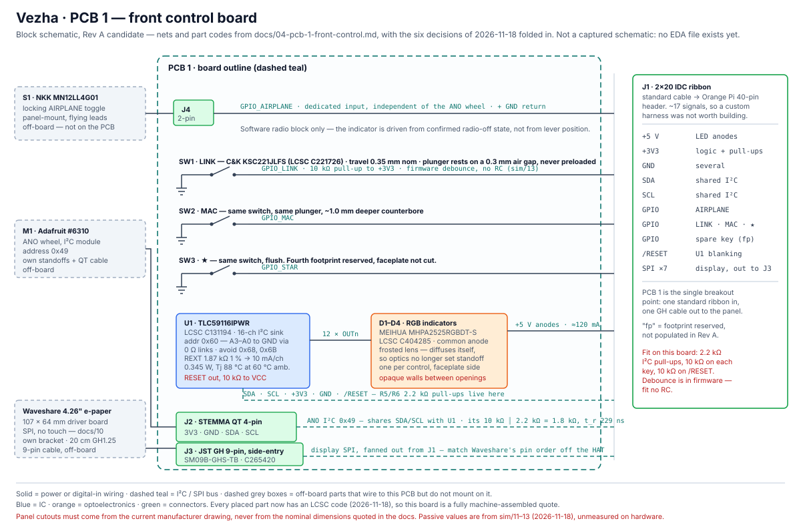

# 04 · PCB 1 — Front Control Board *(retired)*

> [!CAUTION]
> **Retired 2026-11-18. PCB 1 does not exist in v1.** Enclosure A is fully
> headless — no display, no keys, no wheel, no toggle, no indicators, no front
> board at all. Vezha v1 ships **two enclosures and one PCB.** See
> [01 · The v1 scope cut](01-architecture.md#the-v1-scope-cut).
>
> **Do not order parts from this document** and do not lay the board out. The
> schematic that followed from it, [12](12-pcb-1-schematic.md), is retired with
> it.

**What this cost, and what it saved.** The board was *finished* — every placed
part sourced with an LCSC code, the host pin map resolved, three simulations
closed. It was retired for scope, not for a defect. Anyone restoring a front
panel in v2 inherits a complete design; the findings worth keeping:

| Finding | Still true? | Where |
|---|---|---|
| The I²C bus **as originally drawn does not work** — ANO pull-ups alone give 1271 ns rise at 150 pF, failing even 100 kHz. Fit 2.2 kΩ. | Yes, for any I²C front panel | [SIM-11](12-pcb-1-schematic.md#sim-11--ic-pull-ups) |
| Red is the hot channel on a 5 V anode — 3.0 V across the driver vs 1.9 V for green/blue, so four red channels make 44 % of the heat | Yes | [SIM-12](12-pcb-1-schematic.md#sim-12--led-driver-dissipation) |
| Key RC debounce **does** work on a switch-to-ground input: 10 kΩ / 1 kΩ / 100 nF, and it is a *window* — 220 nF and 470 nF both fail | Yes — corrected in `a4c5201` | [SIM-13](12-pcb-1-schematic.md#sim-13--key-debounce) |
| Printed plungers against 0.35 mm of travel were the highest-risk mechanical item, needing a coupon before any faceplate | Moot in v1 — no faceplate openings | [Plunger design](#plunger-design) |

---

*Original document follows, unedited.*

## Original: the front panel of Enclosure A

Read [01-architecture.md](01-architecture.md) first.

**The net-by-net schematic is [12-pcb-1-schematic.md](12-pcb-1-schematic.md).**
This document covers requirements, part choices and the reasoning; 12 covers the
electrical design that follows from them.


Status: **design settled enough to buy test parts; mechanics not frozen.**
Buy the switches and wheel *before* committing the mechanical stack. Panel
cutouts must come from the manufacturer's current drawing, never from a
nominal bushing diameter.

> **Revision note.** This supersedes an earlier four-key layout
> (`LINK` / `MAC` / `F1` / `F2`). Adding the ANO navigation wheel makes two
> general-purpose function keys redundant, so the front row drops to three
> action keys and the wheel handles browsing and selection.
>
> **2026-11-17.** The key switch is now the **C&K `KSC221JLFS`**, replacing the
> APEM Ultramec 6C. JLCPCB can place it; it cannot place the 6C. The MEC 10G
> keycaps go with it, replaced by printed plungers against 0.35 mm of travel.

## Block schematic



Blocks and nets only — **not a captured schematic.** No EDA file exists yet and
no footprint has been pulled. If this drawing and the text below ever disagree,
**the text wins.**

## Concept

A **removable front faceplate** on the upper router box, carrying:

- A locking `AIRPLANE` toggle on one shoulder, clamped through the faceplate
- Three action keys — `LINK`, `MAC`, `★` — on a custom front board
- An **ANO navigation wheel** for scrolling, navigation, and selection

Dedicated keys cover the actions worth a physical control; the wheel covers
everything menu-shaped, without duplicating its five buttons as separate keys.

Everything wires to the Orange Pi in the upper box. **Nothing mounts to the
removable power box.** Keep the display opening separate from the control
openings so a display change does not force a new button PCB.

The display is a **4.26" SPI e-paper panel** — see
[10-display.md](10-display.md). Its nine-wire cable is expected to land on
**this board** and share the single keyed harness to the Orange Pi, rather than
contending for the same 40-pin header. Reserve the connector.

## Bill of materials

| Qty | Part | Approx. USD | Where it mounts |
|---:|---|---:|---|
| 1 | [Adafruit #6310 — pre-soldered ANO I²C module](https://www.adafruit.com/product/6310) | $13.95 | Own standoffs or bracket behind the faceplate, wheel exposed. Short STEMMA QT cable to the front board. **This is the assembled I²C version**, not the bare wheel or the passive breakout. |
| 5 | [C&K KSC series](https://www.ckswitches.com/products/switches/product-details/Tactile/KSC/) `KSC221JLFS` — LCSC `C221726` | $0.76 ea · $0.46 @100 | **JLCPCB places these.** SMD J-lead, 6.2 × 6.2 mm, on the faceplate-facing side of the front PCB. **Populate three, keep two spares.** |
| 3 | **Printed plungers** — no catalogue part | — (printed) | **Design work, not a purchase.** The KSC has no cap system; a plunger bridges each faceplate opening to the switch. See [Plunger design](#plunger-design). |
| 1 | [NKK locking toggle](https://www.nkkswitches.eu/products/Toggles/M/M2012LL4G01/), order `MN12LL4G01` | ~$11 | Clamps through the faceplate with its bushing and nut. Leads run to the front board — **do not mount it to the PCB.** Give the lever a protective recess with room to pull it. |

**Budget ~$29–32** for controls including spares, before cables, shipping, and
PCB assembly. *(Was ~$45–50 with the APEM 6C and its 10G caps.)*

### Why this switch

Chosen 2026-11-17. The decisive factor is that **JLCPCB can actually place it** —
16,623 in stock — which makes PCB 1 a fully machine-assembled board once the RGB
LED is chosen. Nothing on it needs hand reflow.

| | **C&K `KSC221JLFS`** *(chosen)* | APEM Ultramec 6C `6CJ1NOPR` | MEC Multimec 5G `5GTH935` |
|---|---|---|---|
| Termination | SMD J-lead | SMD J-lead | Through-hole |
| Body | **6.2 × 6.2 mm** | 8 × 8 mm, h 2.5 mm | 10 × 10 mm, h 6.4 mm |
| Force | **~2 N** | ~3.6 N | 2.0 / 3.5 / 6.5 N |
| Travel | **0.35 mm** (0.25–0.65) | 2.5 mm | — |
| Caps | **None — plunger** | 10G series | `1Z`/`1S` families |
| JLC stock | ✅ **16,623** | ❌ 0 | ❌ 0 |
| Price @100 | **$0.46** | $3.94 | — |

What this costs, stated plainly:

- **The MEC cap system is gone**, and with it the "buy two caps and you have a
  premium panel" shortcut. Plungers are now a designed part.
- **Travel drops from 2.5 mm to 0.35 mm nominal.** This is the bigger change,
  more than the force. That throw is a short, crisp click with very little room for
  tolerance in the plunger stack — see below.
- **Lighter at ~2 N.** Fine for `LINK` and `★`; it makes accidental presses more
  likely on `MAC`, which is why that key stays recessed.

The two rejected paths stay on record in [07-bom.md](07-bom.md#pcb-1--front-control-board):
the 6C needs hot air and is $3.94 against $0.46, and Multimec 5G is iron-solderable
with a better 10 M-cycle life but is 10 × 10 × 6.4 mm with an incompatible cap
family.

### Plunger design

Three plungers, printed with the faceplate. This is the part of the build that
the catalogue no longer does for you, so it carries the risk.

Constraints:

- **0.35 mm of travel is the whole budget** (0.25 mm worst case). Print tolerance, plunger length and
  standoff height all land in it. Too long and the switch is preloaded or dead;
  too short and the key feels mushy and vague.
- **No preload at rest.** The plunger must sit off the switch with the key
  released, and it must return freely.
- **Keep it captive.** It needs to be retained in the faceplate so it cannot
  fall inward during service with the faceplate off.
- **`MAC` sits lower** than the other two, for the same reason as before — at
  2 N the distinction matters more, not less.
- Opaque, like the old caps. Light still comes from the separate diffusers in
  [RGB indicators](#rgb-indicators), never through the plunger.

**Coupon this before the faceplate.** It is now the highest-risk mechanical item
on the front panel — more than the wheel opening.

## Control behavior and wiring

| Control | Default behavior | Connection |
|---|---|---|
| `AIRPLANE` | Maintained `RADIOS / OFF`. Read it before bringing up wireless; keep Ethernet available. | **Dedicated Orange Pi GPIO, independent of the ANO.** |
| `LINK` | Tap: uplink / IP / portal status. Hold: retry the uplink. | One GPIO per key, switch to ground. |
| `MAC` | Tap: show current uplink MAC. Hold 2 s: rotate it and reconnect. Factory-MAC restore stays in the menu. | Same switch as `LINK`, but **plunger set lower** so it feels different and is harder to hit by accident. At ~2 N this matters more than it did at 3.6 N. |
| `★` | Wi-Fi join QR code; user-assignable later. | One GPIO. For a second shortcut, reserve a fourth footprint but **do not cut the first faceplate for it.** |
| ANO wheel | Rotate to browse, center to select, left to go back. Leave the other directions unassigned until there is a real use. | 3.3 V, GND, SDA, SCL over STEMMA QT; default address `0x49`. An `INT` wire or test pad is optional for event-driven input — **it is not carried on the four-wire QT cable.** |
| `RECOVERY` *(optional, hidden)* | Boot a known wired management profile. **No factory wipe.** | Reserve the footprint behind a pinhole by the Ethernet ports or inside the service cover — not on the front row. |

### rfkill is not an interlock

`AIRPLANE` on a GPIO is a **software-controlled radio block**, not a hardware
disable, unless a verified hardware path is added. A Linux
[`rfkill`](https://networkmanager.dev/docs/rfkill/) implementation can disagree
with the switch position.

Consequence: the `AIRPLANE` indicator must be driven from **confirmed
radio-off state**, not from switch position. That gives live feedback even when
the display is showing a stale image. See
[RGB indicators](#rgb-indicators) below.

With the e-paper display now chosen, **a stale image is the normal state** — a
full redraw takes 4 s and the panel is not meant to be refreshed constantly.
That promotes the RGB indicators from a nicety to the only real-time feedback
the panel has. See [10-display.md](10-display.md#what-this-does-to-the-ui).

## RGB indicators

**One independently programmable RGB indicator beside each control** —
`AIRPLANE`, `LINK`, `MAC`, `★`.

Keep the plungers **opaque**. The light goes through a **separate flush diffuser
above each label**, never through the plunger. This gives a readable panel
without changing how the buttons feel — and it keeps the indicator working
whether or not a key is pressed.

### Parts (Rev A)

| Part | Choice |
|---|---|
| LED driver | [TI TLC59116IPWR](https://www.ti.com/product/TLC59116) — 16-channel I²C constant-current driver. Four RGB LEDs use 12 channels, leaving four spare. Independent 8-bit brightness per color channel, so the Orange Pi sets color *and* brightness per indicator. |
| LEDs | Four **common-anode** SMD RGB LEDs on the **faceplate-facing side** of the PCB. Short frosted light pipe or diffuser each, with **opaque walls between indicators** so light does not bleed into the neighbouring opening. **Pick the LED and its optic together before finalizing standoff height.** |
| Wiring | Shares the Orange Pi's 3.3 V I²C bus with the ANO, but **strapped to a distinct address** from the ANO's `0x49`. Switches stay separate GPIO inputs. LED anodes off the upper box's **5 V** rail, driver logic on **3.3 V**. Check combined I²C pull-ups on the assembled board. |
| Brightness | Set the driver's current-set resistor for a modest peak current, then tune each color in software. Start from a **dim hotel-room preset**. Use short pulses for acknowledgements rather than constant blinking — the driver's group blink is shared, so per-key patterns must be done in software. |

### What the lights mean

| Control | Default behavior |
|---|---|
| `AIRPLANE` | Solid amber **only after the router confirms its radios are blocked.** Meaning is fixed — not user-assignable. |
| `LINK` | Green online · amber captive portal or reconnecting · red uplink down. |
| `MAC` | Normally dark. Pulse amber while the change is in progress, then briefly green on success or red on failure. Ongoing internet status stays with `LINK`. |
| `★` | User-configurable. Default dim white while the Wi-Fi QR page is open, dark otherwise. |

### Stale-indicator hazard

If `AIRPLANE` means *confirmed*, that indicator needs a way to **go dark when
the router stops reporting status.** An I²C driver retains its last setting
while powered, so an Orange Pi crash would otherwise leave stale amber lit —
the panel would claim the radios are off when nothing is confirming it.

- **Reserve a footprint** for a watchdog-controlled reset on the driver.
- **For Rev A without it:** treat the toggle as the *requested* state and the
  LED as the *last software-confirmed* state. Neither is a hardware RF
  guarantee.

### Optical prototype

Prototype **one key and one light pipe in the same printed coupon** as the
mechanical test below, before ordering the faceplate. Check it in a dark room
*and* in daylight. The target is an even, readable dot with **no visible
hotspot and no glow leaking around the plunger.**

The driver is in JLCPCB stock; the RGB LED has no part number yet, so its stock
and optic pairing are still open. **It is now the only unsourced placed part on
this board** — see below.

## Before sending the board to JLCPCB

**Every placed part on this board is in JLCPCB stock except the RGB LED.**
Catalog check 2026-11-17 — codes and price ladders in
[08-sourcing.md](08-sourcing.md#looked-up-so-far):

| Part | Code | JLC can place it? |
|---|---|---|
| C&K `KSC221JLFS` switch | `C221726` | ✅ Yes — 16,623 in stock |
| TI `TLC59116IPWR` driver | `C131194` | ✅ Yes — 3,611 in stock |
| RGB LED | — | 🔴 No part number chosen |

So **the RGB LED is the only thing standing between this board and a quote.**
Choosing it — with its optic — is the critical path for PCB 1.

Nothing else on the front panel is a sourcing question. The toggle is
panel-mount with leads to the board, the plungers are printed, and the ANO is a
module on its own standoffs — none were ever machine-placed parts.

Both are `expand` library parts, so the quote carries an extended-part feeder
fee per distinct part. Confirm stock in the quote itself, not from the catalog.

## Decisions taken 2026-11-18

Six open items, all closed against datasheets rather than catalogue blurbs.
Datasheets read: C&K KSC series (B-49 to B-52), TI TLC59116 (SLDS157E).

| # | Decision | Answer |
|---|---|---|
| 1 | RGB LED | **MEIHUA `MHPA2525RGBDT-S`** (`C404285`), with **Rext = 1.87 kΩ** |
| 2 | Plunger | **0.3 mm air gap, never preloaded** — geometry below |
| 3 | TLC59116 address | **0x60** — A3–A0 all to GND |
| 4 | Display connector | **JST GH 9-pin on PCB 1**, fed by one 2×20 ribbon from the SBC |
| 5 | Reset footprint | **Yes, Rev A carries it** |
| 6 | Switch land pattern | 2 pads ≈2.8 × 4.0 mm, 3.0 mm gap, 8.6 mm span |

### 1 · RGB LED — frosted lens, and a smaller Rext than you'd guess

**MEIHUA `MHPA2525RGBDT-S`, LCSC `C404285`.** 2.6 × 2.4 mm, white frosted lens,
110°, common anode, 8,253 in stock at $0.091.

The deciding property is the **frosted lens**, and it buys something structural:
a water-clear LED needs cavity depth behind the diffuser to avoid a hotspot,
which is why [07-bom.md](07-bom.md) said the LED and optic "set the standoff
height". A frosted emitter does its own diffusing, so **standoff height is no
longer set by the optics** — it is set by the switch and plunger stack, which is
the harder constraint anyway. That removes a coupling between two unknowns.

It is also the largest emitter on the shortlist, which matters for an even patch
behind a window, and its weak channel is 250 mcd rather than the 19–32 mcd of
the other frosted candidate (`C404284`), whose blue is too weak to make cyan or
white at a sane duty cycle.

> [!IMPORTANT]
> **This choice made the thermal case worse, and that changed the current.**
> Its Vf spread is red 1.6–2.6 V and green/blue 2.4–3.6 V. The driver eats the
> remainder, so worst case it drops **3.4 V on red** and 2.6 V on green/blue —
> more than the generic figures first simulated. At 20 mA all twelve channels
> put **0.688 W** into a TSSOP-28: Tj 115 °C at 60 °C ambient, past the 100 °C
> target and near the 125 °C max.

The fix is one resistor, not firmware. Output current is set by `REXT`:

> IOUT = (1.25 V / Rext) × 15 — TI's own example is 931 Ω for 20 mA

| Rext | I/channel | P total | Tj @60 °C |
|---|---|---|---|
| 931 Ω | 20.1 mA | 0.693 W | 115 °C ❌ |
| 1.5 kΩ | 12.5 mA | 0.430 W | 94 °C |
| **1.87 kΩ** | **10.0 mA** | **0.345 W** | **88 °C** ✅ |
| 3.0 kΩ | 6.3 mA | 0.215 W | 77 °C |

**Rext = 1.87 kΩ, 1%.** At 10 mA the LED still gives half of 250–1600 mcd
through a diffuser — far more than a status indicator needs — so nothing is
lost. Firmware can scale further down through the IREF gain bits; this only sets
a ceiling, at a point where the chip is safe even in a full-white self-test.

Red ballast resistors are no longer needed at 10 mA. Keep the option on record:
TI's datasheet recommends exactly that trick when VLED is high or Vf differs
between channels, which is this case.

Second source, if stock moves: **EKINGLUX `E6C0606RGBC3UDA`** (`C375569`),
21,592 in stock, $0.053, and the *highest* Vf of the shortlist so it runs the
driver coolest. It is water clear, so choosing it puts cavity depth back on the
critical path.

### 2 · Plunger — the air gap is the whole design

Real switch numbers, from the C&K datasheet rather than the LCSC listing:

| | |
|---|---|
| Travel | **0.35 mm nominal, +0.3 / −0.1 → 0.25 to 0.65 mm** |
| Actuator | ø 2.9 mm, **3.5 mm** above the PCB at rest |
| Body | 6.2 ± 0.3 mm square, 2.9 mm max |
| Force | 2 ± 0.5 N |
| Life | 500,000 operations |

**Correction to the earlier figure: travel is 0.35 mm nominal, not 0.6 mm.**
0.6 mm is near the top of the tolerance band. The worst case is **0.25 mm**, and
FDM holds roughly ±0.15–0.2 mm in Z — so print tolerance alone can consume the
entire travel budget.

That single fact decides the design:

- **Rest the plunger with a deliberate ~0.3 mm air gap above the actuator.**
  Never size it to touch. Print variation then eats the gap instead of
  preloading the switch, and preload at 2 N means a key that is held down or
  sitting on the edge of triggering.
- Felt travel becomes air gap + switch travel ≈ **0.65 mm**. Short, but crisp,
  and crisp beats long here.
- **Shaft** ø 3.0–3.5 mm, sitting on the 2.9 mm actuator; **head** ø 6–7 mm as a
  finger target.
- **Retain it with a flange** behind the faceplate, larger than the bore, in a
  stepped hole. It drops in from behind at assembly and cannot fall inward
  during service with the faceplate off.
- **`MAC` sits ~1.0 mm lower** than `LINK` and `★` — same plunger, deeper
  counterbore. At 2 N this matters more than it did at 3.6 N.
- **Opaque.** Light comes from the separate diffusers, never the plunger.

Print at three lengths on the coupon and keep the one that feels right. The
0.3 mm figure is a starting point, not a measured result.

### 3 · TLC59116 address — the collision was impossible all along

The slave address is **`110` + A3 A2 A1 A0**, so the part can only ever land in
**0x60–0x6F**. The ANO is at 0x49. **They cannot collide**, and the open question
was unfounded — worth recording so nobody re-opens it.

What it *can* collide with is its own reserved addresses, all inside that range:

| Address | What |
|---|---|
| **0x68** | LED All Call default — **enabled at power-up**, datasheet says do not use as a slave address |
| 0x6B | SWRST reserved |
| 0x69 / 0x6A / 0x6C | Sub Call 1/2/3 defaults — disabled at power-up |

**Strap A3–A0 all low → 0x60.** Bottom of the range, clear of everything. The
datasheet is explicit that there are **no internal pull-ups** on the address
pins and they must each be tied high or low — so tie all four directly to GND,
with 0 Ω link footprints so any can be moved to VCC later.

### 4 · Display connector — one ribbon in, one GH out

**JST GH 9-pin, `SM09B-GHS-TB(LF)(SN)` (`C265420`)**, side-entry, on the back of
PCB 1. Side entry keeps the cable parallel to the board instead of lifting off
it, which protects the tight clearance behind the faceplate. Top-entry
`BM09B-GHS-TBT` (`C495259`, 17,525 in stock) is the alternate if layout prefers
it.

Genuine JST rather than the $0.12 clones, because this mates with a cable you
did not make — the 20 cm GH1.25 9-pin cable in the display box.

On routing SPI through PCB 1: counting it up, a point-to-point harness would
need ~17 conductors (3 power, 2 I²C, 4 keys, 1 driver reset, 7 display). That is
a lot of custom harness. **Use a standard 2×20 IDC ribbon from the Orange Pi's
40-pin header to PCB 1 instead**, and let PCB 1 fan out to the display on the GH
connector. One keyed cable to the SBC, one standard part, and PCB 1 becomes the
single breakout point.

> [!WARNING]
> **Match Waveshare's pin order exactly.** The 9-pin order on their cable is
> theirs, not a standard. Read it off the HAT silkscreen before committing the
> footprint — do not infer it from the signal list in
> [10-display.md](10-display.md#interface-and-wiring).

### 5 · Reset footprint — yes, and it is not optional anyway

`RESET` is **pin 25, active low**, and the datasheet states it *"requires a
pullup resistor to VCC if no active connection is used."* So a pull-up is
mandatory regardless of whether a GPIO drives it.

Given that, wiring it out costs one GPIO and nothing else, and it earns its
place: **it is the only way to blank the indicators when the I²C bus is wedged.**
`SWRST` is a bus command and needs a working bus; the hardware pin does not.
Power-on and external reset both leave all channels deselected — LEDs off —
which is the safe state.

That directly serves the [stale-indicator hazard](#stale-indicator-hazard):
if the router stops reporting, the host can still force the panel dark.

**Rev A carries it:** `RESET` to an Orange Pi GPIO, 10 kΩ pull-up to VCC so it
idles released.

Worth knowing while here: the TLC59116 has **open-circuit detection** and
**per-channel plus global overtemperature shutdown** (~170 °C global) readable
through the `EFLAG1`/`EFLAG2` registers. Free diagnostics — the firmware should
read them.

### 6 · Switch land pattern

From the C&K J-bend pad layout drawing (dimensions in mm):

- **Two pads**, each ≈ **2.8 × 4.0 mm**
- **3.0 mm gap** between facing pad edges (drawing: "3 maxi")
- **8.6 mm total span** (drawing: "8,6 mini")
- Terminals 0.7 ± 0.05 mm wide, 4 mm apart across the body

Each pad covers the two commoned terminals on its side. Body is 6.2 ± 0.3 mm
square and 3.5 mm tall, so allow **6.5 mm square of keep-out** plus the pads.

> These are read off a scanned drawing. Confirm against the datasheet before
> committing the footprint — a land pattern is not something to take second-hand.

## Electrical design, simulated

Three analog questions on this board were open. All three are now answered by
ngspice decks in [`sim/`](../sim/), run 2026-11-18. Each deck carries its own
question, device facts, pass criteria and result in its header.

| Deck | Question | Answer |
|---|---|---|
| `11-i2c-pullups.cir` | Combined bus pull-up with ANO + TLC59116 | **Fit 2.2 kΩ on PCB 1.** The bus as drawn does not work. |
| `12-led-driver-thermal.cir` | TLC59116 dissipation on a 5 V anode | **Cap full-white brightness at 75%** in firmware. |
| `13-key-debounce.cir` | RC debounce on board or in firmware | **Fit it:** 10 kΩ / 1 kΩ / 100 nF per key. |

### I²C: the bus as drawn does not work

With only the ANO module's ~10 kΩ pull-ups — the only ones currently in the
design — rise time at a realistic 150 pF is **1271 ns**. That fails even
100 kHz (limit 1000 ns), and 400 kHz fails at *every* bus capacitance including
an optimistic 50 pF.

| R_total | t_r @150 pF | 100 kHz | 400 kHz |
|---|---|---|---|
| 10 kΩ *(as drawn)* | 1271 ns | ❌ | ❌ |
| 4.7 kΩ | 597 ns | ✅ | ❌ |
| **1.8 kΩ** *(2.2 k ∥ ANO 10 k)* | **229 ns** | ✅ | ✅ |

**Fit 2.2 kΩ on PCB 1.** In parallel with the ANO's 10 kΩ that lands at 1.8 kΩ,
229 ns, sinking 1.6 mA — comfortably inside the 3 mA budget.

> [!WARNING]
> **Do not go below 2.2 kΩ, and measure the SBC header first.** If the Orange
> Pi also fits 2.2 kΩ, then 1.8 kΩ on PCB 1 puts the parallel total at 901 Ω —
> under the 967 Ω floor needed for a valid logic low at 3 mA. Whether the
> Orange Pi 5 Plus fits header I²C pull-ups at all is unverified.

The ANO's 10 kΩ figure is *typical for Adafruit STEMMA QT breakouts*, not
confirmed for #6310. Verify it on the board before trusting the parallel value.

### LED driver: red is the hot channel

A constant-current sink burns whatever the LED does not. On the specified 5 V
anode rail that means **3.0 V across the chip per red channel** against 1.9 V
for green and blue — so four red channels produce 44% of the total heat despite
being the dimmest colour. That is not visible from the schematic.

All 12 channels at 20 mA is **0.544 W in a TSSOP-28**:

| Ambient | Tj @ θ 80 °C/W | Verdict |
|---|---|---|
| 25 °C | 69 °C | fine |
| 50 °C | 94 °C | fine |
| 60 °C | **104 °C** | over the 100 °C target |

Under the 125 °C absolute max, but Enclosure A is a sealed print with an RK3588
in it and **no measured thermal solution**, so 60 °C internal ambient is the
honest worst case.

Cheapest fix first:

1. **Cap global brightness at 75% in firmware** → 0.408 W, Tj 93 °C. No BOM
   change. This is the recommendation.
2. **100 Ω ballast on the four red channels** → 0.384 W, keeping 1.0 V of output
   headroom. 120 Ω leaves only 0.6 V and is too tight.

And the honest framing: **white-at-full is not a real state for a status panel.**
One red indicator lit is 0.060 W at Tj 65 °C. The thermal case exists only for a
full-white self-test, so bounding that one state is sufficient.

Why not just drop the anodes to 3.3 V: blue and green need 2.9–3.4 V plus the
driver's own headroom. A 3.3 V rail cannot guarantee full current into a 3.4 V
blue die. 5 V is right for blue and wasteful for red, and that asymmetry is
exactly what the ballast option addresses.

### Keys: fit the RC filter

> [!NOTE]
> **Corrected 2026-11-18.** This section previously said hardware RC debounce
> could not work here and told you not to fit the capacitors. That was wrong,
> and it was wrong because of the **pass criterion**, not the arithmetic. The
> deck asked whether the filter keeps the node above V_IL for the whole bounce
> burst — whether bounce is hidden *entirely* — which is far stricter than
> debounce requires. The right question, which the PCB 2 encoder work asked
> correctly, is whether the input manufactures a **second edge** after it has
> already read a valid low.

**Fit 10 kΩ pull-up, 1 kΩ series, 100 nF to ground on each key.**

The mechanism is the topology's **asymmetry**: the node discharges through Rs
alone (fast, so the closure stays crisp) but charges through Rs + Rpu (slow, so
a brief contact opening cannot climb back to V_IH). Against the C&K datasheet's
**≤ 1 ms bounce time**:

| Cf | Peak after first valid low | Verdict |
|---|---|---|
| 1 nF | 3.300 V | ❌ bounce passes straight through |
| 10 nF | 2.195 V | ❌ spurious edge |
| **47 nF** | **1.086 V** | ✅ best margin |
| **100 nF** | **1.627 V** | ✅ **chosen** |
| 220 nF | 2.314 V | ❌ |
| 470 nF | never reaches a valid low | ❌ |

**It is a window, not a floor** — too much capacitance fails too. At 220 nF the
cap stops discharging fully during the short closures, only reaches 0.650 V,
and then wanders back over the threshold. That is the non-obvious part.

100 nF is chosen over the slightly better 47 nF for commonality: it is the same
value PCB 2 uses on the EC11 encoder, so one BOM line covers both boards, and
PCB 2 validated it against a harder stimulus (30 µs chatter) than this switch
produces. **Keep 47 nF in mind if the coupon shows double presses.**

Two constraints worth stating because they bound the design:

- **Rs cannot be grown to filter on its own.** At 3.3 kΩ against a 10 kΩ
  pull-up, the closed-switch level is 0.819 V — already over V_IL, and the key
  stops registering. That is why the capacitor is doing the work.
- **Keep the 10 kΩ external pull-up regardless of bounce.** An internal pull-up
  is not active before pinmux runs, so the input floats until then. It also
  settles in 0.84 ms against 7.36 ms for an 80 kΩ internal pull-up.

Still debounce in firmware as well — the RC covers a switch behaving to spec,
firmware covers one that has worn.

### Running these

```sh
rsync -az sim/ fucina:~/builds/vezha-sim/sim/
ssh fucina 'cd ~/builds/vezha-sim && \
  podman run --rm -v ./sim:/work:z vezha-sim sh /work/run.sh'
```

## Mechanical test coupon

Buy the ANO and switches **before** freezing the mechanical stack. Print a small
faceplate coupon with the wheel opening and **two plunger openings — one flush,
one recessed** — with printed plungers in both. With the real parts mounted,
check:

1. All four wheel directions and the center press without the wheel rubbing
2. Plungers return freely with **no preload on the switch at rest**
3. **The short throw is reachable and crisp** through the plunger, not mushy
4. The recessed `MAC` position feels distinct from the flush keys
5. The toggle pulls easily against its locking detent

Item 3 is the new one and the reason this coupon matters more than it used to.
With the MEC cap system gone, the plunger geometry is the only thing standing
between a crisp key and a vague one, and 0.35 mm is not much to aim at. **Print
plungers at two or three lengths** and keep the one that feels right.

Then set standoff height and PCB outlines.

That test says more about how premium the finished controls feel than the
switch force spec alone.

## Shell layout

**Outside.** `AIRPLANE` in a shallow pocket at one end of the faceplate — enough
finger clearance to pull the locking lever, but below the surrounding case
profile so it does not snag in a bag. Action keys in a row below the display;
wheel positioned for thumb reach.

**Inside.** Front PCB parallel to the faceplate on four standoffs. Display on
its **own bracket**, so pressing buttons does not flex the display mount or load
its ribbon. Toggle leads to the front board, then one keyed, detachable harness
from that board to the Orange Pi.

The e-paper's **107 × 64 mm driver board** mounts behind the panel and needs its
own space — it is larger in one axis than the Orange Pi itself. The faceplate's
minimum size is now set by the display window, not by the control row.

For a printed prototype, print the faceplate separately and use a thin mounting
land or a small metal insert for the toggle rather than assuming its nut clears
the full printed wall.

## Open questions

**All six items opened on 2026-11-17 are now closed** — see
[Decisions taken 2026-11-18](#decisions-taken-2026-11-18). What remains:

- **Verify before layout:** the `KSC221JLFS` land pattern against the datasheet
  (read off a scan here), Waveshare's 9-pin cable order off the HAT silkscreen,
  and the ANO module's actual pull-up value.
- **Measure before layout:** whether the Orange Pi 5 Plus fits header I²C
  pull-ups, and at what value. 2.2 kΩ on PCB 1 assumes it does not.
- Plunger length is a starting figure (0.3 mm air gap), not a measured one —
  the coupon sets it. Highest-risk mechanical item on the panel.
- Whether ~2 N is light enough to cause accidental `MAC` presses in a bag, with
  the plunger recessed.
- Whether paged e-paper navigation suits the ANO wheel at all —
  [10](10-display.md#what-this-does-to-the-ui).
- NKK MN12LL4G01 full panel cutout and max panel thickness, from the current
  drawing (nominal is Ø6.5 mm).
- ANO wheel opening diameter and standoff height — set from the test coupon.
- How `AIRPLANE` is read and enforced in software, and what drives the
  confirmed-off LED. Relates to uplink recovery in [09-background.md](09-background.md).
