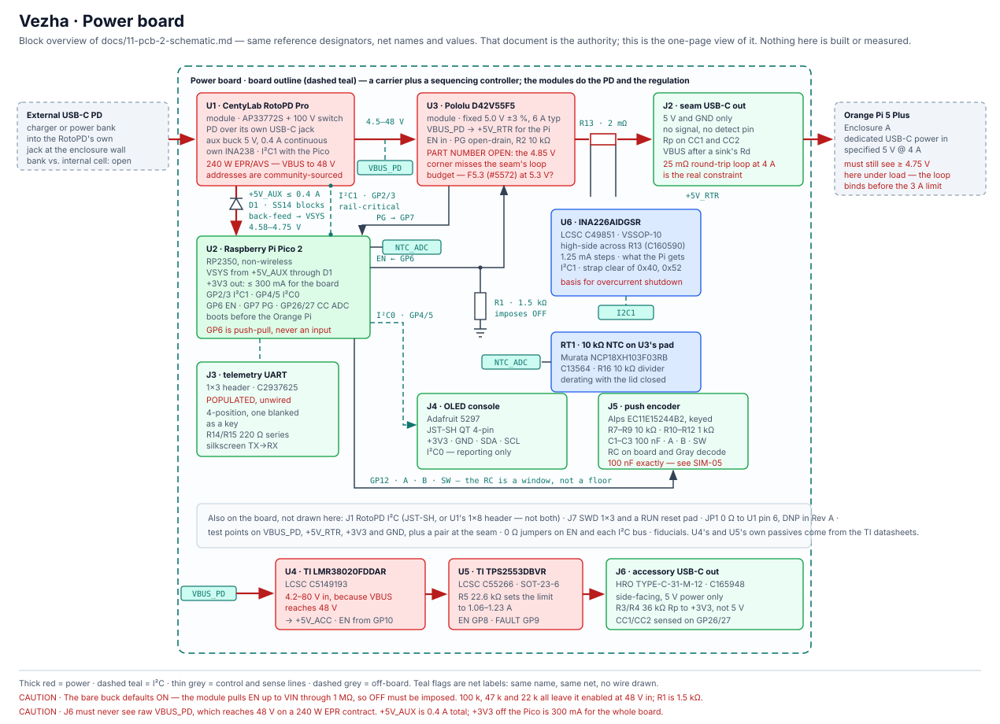

# 05 · Power Board — Requirements

A custom carrier in [Enclosure B](03-enclosure-b-lower.md) that mounts three
modules, drives a small console, and gates power to the router.

Read [01-architecture.md](01-architecture.md) first.

## Block schematic



Blocks and nets only — **not a captured schematic.** Module envelopes are
unmeasured and no EDA file exists yet. If this drawing and the text below ever
disagree, **the text wins.**

## What the board is

A carrier plus a power-sequencing controller. It does not implement PD or
regulation itself — it mounts modules that do, and provides interconnect,
control wiring, a front-panel console, and the mechanical anchor.

| Module | Function |
|---|---|
| **CentyLab RotoPD Pro** | Negotiates a PD contract over its **built-in USB-C jack**; provides switched VBUS |
| **Raspberry Pi Pico 2** | Controller. Sequences the rail, drives the console, talks to the router |
| **Pololu D42V55F5** (#5571) | Steps negotiated VBUS down to **regulated 5 V @ 4 A**. ⚠️ **Part number in question** — its 5.0 V −3 % corner cannot make the seam's loop-resistance budget. See [01 · The 5 V seam problem](01-architecture.md#the-5-v-seam-problem) |
| **Adafruit 5297 OLED** | Front-panel display |
| **Alps Alpine EC11E15244B2** | Front-panel push encoder, 30 detents |
| **HRO TYPE-C-31-M-12** (`C165948`) | Side-facing 5 V accessory output |

## Module interfaces

### CentyLab RotoPD Pro

- **Use its built-in USB-C jack as the PD input.** No separate input
  receptacle on the power board — bring the RotoPD's own jack to the enclosure wall.
- Route **negotiated VBUS and ground to the buck's VIN/GND.**
- **SDA/SCL to the Pico.**

### Raspberry Pi Pico 2 (non-wireless)

- **Keep the USB port accessible for programming.** Bring it to a wall opening
  or it is access in name only.
- **Populate a 3-pin TX/RX/GND header** — see
  [Telemetry header](#telemetry-header) below. Telemetry across the seam is
  **dropped**, but the header costs cents and makes it a jumper job later.
- **The Pico and display boot before the Orange Pi.** This is a sequencing
  requirement, not a preference.
- Powered from the **RotoPD auxiliary 5 V into VSYS** — see
  [the three rules](#three-rules-that-must-survive-layout).

### Pololu D42V55F5

- Supplies **5 V / 4 A to the Orange Pi** through a **dedicated keyed 2-pin
  power connector.**
- **EN and PG both interface to the Pico.**
- **The buck defaults off at startup.**

> [!CAUTION]
> **Corrected: the bare buck defaults ON, not off.** The D42V55F5 pulls EN up
> to VIN through **1 MΩ on the module**. "Defaults off" is therefore something
> the carrier must *impose*, not something it inherits — and the Pico's GPIO is
> high-impedance at reset, so firmware cannot do it either.
>
> **Fit a 1.5 kΩ pull-down on EN.** Simulation (`sim/01-buck-en-pulldown.cir`,
> `sim/02-en-drive-high.cir`) shows **100 kΩ, 47 kΩ and 22 kΩ all leave the
> buck enabled at 48 V input**, and even Raspberry Pi's recommended 8.2 kΩ
> fails once RP2350-E9 pad leakage is active.
>
> Without this the router can come up before any PD contract has been
> validated — the exact failure this architecture exists to prevent.
>
> **PG is an input to the Pico** — it is how firmware confirms the rail
> actually came up, rather than assuming it did after asserting EN.

### Telemetry header

The seam carries no signal, so this header is **not wired in Rev A.** Populate
it anyway — a 3-pin header is cents, and the alternative later is soldering to
bare pads inside a closed enclosure.

**On the Orange Pi side there is probably nothing to install.** The 5 Plus
ships with its 40-pin GPIO header populated, and Orange Pi boards usually carry
a separate 3-pin debug UART header as well. Verify both before buying anything.

> [!CAUTION]
> **Do not use the debug/console UART for telemetry.** It carries boot logs and
> a login prompt — telemetry would be interleaved with console output, and you
> would lose the console you actually want when something goes wrong. Pick a
> second UART off the 40-pin header and disable the console on it in the device
> tree.

**Three cheap things that prevent the usual mistakes:**

| Problem | Fix | Cost |
|---|---|---|
| Header plugged in **backwards** — TX driven into GND | **4-position header with one position blanked** as a key, or a shrouded JST-PH 3-pin instead of bare pins | ~free |
| TX wired to TX | Silkscreen the pin by **its own** function *and* its destination: `TX→RX`, `RX→TX` | free |
| Fault current if either of the above happens anyway | **100–330 Ω series resistors** on TX and RX | ~2 ¢ |

Both sides are 3.3 V, so **no level shifting.** Keep 5 V off this header
entirely — TX/RX/GND only means the worst wiring error is survivable.

Ground is already shared through the USB-C power cable, so this GND is a signal
reference, not a return path. Do not rely on it to carry current.

## Cheap insurance worth adding now

Each of these is small money at design time and expensive or impossible once
the boards are made and the boxes are closed. Ranked by value.

### 1 · INA226 current and voltage monitor — the standout

**~$1–2.** Put it high-side in the 5 V output path, between the Pololu's VOUT
and the USB-C seam receptacle, so it measures exactly what the Orange Pi
receives.

This directly answers **the project's biggest open question** — whether the Pi
stays under USB-C's 3 A limit at 5 V, see
[01 · The 3 A problem](01-architecture.md#the-5-v-seam-problem). Instead of a
one-off bench measurement with a meter in the lid, the board measures it
continuously, with the case closed, under real load, and shows it on the OLED.

| Shunt | Drop at 4 A | % of INA226 range | Resolution | Loss at 4 A |
|---|---|---|---|---|
| 1 mΩ | 4.0 mV | 4.9 % | 2.50 mA | 16 mW |
| **2 mΩ** | **8.0 mV** | **9.8 %** | **1.25 mA** | **32 mW** |
| 5 mΩ | 20.0 mV | 24.4 % | 0.50 mA | 80 mW |

**Use 2 mΩ.** Negligible loss, 1.25 mA resolution, and nearly 10× headroom for
inrush peaks that would clip a larger shunt.

It also gives the Pico a basis for **overcurrent shutdown**, and a peak-hold
figure worth logging.

### 2 · NTC thermistor on the Pololu — ~10 ¢

The other large unknown is **thermal derating in a sealed box** — the 6 A
figure is a typical maximum and the enclosure is not vented. Mount an NTC
against the regulator's thermal pad and run it to a Pico ADC.

This measures the derating **with the lid closed**, which is the condition you
cannot easily probe any other way, and lets the Pico fold back or shut down on
overtemperature rather than finding the limit by failing.

### 3 · Test points on every rail — free

Named, probe-able pads on **PD VBUS, Pololu VOUT, 3.3 V**, and several **GND**.

Add a pair **right at the USB-C seam output.** The measurement plan calls for
voltage *at the Orange Pi* under load; without pads that means probing
connector pins or cutting a cable.

### 4 · Pico SWD header — ~10 ¢

Three pins: SWCLK, SWDIO, GND. The USB bootloader is fine until firmware
crashes before it enumerates — then SWD is the only way in, and the board is
inside a closed box.

### 5 · Smaller items

- **0 Ω jumpers** on buck EN and each I²C bus, so sections can be isolated for
  bench bring-up
- **Reset pad or button** on the Pico's RUN pin — BOOTSEL is unreachable once
  enclosed
- **Spare Pico GPIO** broken out to a header — free optionality
- **Fiducials and mounting holes** — assembly basics

### What these add up to

With the INA226 and the NTC fitted, the Pico can enforce the limits it is
already gating: refuse to enable on an inadequate PD contract *(already
specified)*, shut down on overcurrent, and fold back on overtemperature. The
OLED gets something genuinely worth showing, and the two measurements the
project most needs stop depending on someone remembering to take them.

### Adafruit 5297 OLED

- **4-pin JST-SH STEMMA QT / Qwiic cable: 3.3 V, GND, SDA, SCL.**
- **Use the Pico's second I²C bus** — keeps the console off the bus that talks
  to the RotoPD Pro, so a wedged display cannot block PD control.

### Alps Alpine EC11E15244B2

- Push encoder, **30 detents**.
- **Keyed 4-pin harness: A, B, push switch, GND.**
- **10 kΩ pull-up, 1 kΩ series, 100 nF to ground** on A, B and the switch.
- **Plus a Gray-code decoder in firmware** — the RC filter handles contact
  bounce; it does not handle an encoder turned quickly.

> [!IMPORTANT]
> **Corrected 2026-11-18.** This section previously said *"hardware RC debounce
> cannot work on a switch-to-ground input — do not reserve RC footprints."*
> **That was wrong, and it contradicted both [11](06-power-board-schematic.md) and
> the corrected deck.** Reserve the footprints and fit the parts.
>
> The error was in the pass criterion, not the arithmetic. The original deck
> asked whether the filter hides the bounce burst *entirely* — whether `V_min`
> ever approaches `V_IL`. The question that matters is narrower: **whether a
> second falling edge appears after the input has already read a valid low.**
> It does not, with 10 kΩ / 1 kΩ / 100 nF.
>
> **It is a window, not a floor.** 220 nF and 470 nF both *fail*, because the
> cap stops discharging fully during short closures and the next press starts
> from a level that never reaches `V_IL`. Do not treat a larger capacitor as
> a safer capacitor.
>
> Source: `sim/retired/13-key-debounce.cir`, corrected in `a4c5201`. The deck is
> retired along with PCB 1, but this result is why — it converges with the power board's
> own encoder deck, `sim/05-encoder-debounce.cir`, which had it right.

## Accessory USB-C output port

Side-facing, **power only**, 5 V. Part is HRO `TYPE-C-31-M-12`, JLCPCB
`C165948`.

> [!CAUTION]
> **Do not connect this port to raw PD VBUS.** The RotoPD Pro is a **240 W
> EPR/AVS** part — **VBUS reaches 48 V**, not the 20 V an SPR-only source would
> top out at. Putting that on a port a user plugs a phone into destroys the
> phone.
>
> **The accessory regulator must be rated for 48 V input**, not 24 V.

### Requirements

- **USB-C source detection** — Rp pull-ups on **both CC1 and CC2** (the
  receptacle is reversible, so both must be presented). Apply VBUS only after
  a sink's Rd is detected.
- **Current limiting** — a load switch or eFuse with a defined limit, not just
  a fuse.
- Verify the receptacle's actual pin count and footprint from the HRO drawing
  before layout.

### Proposed current limit

Here is the analysis behind the recommendation.

| Scenario | Total on the 5 V rail | As % of the buck's 6 A figure |
|---|---|---|
| Orange Pi alone | 4.0 A | 67 % |
| Pi + 0.5 A accessory | 4.5 A | 75 % |
| Pi + 0.9 A accessory | 4.9 A | 82 % |
| Pi + 1.5 A accessory | 5.5 A | 92 % |
| Pi + 3.0 A accessory | 7.0 A | **117 % — over** |

That table flatters the design, because **6 A is a *typical maximum*, not a
rating in a sealed printed box with no airflow:**

| Derating of the 6 A figure | Usable cap | Headroom above the Pi's 4 A |
|---|---|---|
| 90 % | 5.4 A | +1.4 A |
| 80 % | 4.8 A | +0.8 A |
| 70 % | 4.2 A | +0.2 A |
| **60 %** | **3.6 A** | **−0.4 A — short of the Pi alone** |

> [!WARNING]
> **At 60 % derating the buck cannot supply the Orange Pi by itself.** The
> accessory port is not the first thing at risk here — the router rail is.
> This is unmeasured, and it is the single most important measurement on this
> board.

### Recommendation: give the accessory port its own regulator

**Yes — the accessory port needs its own regulator.** Feed a small dedicated
buck from PD VBUS, in parallel with the Pololu, rather than tapping the 5 V
router rail.

Four reasons:

1. **The margin being spent is unmeasured.** Adding a second variable load to
   a rail whose real capacity is unknown spends headroom that may not exist.
2. **Fault isolation.** A shorted or inrushing accessory on a shared rail
   causes a voltage dip *before* any limiter reacts. On the router rail, that
   is an unplanned reboot. A separate regulator contains it.
3. **Thermal separation.** Two converters each running moderately warm is a
   better thermal outcome in a sealed box than one running hard.
4. **It costs almost nothing extra.** "Do not connect to raw PD VBUS" already
   requires conversion or switching between VBUS and the port. Making that a
   dedicated buck rather than a load switch buys isolation for a handful of
   parts.

**Proposed figures for the dedicated regulator:**

> [!CAUTION]
> **Corrected: "advertised 1.0 A" is not a legal Type-C advertisement.** A
> source may advertise exactly three levels, and 56 kΩ *is* Default USB —
> 0.5 A, not the 1.0 A previously written beside it.
>
> | Advertisement | Rp to 5 V | Rp to 3.3 V |
> |---|---|---|
> | **Default USB** (0.5 A) | 56 kΩ ±20 % | 36 kΩ ±20 % |
> | 1.5 A | 22 kΩ ±5 % | 12 kΩ ±5 % |
> | 3.0 A | 10 kΩ ±5 % | 4.7 kΩ ±5 % |
>
> The limit must also clear the advertised value **at its minimum**, or a
> compliant sink drawing its full entitlement trips the limiter. A ~1.25 A
> limit has a ~1.06 A minimum, so it pairs with Default USB and **cannot** be
> paired with a 1.5 A advertisement.

Two legal configurations, resolved in
[11 · Accessory port](06-power-board-schematic.md#accessory-usb-c-output-port-j6):

| | **A · Default USB** (recommended) | B · 1.5 A |
|---|---|---|
| Rp on CC1 and CC2 | **36 kΩ ±20 % to 3V3** | 12 kΩ ±5 % to 3V3 |
| Limit min / nom / max | **1.06 / 1.14 / 1.23 A** | 1.51 / 1.55 / 1.68 A |
| Sink may draw | 0.5 A | 1.5 A |
| Gate | none | **needs the thermal measurement below first** |

Rp references **3.3 V, not 5 V**: the 5 V accessory rail is the thing being
decided, so it cannot be the reference before attach. The Type-C spec's 3.3 V
resistor set exists for exactly this, and simulation
(`sim/03-usbc-cc-detect.cir`) confirms the two sets are equivalent at the Rd
node — 0.409 V against 0.417 V.

**If a dedicated regulator is rejected** and the port must share the router
rail: hard-limit it to **0.5 A**, advertise Default USB, and treat it as a
trickle-charge port only — and do not do even that until the Pololu's real
derated capacity in the closed enclosure has been measured.

## Three rules that must survive layout

> [!CAUTION]
> **1 · Do not power the Pico from the Pololu rail.** The Pico brings that
> rail up; a controller that depends on its own output cannot start the
> system. Pico runs off the **RotoPD auxiliary 5 V into VSYS.**
>
> **Put a Schottky in that path — aux 5 V → D1 → VSYS.** Not optional. On a
> Pico 2, VBUS from the programming jack reaches VSYS through the module's own
> diode, which blocks VSYS → VBUS but **not** VBUS → VSYS → out to whatever
> else is tied to VSYS. Since [03](03-enclosure-b-lower.md) brings that jack to
> a wall opening, plugging in a laptop while the RotoPD is unpowered drives
> **5–494 mA backwards into the RotoPD's unpowered aux regulator output**
> (`sim/06-aux-rail-vsys.cir`). One SS14 blocks it to 2 µA and drops VSYS to a
> more comfortable 4.6–4.75 V against the Pico's 5.5 V ceiling.

> [!CAUTION]
> **2 · The auxiliary output is 0.4 A continuous.** It powers the controller
> and the console. It is **not** a source for the Orange Pi, and the OLED and
> encoder must fit inside that budget.

> [!CAUTION]
> **3 · The Pico verifies an adequate PD contract before asserting EN.**
> Bringing the Orange Pi up on an insufficient contract is the failure this
> architecture exists to prevent. The buck defaults off; the Pico confirms the
> contract, asserts EN, then checks PG.

## Boot sequence

```
power applied
  → RotoPD Pro negotiates PD contract
  → aux 5 V brings up Pico 2 + OLED          ← console is live first
  → Pico reads contract over I²C bus 1
  → contract adequate?  ── no ──→ report on OLED, leave EN low
            │ yes
  → Pico asserts buck EN
  → Pico checks PG                            ← confirms, not assumes
  → USB-C source: sink Rd detected?  ── no ──→ hold VBUS off
            │ yes
  → 5 V reaches Orange Pi over the USB-C seam
  → Orange Pi boots independently              ← no telemetry link
```

## Connectors

| Connector | Pins | Carries | Keyed |
|---|---:|---|---|
| **Seam output** | — | 5 V, GND over **USB-C** — power only | By the standard |
| OLED | 4 | 3.3 V, GND, SDA, SCL (JST-SH STEMMA QT) | Yes, by type |
| Encoder | 4 | A, B, push switch, GND | **Yes** |
| RotoPD I²C | — | SDA, SCL to Pico bus 1 | — |

> [!IMPORTANT]
> **The seam is USB-C, 5 V power only.** No signal, no detect pin, no custom
> contact array. USB-C source detection on the output — Rp on CC1/CC2, VBUS
> only after a sink's Rd appears — does the gating a detect contact would have.
>
> **Caveat:** USB-C tops out at **3 A at 5 V** and the Orange Pi is specified
> at 4 A. See [01 · The 3 A problem](01-architecture.md#the-5-v-seam-problem).

## I²C bus allocation

| Bus | Devices | Rationale |
|---|---|---|
| **Bus 1** | RotoPD Pro, **INA226** | Rail-critical: anything needed to control power safely. |
| **Bus 2** | Adafruit 5297 OLED | Reporting only. A wedged display must not stall PD control. |

Check pull-ups on each bus once populated — the RotoPD and the STEMMA QT
cable may both carry their own.

**Verify the INA226's address does not collide with the RotoPD Pro's.** The
INA226 defaults to `0x40` and is strappable across `0x40`–`0x4F`.

## Headroom summary

| Figure | Standing |
|---|---|
| Orange Pi 5 Plus | **5 V at 4 A** specified |
| Pololu D42V55F5 | **6 A typical maximum** — unvalidated in enclosure |
| RotoPD auxiliary | **0.4 A continuous** — Pico + OLED + encoder only |
| Accessory port | **1.0 A proposed**, on its own regulator |
| ~~PCB 1 indicators~~ | **0 mA** — [v1 is headless](01-architecture.md#no-controls-in-v1). Previously charged at ~240 mA, then ~120 mA once `REXT` was set for 10 mA/channel |

## Measurement, before trusting any of this

Measure voltage **at the Orange Pi** — not at the regulator, not at the
charger. Cable and connector drop at several amps is the failure mode.

1. **Cold boot** — the inrush case
2. **Both radios active**, passing traffic simultaneously on 5 GHz
3. **Intended USB load applied**
4. **Buck case temperature in the closed enclosure at sustained 4 A** — this
   produces the real derating figure and decides whether the accessory port is
   viable at all
5. **The Orange Pi's absolute maximum input voltage** — decides whether the
   5.3 V regulator's 5.459 V high corner is safe, and therefore which Pololu
   part is correct

Also confirm which PD profiles the chosen charger actually offers, from the
device rather than its marketing copy.

## Previously-flagged conflicts — both resolved

**1 · Seam is no longer power-only** — **resolved.** The UART is dropped; the
seam is USB-C, 5 V power only. The governing rule in
[01](01-architecture.md) holds again as written.

**2 · Two competing user interfaces** — **resolved twice over.** First by
dropping telemetry: with no link across the seam, this board's OLED can only
show power and PD state, so it could never substitute for a router UI. Then by
[the v1 scope cut](01-architecture.md#no-controls-in-v1), which removed the
competing interface altogether.

| | Interface | Shows |
|---|---|---|
| **Enclosure A** | ⬜ **None — headless.** Web UI only | — |
| **Enclosure B** | OLED + EC11 encoder — **the only panel in the product** | Input voltage, negotiated PD contract, rail status, fault reason |

> [!IMPORTANT]
> **This console is now the only thing that can tell you anything without a
> network.** That raises its value and changes what belongs on it. Worth
> revisiting what it shows on fault: when the router will not come up, this
> display and the `PG` line are the entire diagnostic surface.

## Open questions

- ~~RotoPD Pro **outline, mounting-hole coordinates and height**~~ —
  **resolved 2026-11-18** from the vendor repository.
  [Geometry](06-power-board-schematic.md#u1--rotopd-pro-mechanical--resolved-from-the-vendor-repo)
- **Whether the RotoPD's aux buck survives a contract above 36 V** — it is
  reported to be an LMR51635 fed from VBUS. If so, requesting a 48 V EPR
  contract could cut the Pico's own supply. Until answered, firmware caps
  requested contracts at 20 V. See
  [11 · Boot sequence](06-power-board-schematic.md#boot-sequence).
- ~~`U3` 5.0 V vs 5.3 V~~ — **decided 2026-11-18: the 5.0 V #5571**, forced
  by the Orange Pi's fixed-5 V input. It leaves the seam loop over budget,
  which is now the open problem instead. See
  [06 · U3 is the 5.0 V part](06-power-board-schematic.md#u3-is-the-50-v-part)
- **Seam USB-C receptacle part, and whether the Pi stays under 3 A** — now
  coupled to the loop-resistance problem, not independent of it: a 6-pin
  power-only receptacle brings out only two VBUS and two GND contacts, where
  a 16-pin part brings out four of each. See
  [06 · U3 is the 5.0 V part](06-power-board-schematic.md#u3-is-the-50-v-part)
- INA226 address vs. the RotoPD Pro's
- Whether Rev A populates the telemetry header's series resistors
- Measured buck derating in the closed enclosure
- Pico mounting: castellated vs. 2.54 mm sockets
- ~~Accessory port config **A** or **B**~~ — **decided 2026-11-18: build
  Rev A as config A.** The two differ only in three 0603 values on identical
  footprints, so B stays available as a bench swap after the thermal
  measurement. See
  [06 · What is still open](06-power-board-schematic.md#what-is-still-open)

**Answered in [11-pcb-2-schematic.md](06-power-board-schematic.md)**, with the
simulations behind each:

| Was open | Now |
|---|---|
| EN pull-down value | **1.5 kΩ** — [SIM-01](06-power-board-schematic.md#sim-01--buck-en-pull-down) |
| Encoder debounce: RC or firmware | **Both** — 10 kΩ / 1 kΩ / **100 nF**, plus a Gray-code decoder. [SIM-05](06-power-board-schematic.md#sim-05--encoder-debounce) |
| Dedicated accessory regulator part | **LMR38020FDDAR** (`C5149193`), 80 V in — needed because VBUS reaches 48 V |
| Accessory current limiter | **TPS2553DBVR** (`C55266`) + 22.6 kΩ R_ILIM |
| NTC part and mounting | **NCP18XH103F03RB** (`C13564`) in a 10 kΩ divider to ADC2 |
| Accessory Rp reference and value | **36 kΩ to +3V3** — [SIM-03](06-power-board-schematic.md#sim-03--accessory-cc-detection) |

Full net list, designators and Pico pin map:
[11-pcb-2-schematic.md](06-power-board-schematic.md).
Mechanical context in [03-enclosure-b-lower.md](03-enclosure-b-lower.md).
