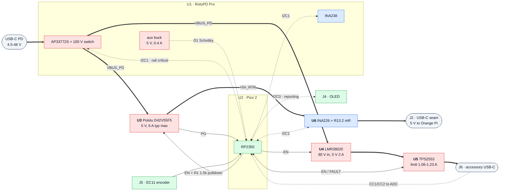

# 11 · PCB 2 — Schematic

A net-by-net schematic for the power board, with every passive value either
calculated or simulated, and the simulation that justifies it.

Requirements live in [05-pcb-2-power.md](05-pcb-2-power.md). This document is
the implementation of them, and in five places it **contradicts** them — those
are called out in [Corrections to 05](#corrections-to-05) and are the most
important part of this file.

Simulation decks are in [`sim/`](../sim/), results in
[`sim/RESULTS-pcb2.txt`](../sim/RESULTS-pcb2.txt). They were run with ngspice 39 in a
podman container on `fucina`.

> [!IMPORTANT]
> **Nothing here has been built or measured.** Simulation establishes that the
> arithmetic and the corner cases work. It says nothing about thermals,
> layout, EMI, or whether the modules behave as their vendors claim. The
> measurement list in [05](05-pcb-2-power.md#measurement-before-trusting-any-of-this)
> still gates everything.

## Corrections to 05

Research for this schematic found five errors in [05](05-pcb-2-power.md), each
of which changes a part choice or a resistor value. **All five are now fixed in
05 itself** — they are restated here because they are the reasoning behind
values in the tables below, and because anyone holding an older copy of 05 is
working from wrong numbers.

### 1 · The buck does not default off — it defaults ON

05 says "The buck defaults off at startup" and that this is "a layout
requirement, not firmware", because "the Pico's GPIO is high-impedance at
reset".

The reasoning is right and the premise is wrong. **The D42V55F5's EN pin is
pulled up to VIN through a 1 MΩ resistor on the module itself.** A bare
module with EN unconnected is *enabled*. The Pico's GPIO being high-impedance
at reset is not a neutral condition — it hands the net to that pull-up.

So the pull-down is not insurance. It is the only thing holding the router
rail down before firmware runs, and **its value matters enormously**.
[SIM-01](#sim-01--buck-en-pull-down) shows the natural choices all fail.

### 2 · PD VBUS reaches 48 V, not 20 V

05 warns that VBUS "may be at 9, 12, 15 or 20 V depending on the negotiated
contract". The RotoPD Pro is a **240 W** breakout built on the AP33772S with a
100 V NMOS switch: its documented output range is **4.5 V to 48 V**, SPR/PPS
to 21 V and EPR/AVS to 48 V.

Consequences:

- The EN pull-down must hold at **48 V**, not 20 V. This is what makes the
  resistor value as low as it is.
- The accessory-port regulator needs a **48 V-rated input**, which rules out
  every 32 V-class part (AP63205, AP63357) that would otherwise be the obvious
  cheap choice.
- The warning "do not connect this port to raw PD VBUS" is more serious than
  05 states — the hazard is 48 V on a phone, not 20 V.

### 3 · "Advertised 1.0 A" is not a legal Type-C advertisement

05 proposes "Advertised: **5 V @ 1.0 A** — Rp for Default USB (56 kΩ ±20 %)".
Those are two different things and neither gives 1.0 A. A Type-C source may
advertise exactly three levels:

| Advertisement | Rp to 5 V | Rp to 3.3 V |
|---|---|---|
| **Default USB** (0.5 A) | 56 kΩ ±20 % | 36 kΩ ±20 % |
| 1.5 A | 22 kΩ ±5 % | 12 kΩ ±5 % |
| 3.0 A | 10 kΩ ±5 % | 4.7 kΩ ±5 % |

56 kΩ *is* Default USB, so 05's own resistor advertises 0.5 A, not the 1.0 A
written beside it. See [Accessory port](#accessory-usb-c-output-port-j6) for
the two configurations that are actually legal.

### 4 · The Pololu part number is in question

05 and [07](07-bom.md) both specify the D42V55F5 (5.0 V, Pololu #5571).
[SIM-04](#sim-04--router-rail-ir-drop) says that part cannot meet the Orange
Pi's input requirement at 4 A through the USB-C seam in its worst tolerance
corner — and that reducing the current does not rescue it either. This is the
largest open electrical question on the board.

**The decision sits with the seam spec, not here** — see
[01 · The 5 V seam problem](01-architecture.md#the-5-v-seam-problem). Current
lean is the 5.3 V part (#5572), gated on measuring the Orange Pi's maximum
input voltage. This document specifies the board around whichever is chosen:
the two parts are pin- and footprint-identical, so nothing else in the
schematic moves.

### 5 · The programming port back-feeds the RotoPD

Not mentioned anywhere in the repo. [03](03-enclosure-b-lower.md) requires the
Pico's USB port reach a wall opening; [01](01-architecture.md) and 05 require
VSYS be fed from the RotoPD's aux 5 V. Doing both creates a path from a
laptop's USB into the RotoPD's unpowered regulator output.
[SIM-06](#sim-06--aux-rail-and-vsys) measures it and fixes it with one diode.

## Power domains

| Net | Source | Range | Budget | Consumers |
|---|---|---|---|---|
| `VBUS_PD` | RotoPD switched output | **4.5–48 V** | 5 A | U3 VIN, U4 VIN |
| `+5V_RTR` | U3 (Pololu) VOUT | 5.0 V ±3 % | 4 A to the Pi | seam, INA226 shunt |
| `+5V_AUX` | RotoPD aux buck | 5.0 V | **0.4 A cont**, 1 A peak | D1 → VSYS |
| `VSYS` | `+5V_AUX` via D1 | 4.58–4.75 V | — | Pico 2 |
| `+3V3` | Pico 3V3(OUT) | 3.3 V | **≤300 mA** | OLED, pull-ups, CC Rp |
| `+5V_ACC` | U4 → U5 | 5.0 V | 1.06–1.23 A limit | accessory port |



## Reference designators

| Ref | Part | LCSC | Package | Stock 2026-11-18 | Function |
|---|---|---|---|---:|---|
| **U1** | CentyLab RotoPD Pro | — | module | — | PD negotiation, switched VBUS, aux 5 V |
| **U2** | Raspberry Pi Pico 2 | — | module | — | controller |
| **U3** | Pololu D42V55F5 **or F5.3** (#5571 / #5572) | — | module | — | router rail — **part number open, see [SIM-04](#sim-04--router-rail-ir-drop)** |
| **U4** | TI LMR38020FDDAR | `C5149193` | SO-PowerPAD-8 | 4,566 | accessory buck, **4.2–80 V in** |
| **U5** | TI TPS2553DBVR | `C55266` | SOT-23-6 | 45,815 | accessory current limit + FAULT |
| **U6** | TI INA226AIDGSR | `C49851` | VSSOP-10 | 56,084 | router rail V and I |
| **D1** | MDD SS14 | `C2480` | SMA | 1,286,168 | aux 5 V → VSYS blocking — **`basic` library** |
| **R1** | **1.5 kΩ** 1 % | — | 0603 | — | **U3 EN pull-down — [SIM-01](#sim-01--buck-en-pull-down)** |
| **R2** | 10 kΩ 1 % | — | 0603 | — | U3 PG pull-up to +3V3 |
| **R3, R4** | **36 kΩ** 1 % | — | 0603 | — | accessory CC1/CC2 Rp — [SIM-03](#sim-03--accessory-cc-detection) |
| **R5** | **22.6 kΩ** 1 % | — | 0603 | — | U5 R_ILIM, sets 1.06–1.23 A |
| **R6** | 100 kΩ | — | 0603 | — | U5 FAULT pull-up to +3V3 |
| **R7–R9** | 10 kΩ | — | 0603 | — | encoder A/B/SW pull-ups to +3V3 |
| **R10–R12** | 1 kΩ | — | 0603 | — | encoder series R — [SIM-05](#sim-05--encoder-debounce) |
| **R13** | **2 mΩ** 1 % | `C160590` | 2512 | 32,253 | INA226 shunt |
| **R14, R15** | 220 Ω | — | 0603 | — | telemetry TX/RX series protection |
| **RT1** | Murata NCP18XH103F03RB | `C13564` | 0603 | 261,587 | 10 kΩ NTC on U3 thermal pad |
| **R16** | 10 kΩ 1 % | — | 0603 | — | NTC divider top leg to +3V3 |
| **C1–C3** | **100 nF** X7R | — | 0603 | — | encoder RC — [SIM-05](#sim-05--encoder-debounce) |
| **J1** | RotoPD I²C, 4-pin JST-SH | — | — | — | Qwiic to U1 — *or* U1's 1×8 header, not both |
| **JP1** | 0 Ω jumper, **DNP in Rev A** | — | 0603 | — | U1 pin 6 (3.3V) ← +3V3 — [see the caution](#u1--rotopd-pro) |
| **J2** | USB-C seam receptacle | — | — | — | 5 V to Orange Pi (owned by the seam spec) |
| **J3** | 1×3 header 2.54 mm | `C2937625` | TH | 1,030,846 | telemetry, unwired in Rev A |
| **J4** | OLED, 4-pin JST-SH | — | — | — | STEMMA QT to Adafruit 5297 |
| **J5** | Encoder, 4-pin keyed | — | — | — | A, B, SW, GND |
| **J6** | HRO TYPE-C-31-M-12 | `C165948` | SMD 16P | 508,308 | accessory output, side-facing |
| **J7** | SWD, 1×3 header | `C2937625` | TH | 1,030,846 | SWCLK, SWDIO, GND |

Every part except **D1** is an `expand` library part, so each adds a JLCPCB
feeder fee. D1 is `basic`.

U4's and U5's own passives (buck inductor, input/output caps, bootstrap,
feedback divider, U4 soft-start) are not enumerated here — they come from the
TI datasheets' typical-application tables once the switching frequency and
output capacitance are fixed, and they should be taken from the datasheet
rather than invented.

## Module pinouts — verified from vendor drawings

Both of these were listed as blocking unknowns. They are now resolved from the
vendor artwork, which is published only as images.

### U1 · RotoPD Pro

Source: [`Documents/RotoPD_Pro_pinout.png`](https://github.com/CentyLab/RotoPD_Pro/blob/main/Documents/RotoPD_Pro_pinout.png).
The 1×8 2.54 mm header (J4 in the vendor schematic), top to bottom with the
USB-C jack at the top:

| Pin | Name | Use on PCB 2 |
|---:|---|---|
| 1 | USB_D− | not connected |
| 2 | USB_D+ | not connected |
| 3 | **INT** | → U2 GP11 |
| 4 | **SDA** | → I²C1, U2 GP2 |
| 5 | **SCL** | → I²C1, U2 GP3 |
| 6 | **3.3V** | → see the jumper note below |
| 7 | **GND** | → GND |
| 8 | **5V** | → **aux rail**, into D1 → VSYS |

Also on the board:

- **The switched VBUS output is a 2-position 5 mm screw terminal**, not header
  pins — `VBUS` and `GND`, on the edge opposite the USB-C jack. This is the
  main power path to U3's VIN, and it is an **assembly and enclosure
  constraint**, not just a schematic one: PCB 2 cannot simply reflow the
  module down for the power path. Either land short heavy wire from the screw
  terminal, or remove the terminal and solder to its pads. Decide before
  drawing the carrier.
- A Qwiic/STEMMA QT JST-SH connector carries the same SDA/SCL/3V3/GND — use it
  *or* the header pins, not both.
- **Two mounting holes**, at the top corners flanking the USB-C jack.
  Positions and diameter are still not dimensioned anywhere published.
- The artwork confirms the electrical range directly: *"Input and output
  voltage range of 4.5-48V. Support PD3.1 EPR/AVS Up to 48V and SPR/PPS Up to
  21V."*

> [!CAUTION]
> **Fit pin 6 (3.3V) through a 0 Ω jumper, and leave it UNPOPULATED in Rev A.**
>
> It is not documented whether this pin is an input or an output. The board
> carries a TXS0102 level translator with separate `SDA_3V3`/`SDA_5V` nets,
> which is the signature of a part whose low-side reference (VCCA) is supplied
> by the host — in which case the Pico's +3V3 must drive it. But if it is
> instead a 3.3 V rail the module *provides*, tying it to the Pico's 3V3(OUT)
> puts two regulators in contention.
>
> A jumper footprint plus a test point costs nothing and settles it on the
> bench: bring the board up with the link open and measure pin 6. Reads 0 V,
> populate the jumper. Reads 3.3 V, leave it open forever.

### U3 · Pololu D42V55F5 mechanical

Source: [the family dimension drawing](https://www.pololu.com/file/0J2180/d42v55fx-step-down-voltage-regulators-dimensions.pdf)
(dev code `reg34a`, items 5570–5579).

| | |
|---|---|
| Board | 25.4 × 25.4 mm, 1.57 mm thick |
| **Mounting** | **3 holes, ⌀2.18 mm, on a 21.1 × 21.1 mm pattern, 2.2 mm in from each edge** (#2 / M2) |
| Pin holes | 12 × ⌀1.02 mm, two rows, first row 1.27 mm from the edge |
| **Height above board** | **6.1 mm** for items 5570–5577, which includes #5571 and #5572 |
| Height below board | 1.4 mm |
| Drill tolerance | ±0.1 mm · board edge ±0.3 mm |

Total stack is 9.07 mm, consistent with the 9 mm figure in
[03](03-enclosure-b-lower.md) and [07](07-bom.md). **Items 5578 and 5579 are
8.0 mm above board** — if the part number ever changes to one of those, the
enclosure height changes with it.

The exact left-to-right pin order within each row is still not legible at the
published resolution. Take it from the physical board or the STEP model, and
remember Pololu's own warning that **EN and PG are adjacent on different rows**
and easy to short together.

## Nets

### Rail control — U3 EN and PG

```
U2.GP6 ──┬── U3.EN
         │
        R1 1.5k
         │
        GND
```

- **R1 = 1.5 kΩ, not 10 kΩ and not 100 kΩ.** This is the single most
  consequential value on the board. [SIM-01](#sim-01--buck-en-pull-down).
- GP6 must be configured as a **push-pull output and never as an input.** If
  firmware ever leaves it an input, RP2350-E9 leakage joins the module's
  pull-up in fighting R1. R1 is sized to win even then, but the rule stands.
- Asserting EN costs 2.1 mA from GP6 and burns 6.8 mW in R1 —
  [SIM-02](#sim-02--can-the-pico-still-assert-en) — both negligible.

```
+3V3 ── R2 10k ──┬── U3.PG ── U2.GP7
                 │
              (open drain)
```

- Pololu recommends 100 kΩ. **10 kΩ is used instead** for noise immunity and
  a faster edge; PG's only job is to be read occasionally, so the extra 330 µA
  is irrelevant against the 300 mA +3V3 budget.
- PG is low during soft-start and while disabled, so firmware must allow a
  settling window after asserting EN before treating a low PG as a fault.
- E9 is harmless here: it can only *source* current, and the open-drain NMOS
  sinks it easily when PG is asserted.

### Aux 5 V → VSYS

```
U1.5V_AUX ── D1 (SS14) ── U2.VSYS
```

- **D1 is mandatory, not optional.** It blocks the programming-port back-feed
  and buys VSYS headroom at the same time —
  [SIM-06](#sim-06--aux-rail-and-vsys).
- VSYS lands at **4.58–4.75 V** across the load range, inside the Pico 2's
  1.8–5.5 V window with 0.75–0.92 V of ceiling margin. Tied directly, it would
  sit at 4.94–5.00 V with only 0.50–0.56 V of margin.
- Do **not** also short VBUS to VSYS on the Pico. That shortcut is documented
  by Raspberry Pi for USB-only designs and defeats D1's purpose here.

### I²C bus allocation

| Bus | RP2350 | Pins | Devices | Why |
|---|---|---|---|---|
| **I²C1** | i2c1 | GP2 SDA, GP3 SCL | U1 RotoPD (AP33772S `0x52`, INA238 `0x40`), **U6 INA226** | **Rail-critical.** PD control and the current measurement the shutdown decision depends on. |
| **I²C0** | i2c0 | GP4 SDA, GP5 SCL | J4 OLED | **Reporting only.** A wedged display cannot stall PD control. |

- Addresses `0x52` and `0x40` are **community-documented, not vendor
  confirmed** — scan the bus before trusting them. The RotoPD may also respond
  at `0x70`.
- U6's INA226 address is strap-selectable; pick one that collides with neither.
- Check pull-ups once populated. U1 appears to carry its own, and the STEMMA QT
  cable may too. Three sets of parallel pull-ups on one bus is a real failure
  mode.

### Accessory USB-C output port (J6)

```
VBUS_PD ──> U4 LMR38020 ──> +5V_ACC ──> U5 TPS2553 ──> J6.VBUS
                 ^EN                      ^EN  ^FAULT
                 │                         │     │
              U2.GP10                  U2.GP8  U2.GP9

+3V3 ── R3 36k ── J6.CC1 ── U2.GP26/ADC0
+3V3 ── R4 36k ── J6.CC2 ── U2.GP27/ADC1
```

**U4 is an 80 V part because VBUS reaches 48 V.** The LMR38020FDDAR runs
4.2–80 V in at 2 A with internal compensation. A 32 V part would be cheaper
and smaller and would be destroyed by an EPR contract.

**Rp references +3V3, not 5 V.** 05 specifies Rp to 5 V, but the 5 V
accessory rail is the thing being decided — it is not available to reference
against before attach. The Type-C spec's 3.3 V resistor set exists for this.
[SIM-03](#sim-03--accessory-cc-detection) confirms 36 kΩ/3V3 puts 0.409 V
across Rd against 0.417 V for the spec's 56 kΩ/5 V — 8 mV apart, equivalent.

Firmware thresholds from the simulated corners:

| V(CC) | Meaning | Action |
|---|---|---|
| > 2.0 V | unattached | U4 EN low, U5 EN low |
| 0.22–0.90 V | **sink attached (Rd)** | enable U4, settle, then enable U5 |
| < 0.20 V | powered cable Ra, or short | do not enable |

Two legal configurations. **Config A is the recommendation.**

| | **A · Default USB** | B · 1.5 A |
|---|---|---|
| R3, R4 | **36 kΩ ±20 %** | 12 kΩ ±5 % |
| R5 (R_ILIM) | **22.6 kΩ** | 16.2 kΩ |
| Limit min/nom/max | **1.06 / 1.14 / 1.23 A** | 1.51 / 1.55 / 1.68 A |
| Sink may draw | 0.5 A | 1.5 A |
| Port power | 2.5 W | 7.5 W |
| Thermal | untested, low risk | **needs the sealed-box measurement first** |

Config B's limit must exceed 1.5 A *at its minimum*, or a compliant sink
drawing its full advertised current trips the limiter. 16.2 kΩ is the value
that satisfies that; 22.6 kΩ would not, which is why the two columns cannot
share a resistor. Both fit U4's 2 A.

R5 from TI's equations (R in kΩ, I in mA):

```
I_OSmax = 22980 / R^0.94      I_OSnom = 23950 / R^0.977      I_OSmin = 25230 / R^1.016
R5 = 22.6k  ->  max 1225 mA, nom 1138 mA, min 1062 mA
```

Also on J6:

- **D+/D− to a 200 Ω footprint shorting them**, fitted or not. That is the
  BC1.2 DCP signature, and it is what lets an older phone that ignores CC
  charge at more than 100 mA. Power-only means no data either way.
- **No VCONN.** A power-only source is not required to supply it, and Ra
  detection is only used here to refuse to energise.
- Verify the HRO 16-pin footprint against the drawing before layout. The part
  is a 16-contact USB 2.0 variant, not a 24-contact one — SBU and the
  SuperSpeed pairs are simply absent.

### Encoder (J5)

```
+3V3 ── R7 10k ──┬── J5.A ── R10 1k ──┬── U2.GP12
                 │                     │
              (contact)              C1 100nF
                 │                     │
                GND                   GND      (×3: A, B, SW)
```

**RC on board *and* a Gray-code decoder in firmware.** 05 left this open as an
either/or. [SIM-05](#sim-05--encoder-debounce) shows the RC alone is
sufficient at 10 kΩ/1 kΩ/100 nF, so the footprints are worth fitting — but the
firmware decoder costs nothing and covers the case where a worn contact
chatters longer than the 2 ms modelled.

Values are not interchangeable:

- **100 nF is the answer.** 1 nF and 10 nF let bounce through as extra edges.
  220 nF suppresses bounce but drops the rotation ceiling to 3.7 rev/s, too
  close to the ~3 rev/s a brisk flick reaches. 100 nF suppresses bounce and
  tops out at 8.1 rev/s.
- The asymmetry is deliberate: 91 µs falling, 1.1 ms rising. The slow rise is
  what rejects bounce; the fast fall is what keeps the edge crisp.

### NTC on U3 (RT1)

```
+3V3 ── R16 10k ──┬── U2.GP28/ADC2
                  │
                RT1 10k NTC  (against U3's thermal pad)
                  │
                 GND
```

At 25 °C the divider sits at 1.65 V, mid-scale. Firmware must clear the pad
input enable on GP26/27/28 before reading them, per the RP2350 datasheet's ADC
section — which also removes E9 leakage on those pins.

### Telemetry (J3) — populated, unwired

```
U2.GP0 (UART0 TX) ── R14 220R ── J3.1   silkscreen "TX->RX"
U2.GP1 (UART0 RX) ── R15 220R ── J3.2   silkscreen "RX->TX"
                                 J3.3   GND
```

Per 05: a 4-position header with position 3 blanked as a key, so it cannot go
in backwards. 220 Ω limits fault current if it does anyway.

## Pico 2 pin map

The ADC is the constraint worth noticing.

| GPIO | Pin | Direction | Net | Notes |
|---|---:|---|---|---|
| GP0 | 1 | out | UART0 TX → J3 | via R14 |
| GP1 | 2 | in | UART0 RX ← J3 | via R15 |
| GP2 | 4 | bidir | I²C1 SDA | rail-critical bus |
| GP3 | 5 | bidir | I²C1 SCL | rail-critical bus |
| GP4 | 6 | bidir | I²C0 SDA | OLED |
| GP5 | 7 | bidir | I²C0 SCL | OLED |
| **GP6** | 9 | **out only** | **U3 EN** | never configure as input |
| GP7 | 10 | in | U3 PG | 10 k pull-up, low during soft-start |
| GP8 | 11 | out | U5 EN (active high) | accessory load switch |
| GP9 | 12 | in | U5 FAULT | open drain, 100 k pull-up |
| GP10 | 14 | out | U4 EN | accessory buck |
| GP11 | 15 | in | U1 INT | AP33772S interrupt |
| GP12 | 16 | in | encoder A | RC filtered |
| GP13 | 17 | in | encoder B | RC filtered |
| GP14 | 19 | in | encoder SW | RC filtered |
| **GP26** | 31 | **ADC0** | J6 CC1 | clear pad IE before reading |
| **GP27** | 32 | **ADC1** | J6 CC2 | clear pad IE before reading |
| **GP28** | 34 | **ADC2** | RT1 NTC | clear pad IE before reading |
| GP29 | — | ADC3 | VSYS ÷ 3 | internal on Pico 2, free aux-rail monitor |

> [!WARNING]
> **The ADC budget is exactly full.** Pico 2 brings out three ADC channels;
> this design uses all three (CC1, CC2, NTC). GP29/ADC3 is wired to VSYS÷3 on
> the module and is not available for anything else. Any further analog input
> — a second NTC, a VBUS divider, a battery gauge — needs an external mux, or
> CC detection must move to a dedicated controller such as the TPS25810
> (`C473913`, 6,045 in stock), which does Rp, Rd detection and the load switch
> in hardware and frees both channels.

## Boot sequence

Firmware-level, with the hardware state at each step.

```
power applied to U1's USB-C jack
  │  R1 holds U3.EN low            -> router rail OFF, guaranteed by hardware
  │  U4.EN, U5.EN low              -> accessory port OFF
  ▼
U1 negotiates a PD contract (default safe 5 V until commanded)
  │
  ▼
+5V_AUX comes up -> D1 -> VSYS -> Pico 3V3 -> Pico and OLED boot
  │                                            console live first
  ▼
Pico reads AP33772S PDOs over I2C1
  │
  ├─ contract inadequate ──> report on OLED, leave EN low, stop
  │
  ▼  contract adequate
Pico requests the chosen PDO (PD_REQMSG, 0x31)
  │  NEVER request above 20 V - see the hazard note below
  ▼
Pico drives GP6 high -> U3.EN asserted
  │
  ▼
Pico waits out soft-start, then reads PG
  │
  ├─ PG still low after timeout ──> EN low, report fault
  │
  ▼  PG high
Pico reads U6 INA226 -> rail voltage and current confirmed
  │
  ▼
5 V reaches the Orange Pi over the USB-C seam; Orange Pi boots
  │
  ▼
steady state: poll INA226 and RT1, service the console,
              watch CC1/CC2 for an accessory attach
```

> [!CAUTION]
> **Never request a contract above 20 V.** This is a firmware rule with a
> hardware reason, and it is not in 05.
>
> The RotoPD's auxiliary 5 V buck — the Pico's own supply — is reported to be
> an **LMR51635**, whose input range is 4.5–36 V, fed from VBUS. If the Pico
> requests a 48 V EPR contract it may take out the rail powering the Pico
> itself, mid-transaction, with the router rail in an unknown state.
>
> This is unverified and it is a question for CentyLab, not an inference to
> build on. Until it is answered, cap requested contracts at 20 V: it is
> enough for 4 A at 5 V with the conversion losses, and it stays inside every
> part's comfortable range.

## Simulation results

Decks and full output: [`sim/`](../sim/), [`sim/RESULTS-pcb2.txt`](../sim/RESULTS-pcb2.txt).

### SIM-01 · Buck EN pull-down

**The question.** What value is R1? 05 says "a pull-down" without a number.

**The model.** The module's 1 MΩ to VIN, swept to 48 V, plus RP2350-E9
leakage as a Thevenin source (2.2 V behind 2.2 V ÷ I_leak). Pass criterion
V(EN) < 0.5 V, the Pololu's shutdown threshold.

E9 affects RP2350 **A2** silicon (fixed in A3): a Bank-0 pad configured as an
input and sitting in the undefined logic region sources ~120 µA and holds
itself near 2.2 V. Raspberry Pi's stated workaround is an external pull-down
of **8.2 kΩ or less**. It does *not* apply immediately after PoR or RUN reset,
because the pad input enable starts clear — but it does apply if firmware
configures the pin as an input and then hangs.

**Post-reset, E9 absent:**

| R1 | V(EN) @ 20 V | V(EN) @ 48 V | |
|---|---|---|---|
| 100 kΩ | 1.818 V | **4.364 V** | FAIL — enabled |
| 47 kΩ | 0.898 V | **2.155 V** | FAIL — enabled |
| 22 kΩ | 0.431 V | **1.033 V** | FAIL — enabled |
| 10 kΩ | 0.198 V | 0.475 V | pass, 25 mV margin |
| 4.7 kΩ | 0.094 V | 0.225 V | pass |
| **1.5 kΩ** | 0.030 V | **0.072 V** | pass |

**Firmware hung with the pad as an input, E9 at 120 µA, VIN 48 V:**

| R1 | V(EN) | |
|---|---|---|
| 10 kΩ | 1.080 V | FAIL — enabled |
| **8.2 kΩ** | **0.947 V** | **FAIL — Raspberry Pi's own recommended value is not enough here** |
| 4.7 kΩ | 0.626 V | FAIL — enabled |
| 3.3 kΩ | 0.469 V | pass, 31 mV |
| 2.2 kΩ | 0.329 V | pass |
| **1.5 kΩ** | **0.233 V** | pass, 267 mV |

**E9 pessimistic at 200 µA:** 3.3 kΩ fails (0.628 V), 2.2 kΩ passes with only
46 mV, **1.5 kΩ passes with 173 mV**. At 1 % tolerance 1.5 kΩ spans
0.230–0.235 V.

**Conclusion.** **R1 = 1.5 kΩ 1 %.** Three findings matter beyond the value:

1. The obvious choices — 100 k, 47 k, 22 k — all leave the buck **enabled** at
   a 48 V contract. 22 kΩ clears the 1.0 V enable threshold outright.
2. 10 kΩ passes the reset case by 25 mV and fails the E9 case. It is the sort
   of value that works on the bench and fails in the field.
3. Raspberry Pi's blanket 8.2 kΩ guidance is for beating E9 alone. It does not
   account for a 1 MΩ pull-up to 48 V on top, and fails here.

### SIM-02 · Can the Pico still assert EN?

A 1.5 kΩ pull-down is strong; check it does not defeat the GPIO. Worst case is
VIN low, where the module's pull-up helps least.

| R1 | pad R | V(EN) | I(GP6) | P(R1) | |
|---|---|---|---|---|---|
| 1.5 kΩ | 50 Ω | 3.194 V | 2.13 mA | 6.8 mW | PASS |
| 1.5 kΩ | 200 Ω | 2.912 V | 1.94 mA | 5.7 mW | PASS |
| 1.0 kΩ | 200 Ω | 2.750 V | 2.75 mA | 7.6 mW | PASS |

**Conclusion.** EN reaches 2.9–3.2 V against a 1.0 V requirement, drawing
~2 mA — inside the default 4 mA drive strength, no need to raise it. The
strong pull-down costs nothing.

### SIM-03 · Accessory CC detection

Rp = 36 kΩ to +3V3. Corners: Rp ±20 %, +3V3 ±3 %, Rd 5.1 kΩ ±10 %, Ra 1.1 kΩ
±10 %.

| State | V(CC) range across all corners | ADC codes |
|---|---|---|
| Unattached | **3.201 – 3.399 V** | 3973 – 4095 (clips) |
| Sink attached (Rd) | **0.307 – 0.554 V** | 381 – 688 |
| Powered cable (Ra) | **0.072 – 0.137 V** | 89 – 170 |

Band separation: Ra top to Rd bottom is **170 mV**; Rd top to unattached
bottom is **2.65 V**. Criterion was 100 mV minimum, so both clear.

Equivalence check — V(CC) with Rd = 5.1 kΩ:

| Config | V(CC) |
|---|---|
| Default USB, 36 kΩ / 3V3 | 0.4095 V |
| Default USB, 56 kΩ / 5V0 | 0.4173 V |
| 1.5 A, 12 kΩ / 3V3 | 0.9842 V |
| 1.5 A, 22 kΩ / 5V0 | 0.9410 V |

**Conclusion.** Rp to +3V3 is electrically equivalent to the spec's 5 V set
(8 mV apart for Default USB) and removes the chicken-and-egg. Load on the
+3V3 rail is 80 µA with a sink attached, nothing when idle — irrelevant
against 300 mA. The three states are separable with margin far larger than any
plausible ADC nonlinearity, which matters because **RP2350's ADC INL and DNL
are listed as "Details to follow" in the datasheet** — they are unspecified.

### SIM-04 · Router rail IR drop

**The question.** 05 says to measure voltage at the Orange Pi. What is the
measurement likely to find, and what does it mean for part choice?

**The model.** Regulator at its tolerance corner, into a total round-trip loop
resistance, at load. The Orange Pi needs 5 V at 4 A; 4.75 V is the USB
minimum.

**D42V55F5 at its −3 % corner, 4.850 V:**

| R_loop | V(pi) @ 4 A | |
|---|---|---|
| 20 mΩ | 4.77 V | PASS |
| 60 mΩ | 4.61 V | out of USB spec |
| 120 mΩ | 4.37 V | brownout risk |
| 250 mΩ | 3.85 V | brownout risk |

**Maximum loop resistance that still delivers 4.75 V**, against load:

| Source | @ 4.0 A | @ 3.0 A | @ 2.5 A | @ 2.0 A |
|---|---|---|---|---|
| 4.850 V (F5 at −3 %) | **25 mΩ** | **33.3 mΩ** | 40 mΩ | 50 mΩ |
| 5.000 V (F5 nominal) | 62.5 mΩ | 83.3 mΩ | 100 mΩ | 125 mΩ |
| 5.141 V (F5.3 at −3 %) | 97.75 mΩ | 130.3 mΩ | 156.4 mΩ | 195.5 mΩ |
| 5.300 V (F5.3 nominal) | 137.5 mΩ | 183.3 mΩ | 220 mΩ | 275 mΩ |

**Conclusion, and it is a problem.** A single USB-C mated pair is typically
30–40 mΩ. **At its worst tolerance corner the 5.0 V part allows 25 mΩ for the
entire path** — less than one connector, before any cable or trace. The 5.0 V
D42V55F5 cannot be shown to meet the Orange Pi's input requirement at 4 A
across a USB-C seam.

The same-family D42V55F5.3 (Pololu #5572, 5.3 V, identical footprint and
pinout) buys 97.75 mΩ at its −3 % corner. But at its +3 % corner it sits at
**5.459 V** unloaded, above the 5.25 V a USB sink is specified to tolerate:

| R_loop | V(pi) @ 0 A | V(pi) @ 0.5 A |
|---|---|---|
| 20 mΩ | 5.459 V | 5.449 V |
| 120 mΩ | 5.459 V | 5.399 V |

**Lowering the current does not rescue the 5.0 V part.** This is the trap
worth being explicit about, because the obvious response to the seam's 3 A
advertisement limit — measure the real draw and hope it is under 3 A — fixes
that constraint and not this one. Tested against a 35 mΩ loop, which is one
mated USB-C pair plus a little wire:

| Load | V(pi) at the 4.850 V corner, R_loop = 35 mΩ | |
|---|---|---|
| 4.0 A | 4.710 V | FAIL |
| 3.0 A | 4.745 V | FAIL — short by 5 mV |
| 2.5 A | 4.7625 V | pass, by 12 mV |
| 2.0 A | 4.780 V | pass |

At 3 A the 5.0 V part is still out of spec. It only passes at 2.5 A, and then
with 12 mV left over — nothing for a cable, a trace, or a second connector.

Neither fixed part is clean. The decision turns on **the Orange Pi 5 Plus's
actual maximum input voltage**, which is not in this repo and needs to be read
off the board's own regulator, not its marketing. Three levers:

1. **Move to the 5.3 V part**, which is the current lean, after confirming the
   Pi tolerates 5.46 V at no load. USB-C `vSafe5V` is specified 4.75–5.5 V, so
   a *compliant* sink must tolerate it; the named risk is that the Pi's USB-C
   input is a plain 5 V rail wearing a USB-C connector rather than a compliant
   sink.
2. **Attack R_loop.** Feed the Pi through a header or barrel input rather than
   USB-C if it has one; shorten and fatten the harness; double up contacts.
3. **Measure the Pi's real peak draw** — necessary for the seam's 3 A limit,
   but per the table above, not sufficient for this.

If the Pi's maximum input rules out the 5.3 V part, the honest conclusion is
that **a USB-C seam cannot carry this load in spec**, and the power seam
reopens as a connector decision. That fallback is recorded in
[01](01-architecture.md#the-5-v-seam-problem).

### SIM-05 · Encoder debounce

**The question.** 05: "RC on-board or internal pull-ups plus firmware
debounce. Decide before layout."

**The model.** 10 kΩ pull-up, 1 kΩ series, Cf to ground, a
voltage-controlled switch. Stimulus: a 2 ms bounce burst of ~30 µs chatter
pulses, then clean 2.78 ms and 1.67 ms closures (3 and 5 rev/s on a
30-detent encoder, 4 quadrature edges per detent). Thresholds VIL 0.8 V,
VIH 2.0 V.

| Cf | τ fall | τ rise | 3 rev/s | 5 rev/s | bounce peak after first assert | max rev/s |
|---|---|---|---|---|---|---|
| 1 nF | 0.9 µs | 11 µs | seen | seen | **3.300 V FAIL** | 813 |
| 10 nF | 9.1 µs | 110 µs | seen | seen | **2.962 V FAIL** | 81 |
| **100 nF** | **91 µs** | **1.1 ms** | **seen** | **seen** | **1.307 V PASS** | **8.1** |
| 220 nF | 200 µs | 2.4 ms | seen | seen | 0.797 V PASS | 3.7 |
| 1 µF | 909 µs | 11 ms | seen | seen | 0.799 V PASS | 0.81 |

The bounce test asks the right question: not whether the node wobbles during
the burst, but whether — *after* the GPIO has already read a valid low — it
climbs back above VIH and manufactures an extra edge.

**Conclusion.** **Cf = 100 nF, Rpu = 10 kΩ, Rs = 1 kΩ.** This contradicts the
expectation that bounce and fast rotation are irreconcilable: the topology's
**asymmetric** time constants resolve it. Falling is fast (91 µs, through
Rs ∥ Rpu) so edges stay crisp; rising is slow (1.1 ms, through Rs + Rpu) so a
30 µs bounce excursion cannot climb back to VIH. The same slow rise sets the
speed ceiling at 8.1 rev/s, 2.7× a brisk flick.

220 nF also suppresses bounce but its 3.7 rev/s ceiling is uncomfortably close
to real use, and 1 µF at 0.81 rev/s would feel broken. 1 nF and 10 nF pass
bounce straight through.

Fit the RC. Also write the Gray-code decoder — it is free and it covers a worn
contact that chatters longer than 2 ms.

### SIM-06 · Aux rail and VSYS

**With D1 fitted**, VSYS against total console load:

| Load | V(aux) | V(VSYS) | Vf | Headroom to 5.5 V |
|---|---|---|---|---|
| 20 mA | 4.997 V | 4.745 V | 0.252 V | 0.755 V |
| 150 mA | 4.978 V | 4.662 V | 0.315 V | 0.838 V |
| 400 mA | 4.940 V | 4.580 V | 0.360 V | 0.920 V |

**Tied directly** (no D1): VSYS 4.94–5.00 V, headroom 0.50–0.56 V.

**Back-feed** — laptop on the programming port, RotoPD unpowered, current into
the RotoPD's aux output:

| Aux output impedance | With D1 | Without D1 |
|---|---|---|
| 1 kΩ | 0.002 mA | **5.0 mA** |
| 100 Ω | 0.002 mA | **49.9 mA** |
| 10 Ω | 0.002 mA | **494 mA** |

**Aux budget, itemised** against the 0.4 A continuous limit:

| Consumer | Current |
|---|---|
| Pico 2 at 150 MHz, both cores | ~55 mA (measure) |
| OLED, most pixels lit | ~25 mA |
| 3 × encoder pull-ups | ~1 mA |
| 2 × CC Rp | 0.2 mA |
| PG + FAULT pull-ups | 0.1 mA |
| **Total** | **~81 mA of 400 mA** |

**Conclusion.** The 0.4 A aux limit that 05 makes a headline rule is **not the
binding constraint** — the budget closes with 4× margin. The two real
constraints on this rail are the 5.5 V VSYS ceiling and the back-feed path,
and one SS14 addresses both: it drops VSYS to a comfortable 4.6–4.75 V and
blocks up to half an amp of back-feed. Without it, a routine firmware update
drives a laptop's USB rail into an unpowered regulator's output.

## What is still open

Unchanged from 05 and [03](03-enclosure-b-lower.md):

- **RotoPD Pro outline and mounting-hole positions.** Still blocking, and
  still blocking twice over since its own jack is the PD input. **Narrowed:**
  the header pinout is now known from the vendor artwork — see
  [U1 · RotoPD Pro](#u1--rotopd-pro) — and there are two holes at the USB-C
  end. What remains unknown is the outline, the hole coordinates and diameter,
  and the tallest component. Those need the `.kicad_pcb` or the physical board,
  not another email.
- **Whether U1 pin 6 (3.3V) is an input or an output.** Handled by making JP1
  a DNP jumper, so this no longer blocks layout — but it must be measured
  before the board is trusted.
- **Whether to keep or remove U1's screw terminal** for the VBUS path. An
  assembly decision with an enclosure-height consequence.
- **Whether Enclosure B has a front panel at all** — decides whether J4 and J5
  exist.
- Measured buck derating in the closed enclosure.
- Pico mounting: castellated or socketed.

New, from this document:

- **U3: 5.0 V or 5.3 V part.** Needs the Orange Pi's real peak draw and its
  maximum input voltage. [SIM-04](#sim-04--router-rail-ir-drop).
- **Whether the RotoPD's aux buck survives a >36 V contract.** A question for
  CentyLab. Until answered, firmware caps requests at 20 V.
- **AP33772S and INA238 I²C addresses** — community-sourced, unverified.
- **Accessory port config A or B.** A needs nothing; B needs the thermal
  measurement first.
- **U4 and U5 support passives** from the TI datasheets' typical-application
  tables.
- **Which RP2350 stepping the Pico 2 carries.** A2 has E9, A3 fixes it. R1 is
  sized for A2 either way, so this is informational — but worth recording on
  the unit that gets built.
