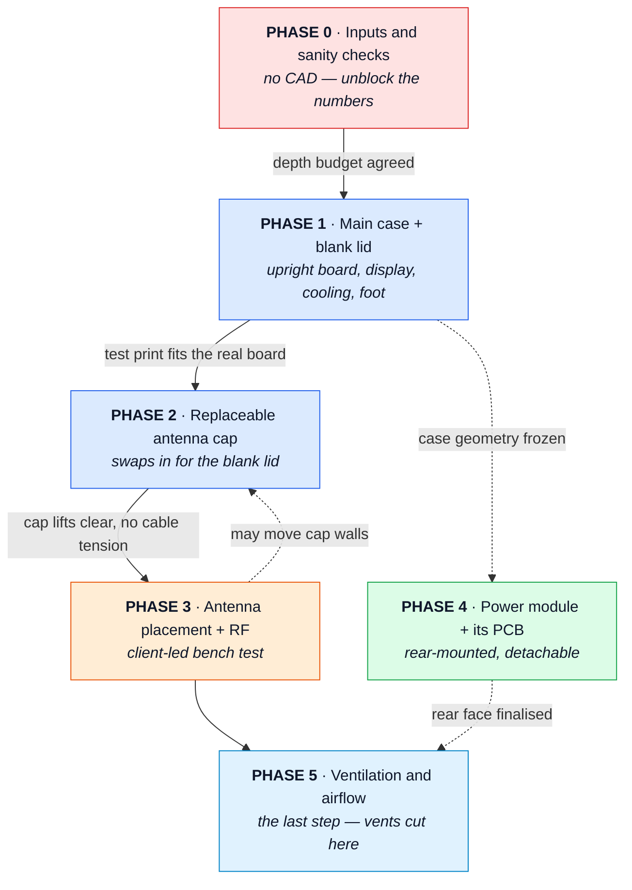

<div align="center">

# Vezha — Enclosure & PCB Handoff

### Upright Orange Pi 5 Plus handheld · replaceable antenna cap · detachable power module

**A phased plan for the mechanical and PCB design work.**

[](#phase-1--main-case-and-blank-lid)
[](#phase-2--the-replaceable-antenna-cap)
[](#phase-3--antenna-placement-and-rf-validation)
[](#phase-4--the-lower-power-module-and-its-pcb)
[](#phase-0--inputs-and-sanity-checks)

</div>

---

## What this is

Vezha is a **two-piece handheld travel router**. This folder is the handoff for
the physical design: an **upright Orange Pi 5 Plus enclosure with a front
display and a replaceable antenna cap**, and later a **detachable power module
that mounts on the back.**

**You are picking up the mechanical work first.** The PCB work is real and
specified, but it is [Phase 4](#phase-4--the-lower-power-module-and-its-pcb) —
the case comes first because the client has the board in hand and the power
module's shape depends on the case it bolts to.

> [!IMPORTANT]
> **Everything in this folder is self-contained enough to work from.** The
> wider repo in [`../docs/`](../docs/) has the reasoning behind every decision
> and is linked throughout — read it when you want to know *why*, not to find
> out *what*. Two documents are worth reading before you start:
> [01 · Architecture](../docs/01-architecture.md) for the system split, and
> [02 · Enclosure A](../docs/02-enclosure-a-upper.md) for this box in detail.

### Files here

| File | What it is |
|---|---|
| **README.md** ← you are here | The phased plan. Start here |
| [01 · Brief — upright case](01-brief-upright-case.md) | The original brief, verbatim |
| [02 · Brief — antenna cap](02-brief-antenna-cap.md) | The cap follow-up, verbatim |
| [03 · Parts, dimensions and links](03-parts-and-dimensions.md) | **Every number, tagged with its provenance.** Your working reference |

---

## The shape of the thing

A Game Boy-style upright handheld. Display at the front, board standing
vertically behind it, cooling behind that, antenna cap on top, and a **stable
foot at the bottom.** The power module mounts on the **back**, later.

```
                         ┌────────────────────────┐
                         │   ANTENNA CAP          │  ← hollow, replaceable,
                         │   (lift off, 2 × M3)   │    nonmetallic · Phase 2
                         ╞════════════════════════╡  ← cap seam · cable passage
                         │   ┌────────────────┐   │
                         │   │                │   │
                         │   │     DISPLAY    │   │  ← OLED, front face
                         │   │                │   │
                         │   └────────────────┘   │    behind it: Orange Pi on
                         │                        │    edge, heatsink + fan aft
                         │   space reserved       │
                         └────────────────────────┘
                          ══════════════════════════  ← STABLE FOOT · no opening

        rear elevation:  ┌────────────────────────┐
                         │  [o]              [o]  │  ← cap screw ears
                         │   ┌────────────────┐   │
                         │   │  POWER MODULE  │   │  ← Phase 4, mounts HERE
                         │   │  (later)       │   │    on the back, detachable
                         │   └────────────────┘   │
                         └────────────────────────┘
```

> [!IMPORTANT]
> **The written brief's diagrams are out of date** and were not redrawn.
> [01](01-brief-upright-case.md) carries the corrections at the top: no
> bottom opening, no 40-pin header access, and the power module mounts on the
> back.

**Style reference:** the
[Lilygo T-Beam SUPREME TS1 case by Alley Cat](https://www.printables.com/model/705817-lilygo-t-beam-supreme-ts1-case-by-alley-cat)
— specifically its **curved features, strap slots and textured surface
lines.** A visual language reference, not a geometry one.

---

## Phases at a glance



**Phases 1 and 4 can overlap** once the case geometry is frozen. Phase 3 can
send you back to Phase 2 — that is expected, and it is why the cap is a
separate replaceable part in the first place. **Phase 5 is deliberately last**:
vent geometry depends on the final internal layout and on where the rear
module ends up.

---

## Phase 0 · Inputs and sanity checks

**No CAD in this phase.** Three numbers need to be unblocked first, and one of
them says the proposed envelope does not close.

### 0.1 · Retrieve the board drawing — blocking

The authority for the hole pattern, connector positions and component heights
is a file nobody has opened yet:

**[Orange Pi 5 Plus mechanical files](https://drive.google.com/file/d/1rW0tlabPHQ-_rhFcBBpHRGK9TQmT1JEP/view)**

The brief says to *"support the board using its actual mounting holes"* and
*"place port openings from the actual board CAD / measurements."* Neither is
possible without this. **If the link needs sharing permissions, ask on day
one** — it blocks everything downstream.

Useful secondary references while you wait:
[CNX Software on the M.2 sockets](https://www.cnx-software.com/2023/05/10/orange-pi-5-plus-sbc-switches-to-rockchip-rk3588-soc-brings-dual-hdmi-2-1-dual-2-5gbe-m-2-pcie-sockets/) ·
[CircuitPython Blinka board listing](https://circuitpython.org/blinka/orange_pi_5_plus/)

### 0.2 · The cooling stack — resolved

**The fan and heatsink are separate parts and they stack**, with the fan
drawing air in through a vented surface and pushing it down into the fins:

```
    vented enclosure surface
            │
            ▼  intake air
    ┌───────────────────┐
    │  FAN  40 × 40     │   Noctua NF-A4x10 5V
    └───────────────────┘   12 mm installed with pads
            ▼
      small clearance gap    ← depth not specified
    ┌───────────────────┐
    │ HEATSINK 50 × 46  │   12.6 mm
    └───────────────────┘
    ═══════════════════════  Orange Pi 5 Plus
```

**So the thermal block is `12 + gap + 12.6` ≈ 27 mm**, not 12.6 mm. The fan
is in **push/intake** configuration — it pulls outside air in and forces it
through the fins rather than extracting from the case.

| Still open | Why it matters |
|---|---|
| **The clearance gap depth** | "Small" is not a number. It is a direct term in the depth budget, and too small chokes the fan |
| **Which surface is the vented one** | The stack is drawn vertically, but the board stands on edge — so the fan faces **rearward**, not up. See the warning below |
| **Where the exhaust goes** | Only the intake is specified. Air has to leave somewhere, and that is [Phase 5](#phase-5--ventilation-and-airflow) |

> [!WARNING]
> **"Lid" is ambiguous and it matters.** The stack above is drawn with intake
> at the top, but **the top of this device is the antenna cap** and the board
> stands on edge — which puts the heatsink face, and therefore the fan,
> pointing at the **rear**, not the sky.
>
> Two readings, and they give different enclosures:
>
> 1. **The fan faces rearward** and draws through a vented rear surface. This
>    follows from the board being on edge — but it collides with the rear
>    service panel and the Phase 4 power module.
> 2. **The fan faces upward**, drawing through a vented top. That means
>    venting the antenna cap or the surface beneath it, and routing intake
>    past the cable passage.
>
> **Confirm which before Phase 1 geometry is cut.** Reading 1 is the one the
> on-edge board implies.

### 0.3 · Run the depth budget — it does not close

Front to back, with every term's provenance. Display at the front, cooling at
the rear, per the [side section](01-brief-upright-case.md).

| Term | Low | High | Provenance |
|---|---:|---:|---|
| Front wall | 2.0 | 2.0 | 🟢 Spec |
| OLED module + mount | 3.0 | 5.0 | 🔴 Allowance — model not chosen |
| **Front-face M.2 stack** (adapter + card + mated plugs + coax bend) | 15.9 | 15.9 | 🔴 **Four stacked guesses** |
| Orange Pi PCB | 1.6 | 1.6 | 🔴 Typical FR4 |
| **Heatsink** | 12.6 | 12.6 | 🟠 Supplied |
| **Clearance gap** | 2.0 | 5.0 | 🔴 "Small" — not specified |
| **Fan** | 12.0 | 12.0 | 🟠 Supplied, installed with pads |
| Rear clearance + service panel | 2.0 | 3.0 | 🔴 Allowance |
| **Total depth** | **≈ 51 mm** | **≈ 57 mm** | |

**The brief proposes 30 mm.** The budget says **51–57 mm** — roughly double.

> [!IMPORTANT]
> **This is not a reason to stop; it is a reason to agree the real number
> before cutting CAD.** The cap brief already says *"match the final
> width/depth to the main enclosure"*, so the cap follows the case — and the
> case is much deeper than the placeholder.
>
> **The levers, in order of size:**
>
> 1. **The front-face M.2 stack at 15.9 mm** is the largest soft term and the
>    least trustworthy — four guesses multiplied together. The client has the
>    board with cards installed, so **ask for this measurement**. Procedure:
>    [10 · Measurement protocol](../docs/10-measurement-protocol.md#1--underside-m2-stack)
> 2. **The clearance gap**, worth up to 3 mm, and a number nobody has set
> 3. **The cooling stack itself at ~27 mm** is now the single biggest block
>    and it is largely fixed. Shrinking it means a different heatsink or a
>    thinner fan, which is a client decision, not a CAD one
>
> For scale: an original Game Boy was 32 mm deep. At 51–57 mm this is a
> substantially chunky object — a product decision worth making knowingly
> rather than discovering at first print.

**Width and height close fine.** Board 100 mm + 2 × 2 mm walls + clearance
sits comfortably inside the proposed **110 mm** cap width. Board height 75 mm
plus the foot puts the main case near **95 mm**, with the **60 mm** cap above.

### 0.4 · Confirm the OLED model

The front panel is an **OLED**, output only. The candidate is the **Adafruit
5297** — already used as the power board's console, so the same part in both
boxes means one driver and one spare.

| | Adafruit 5297 |
|---|---|
| Active area | **20.076 × 20.076 mm** |
| Interface | **I²C**, 4-pin JST-SH STEMMA QT — 3.3 V, GND, SDA, SCL |
| Operating temp | **−40 to +70 °C** |

> [!WARNING]
> **20 mm square is small for a front panel on a device this size, and that
> is the open question.** A Wi-Fi join QR for a strong passphrase needs
> roughly **≥ 0.5 mm per module** to scan reliably, which is marginal at
> 20.076 mm. **If the join QR has to render on the panel, a larger OLED is
> needed** — and that moves the front-face geometry, so it has to be settled
> before the window is cut.

You need from the client: **the chosen model and size.**

### 0.5 · The 40-pin header is internal only

**Cancelled: the header access opening.** The brief's bottom view shows a
`40-PIN HEADER ACCESS OPENING`. **There is no header access and no bottom
opening** — the bottom is a closed, stable foot.

The header does not go unused, though. **The OLED hangs off it** — I²C plus
3.3 V ([0.4](#04--confirm-the-oled-model)) — so it becomes an **internal**
resource. That is a reason to keep it *unexposed*, not a reason to open the
bottom.

**What this means for you:** route and strain-relieve a short cable from the
front panel down to the bottom board edge, inside the shell. Pin direction
still matters for *that* clearance — just not for an external opening.

> [!NOTE]
> **The power module does not use the header either.** Only **5 V over
> USB-C** crosses between the two boxes — no signal, no telemetry. That is a
> deliberate architectural rule, not an omission.
> [01 · Crossing the seam](../docs/01-architecture.md#crossing-the-seam)

### Phase 0 exit criteria

- [ ] Board mechanical drawing in hand, hole pattern extracted
- [ ] Clearance-gap depth and vented-surface orientation answered
- [ ] Real front-face M.2 stack measurement requested or received
- [ ] Case depth agreed with the client, in writing
- [ ] Display model chosen
- [ ] Header pin direction confirmed

---

## Phase 1 · Main case and blank lid

**The deliverable the client asked to start with.** An upright enclosure for
the Orange Pi 5 Plus with a **plain removable lid** on the edge opposite the
40-pin header.

> [!TIP]
> **Design the lid's interface as if it were the antenna cap, because it
> is.** The client's intent is that the blank lid is *later replaced* by the
> cap. If the skirt geometry, seam ledge, cable passage and the two M3 ear
> positions are fixed now, Phase 2 is a new top part against an unchanged
> main case. If they are not, Phase 2 reopens Phase 1.
>
> **Build the cap interface in Phase 1. Build the cap in Phase 2.**

### Scope

**Main case**
- Orange Pi 5 Plus **standing vertically**, 40-pin header at the bottom edge
  (**internal use only — not exposed**), supported on its **actual mounting
  holes**
- Clearance on **both board faces** — one M.2 card per face, one of them on an
  adapter. Neither face is flat
- **Cooling volume** for the ~27 mm stack — fan over a clearance gap over the
  heatsink, [per 0.2](#02--the-cooling-stack--resolved) — with the fan mounted
  and retained. **Reserve** intake and exhaust surface area; the actual vent
  pattern is [Phase 5](#phase-5--ventilation-and-airflow)
- **OLED mounted to the front face**, window cut to its **active area**,
  bezel covering the module margin and the cable exit
- **A stable foot at the bottom.** Closed — **no opening, no header access.**
  The device stands on its own on a desk or hotel nightstand; give it enough
  footprint and a low enough centre of mass that a tugged USB-C cable does not
  topple it
- **Removable rear service panel**
- **Reserve rear area for the Phase 4 power module** to mount against — see
  the rear-face congestion warning below
- **Reserve surface area for vents, but do not cut final vent geometry** —
  that is [Phase 5](#phase-5--ventilation-and-airflow)
- **Port openings from the actual board CAD** — not from the 100 × 75 mm
  outline
- Two **reinforced rear shoulder pockets** below the cap seam carrying the M3
  heat-set inserts, with straight soldering-iron access while the case is bare
- Styling per the
  [reference](https://www.printables.com/model/705817-lilygo-t-beam-supreme-ts1-case-by-alley-cat):
  curves, **strap slots**, textured lines

**Blank lid**
- Same locating skirt, seam ledge and two M3 ears the cap will use
- Closed top, no antenna features, no cable passage features beyond the
  opening itself

**Coupons**
- Skirt-fit coupon
- Heat-set insert coupon

### Watch items

> [!WARNING]
> **The fan pocket is 12 mm, not 10 mm.** The model name says
> `NF-A4x10` and the client's note says 10 mm. The part is **11 mm bare and
> 12 mm with its anti-vibration pads.** Pocket at **12 mm**. Dropping the pads
> to recover 1 mm puts vibration straight into a printed shell held in the
> hand.

> [!NOTE]
> **The OLED is not a thermal weak point**, which is part of why it was
> chosen over e-paper — it is rated **−40 to +70 °C** against e-paper's
> typical 0–50 °C. Still route exhaust away from the front face, but the
> panel is no longer the limiting component.

> [!NOTE]
> **The sealed-shell assumption is gone.** Earlier revisions of this project
> treated the box as a closed form broken only by a power inlet. With a fan it
> is a ventilated box: dust ingress, acoustic leakage, and an airflow path
> that has to actually cross the heatsink.

> [!CAUTION]
> **The rear face is getting crowded, and it is worth planning now.** With the
> bottom closed as a foot, four things want the back:
>
> 1. The **removable service panel**
> 2. The **two cap screw ears** and their insert bosses, just below the seam
> 3. **Fan exhaust**, if the airflow path runs front-to-back
> 4. The **Phase 4 power module**, mounted flat against it
>
> Items 3 and 4 are in direct conflict — a module bolted over the exhaust
> blocks it. **Resolve the airflow direction and the module's mounting
> footprint together**, not separately. Flag it early if the rear cannot carry
> all four; venting may have to move to the sides or the top.

> [!NOTE]
> **Where does the USB-C power inlet go now?** The bottom used to be the
> service and expansion edge; it is now a closed foot. The inlet has to move
> to a side or the rear, and it must clear the **mated plug plus its cable
> bend radius** — not the receptacle footprint. Size it so a plugged-in cable
> does not lever the device over.

> [!NOTE]
> **No controls in this revision.** The front view reserves a control area
> below the display. **Reserve the space; do not populate it.** Keys, a nav
> wheel, a toggle and indicator LEDs were all specified and then cut —
> [the scope cut](../docs/01-architecture.md#no-controls-in-v1) has the
> reasoning, and [the retired front-panel work](../docs/retired/pcb-1-front-control.md)
> is kept should they return.

### Deliverables

Editable parametric CAD plus printable files for: **main enclosure** (with
receiving shoulders and insert bosses), **blank lid**, **rear service panel**,
**skirt-fit coupon**, **heat-set insert coupon**.

### Phase 1 exit criteria

- [ ] Test print fits the **real board with cards and heatsink installed**
- [ ] All port openings line up against the physical board
- [ ] Inserts install cleanly with straight tool access
- [ ] Rear panel removes and refits without tools fouling
- [ ] Display window aligns to the active area
- [ ] Fan clears at 12 mm with pads fitted, over its clearance gap

---

## Phase 2 · The replaceable antenna cap

**Swap the blank lid for a hollow antenna chamber.** Full spec in
[02 · Brief — antenna cap](02-brief-antenna-cap.md); it is detailed and worth
reading in full. Summary of what matters:

### Scope

- **Hollow, open-bottom, closed-top cap**, nonmetallic, interior front and
  rear walls **flat and unobstructed**
- Initial envelope **110 W × 60 H × 30 D**, 2 mm wall — **but match width and
  depth to the Phase 1 case**, which [the budget](#03--run-the-depth-budget--it-does-not-close)
  says is deeper than 30 mm
- **Locating skirt 4–5 mm deep**, 0.25–0.35 mm sliding clearance per mating
  side, lead-in edges, positive seating ledge
- **Two rear-access M3 screws** into the main case's heat-set inserts. Ears
  below the seam, flush with the rear surface, recessed pockets
- **Generous radiused cable passage**, sized for the **connectors and the
  number of cables**, not for bare coax diameter
- **Strain relief below the seam.** Do not clamp or sharply bend micro-coax
- **A temporary service position**: the cap loosens and tilts far enough to
  reach the connectors without tension on the cards
- **Reserve smooth front and rear wall area** for later antenna trials — no
  ribs, bosses, embossed labels or cable clips through those zones
- **No metal anywhere in the chamber.** No foil liner, conductive coating or
  metal decorative trim. **No carbon-filled filament**

### Watch items

> [!CAUTION]
> **The 100 mm leads probably do not let the cap come fully free while
> connected.** The brief says not to assume they do. The antennas have
> **100 ± 3 mm** cables, the radios sit on **opposite faces** of a board
> standing on edge, and the far-face lead has to cross the board thickness
> *and* reach the cap. **Mock up every lead before fixing cap and card
> positions.**
>
> The agreed workflow is that cables are **disconnected by hand** before the
> cap is exchanged. No blind-mate system is wanted. So the service position
> matters more than full-separation reach.

> [!NOTE]
> **Design to the connector, not the antenna film.** The Taoglas datasheet
> **does not give a body thickness** — the spec table's field is blank and the
> drawing has no callout. The mated **MHF4 connector is 2.1 ± 0.4 mm**, which
> is dimensioned and an order of magnitude larger than any candidate film
> thickness. That plus the 3M 467 adhesive is what sets clearance behind the
> cap wall. Details:
> [03 · Antennas](03-parts-and-dimensions.md#antennas).

> [!IMPORTANT]
> **Do not place antennas in this phase.** Positions are a Phase 3 outcome.
> Leave clean wall area and nothing else.

### Deliverables

Editable parametric CAD plus a printable **antenna cap** with locating skirt
and mounting ears. Updated main case if the receiving geometry moved.

### Phase 2 exit criteria

- [ ] Cap lifts straight off after two screws, **without removing the rear
      service panel**
- [ ] No cable pinch, no tension, no sharp coax bends during removal
- [ ] Service position reachable with the unit assembled
- [ ] Screwdriver access with the device fully built
- [ ] No collision with display frame, heatsink, board or ports

---

## Phase 3 · Antenna placement and RF validation

**Client-led, but it can send CAD back to Phase 2.** Four
[Taoglas FXP830.24.0100B](https://www.taoglas.com/datasheets/FXP830.24.0100B.pdf)
flex dipoles, 42 × 7 mm each, adhered to the cap's inside faces.

The hard requirement this validates: **two independent Wi-Fi radios, both on
5 GHz, at the same time** — a 5 GHz uplink *and* a 5 GHz private AP,
concurrently. Full test plan and pass criteria:
[04 · Antennas](../docs/04-antennas.md).

> [!WARNING]
> **Putting all four elements in one cap is the specific risk this phase
> tests.** An earlier layout deliberately spread them around the walls to keep
> the two radios physically separated. Concentrating them in the cap is the
> current plan, and **inter-radio isolation is what could fail.** Expect the
> possibility of moving walls, and do not freeze the cap before this passes.

Your involvement is to **respond to the results**: adjust wall geometry,
spacing or orientation, and reprint the cap. Because the cap is a separate
cheap part, this loop is deliberately inexpensive — that is the whole reason
for the architecture.

---

## Phase 4 · The lower power module and its PCB

**This is where the PCB work is**, and it is specified in detail already.
It **mounts flat against the back of the main case** and is **detachable.**

> [!IMPORTANT]
> **Rear-mounted, not bottom-mounted.** Earlier drafts and the written brief
> put this module under the device. It goes on the **back.** Nothing crosses
> between the two but **5 V over a short USB-C cable** — no signal, no
> telemetry, no 40-pin header — so the mechanical interface is just a mount
> and a short cable run, and the module must come off without disturbing any
> antenna or PCIe connection.
>
> Note the knock-on: a module covering the rear face **competes with the fan
> exhaust and the service panel.** See the rear-face warning in
> [Phase 1](#watch-items).

| | |
|---|---|
| **Enclosure** | [03 · Enclosure B](../docs/03-enclosure-b-lower.md) — contents, sizing, wall openings |
| **PCB requirements** | [05 · Power board](../docs/05-power-board.md) — what the board must do, and the rules that must survive layout |
| **Net-by-net schematic** | [06 · Power board schematic](../docs/06-power-board-schematic.md) — every passive calculated or simulated, with a Pico 2 pin map |
| **BOM** | [07 · BOM](../docs/07-bom.md) — part numbers, JLCPCB codes, what is unresolved |
| **Sourcing** | [08 · Sourcing](../docs/08-sourcing.md) — the LCSC/JLCPCB lookup method |
| **Simulations** | [`../sim/`](../sim/) — ngspice decks backing the schematic |

**What the module does:** negotiates USB-C Power Delivery with a
[CentyLab RotoPD Pro](https://github.com/CentyLab/RotoPD_Pro), regulates to
5 V through a Pololu buck, and hands that 5 V to the router over a short
USB-C cable. A Raspberry Pi Pico 2 sits beside that path — not in it —
validating the PD contract before enabling the rail. It also carries the
product's only controls: an OLED and a push encoder.

> [!CAUTION]
> **One open electrical problem you should know about before laying anything
> out.** The 5 V seam has a **25 mΩ round-trip resistance budget**, and a
> single mated USB-C pair is **30–40 mΩ on its own.** The regulator cannot
> absorb it, because the Orange Pi's USB-C input takes a fixed 5 V and its
> vendor warns that anything higher damages the board. This is the project's
> biggest live technical item and it is **a decision, not a measurement.**
>
> The levers and their costs are laid out in
> [06 · What is actually left to pull on](../docs/06-power-board-schematic.md#what-is-actually-left-to-pull-on).
> One of them — moving the regulator into the upper case — **would change the
> enclosure**, so it is worth reading before Phase 1 geometry is frozen even
> though the PCB itself is Phase 4.

---

## Phase 5 · Ventilation and airflow

**The last step, deliberately.** Vent geometry depends on the final internal
layout, the real thermal load and where the rear module lands — so the earlier
phases **reserve** vent surface and this one **cuts** it.

### The open question for you

> [!IMPORTANT]
> **Can you model the airflow and propose the vent design yourself, or would
> you rather the vent pattern and positions were specified for you?**
>
> Either is fine — we just need to know which. If you can run even a rough CFD
> or a reasoned airflow study and come back with a proposal, that is the
> preferred route, because you will have the full internal geometry in CAD and
> nobody else will. If you would rather not, say so and a vent layout will be
> specified for you to implement.
>
> **Please answer this one early**, even though the phase is last — it changes
> how much surface Phase 1 needs to keep clear.

### What the vents have to do

- **Feed the intake.** The fan draws through a vented surface directly above
  it and pushes down into the fins — that surface needs enough open area not
  to choke it, and it must not be blocked by the rear module or a hand
- **Give the air somewhere to go.** Only the intake is specified. Exhaust
  position is yours to propose, and it must not sit adjacent to the intake or
  the fan recirculates its own air
- **Cross the heatsink**, not bypass it. The easy failure is air taking a
  short free path from intake to exhaust and leaving the fins untouched
- **Keep warm air off the front face.** The OLED tolerates −40 to +70 °C so
  it is not the limiting part, but a hot front panel is still unpleasant to
  hold
- **Not fight the rear module.** See the
  [rear-face congestion warning](#watch-items)
- **Not become an antenna problem.** Vents in or near the cap are fine
  mechanically but the chamber must stay free of metal; no metal mesh inserts
- **Stay quiet.** The fan has **no PWM input** and may run flat out. Vent
  geometry is one of the few remaining levers on perceived noise, and this
  device gets used in hotel rooms at night
- **Resist pocket lint and desk dust** at least passively — no filter is
  specified, but tiny slots clog faster than fewer larger ones

### Inputs you will have by then

| From | What |
|---|---|
| [Phase 0.2](#02--the-cooling-stack--resolved) | The stack order, the gap, and which surface the fan draws through |
| Phase 1 | Final internal layout and free volume |
| Phase 4 | The rear module's footprint and standoff |
| Client | A thermal measurement under sustained dual-radio load — **this does not exist yet** and is the honest gap in this phase |

> [!WARNING]
> **Nobody has measured this box's thermal behaviour.** The fan is *planned*,
> not validated, and the case that justified it — two Wi-Fi 6E radios under
> simultaneous sustained load — has never been run. Treat any airflow model as
> a design aid, not a proof, and expect the vent design to be revisited once
> there is a real temperature curve.

### Deliverables

Updated main case and cap with final vent geometry; a short note on the
intended airflow path and the reasoning behind the pattern; if modelled, the
study itself.

## What not to guess

A short list of things where a wrong assumption is only discovered after a
case has been printed or a board fabricated. **Ask instead — the client has
the hardware on the desk.**

| Don't guess | Why | Where |
|---|---|---|
| **The board's mounting holes and port positions** | The 100 × 75 mm outline tells you neither | [0.1](#01--retrieve-the-board-drawing--blocking) |
| **The fan-to-heatsink clearance gap** | "Small" is not a number, and it is a depth-budget term | [0.2](#02--the-cooling-stack--resolved) |
| **The installed M.2 stack height** | Currently four stacked guesses at 15.9 mm, and it is the largest term in the depth budget | [10 · Measurement protocol](../docs/10-measurement-protocol.md#1--underside-m2-stack) |
| **Whether the header is exposed** | It is **not.** Internal only, for the display ribbon | [0.5](#05--the-40-pin-header-is-internal-only) |
| **Antenna recess depth** | The datasheet has no thickness figure at all. Use the connector | [03](03-parts-and-dimensions.md#antennas) |
| **Heat-set insert bore size** | "M3" does not specify a bore. Use the chosen insert's drawing | [Prusa guidance](https://www.prusa3d.com/product/heat-set-inserts-m3-standard-100-pcs/) |
| **Mated USB-C plug clearance** | Plug body *and* cable bend radius, measured with the cable actually being used | [10 · Measurement protocol](../docs/10-measurement-protocol.md#3--mated-usb-c-plug-and-bend-radius) |
| **Whether the Orange Pi 5 is a substitute for the 5 Plus** | Probably not socket-compatible — it would break the radio design | [03](03-parts-and-dimensions.md#alternate-board--not-a-drop-in) |

---

## Questions worth asking on day one

Batched so they can be answered in one go:

1. Can you share the **Google Drive mechanical files** — is the link
   permissioned for me?
2. **How big is the fan-to-heatsink clearance gap**, and which surface is the
   vented one the fan draws through — rear or top?
3. Can you **measure the installed M.2 stack** on the board you have — adapter
   + card + mated antenna plugs + coax bend, from the board face to the lowest
   point?
4. **~51–57 mm case depth** is where the budget lands against the 30 mm
   placeholder — the cooling stack alone is ~27 mm. Is that acceptable, or
   should we hunt for depth?
5. Which **display model**, and bare panel + adapter board or integrated
   module?
6. **Can you model the airflow and propose the vents**
   ([Phase 5](#phase-5--ventilation-and-airflow)), or should a vent layout be
   specified for you? Worth answering early even though the phase is last.
7. How many **antennas were actually ordered**? The plan says four; the order
   quantity was not recorded.
8. Any constraint on **print material** — the inserts and the case temperature
   both bear on it, and no case temperature has been measured yet.
9. Roughly **how big should the foot be**? It is a styling and stability call
   as much as a mechanical one, and the strap slots interact with it.

---

*Licensed under the [Blue Oak Model License 1.0.0](../LICENSE.md). Blue Oak
covers software; once STLs and PCB files exist, a hardware license such as
CERN-OHL-S or CERN-OHL-P would suit those better, scoped by directory.*
