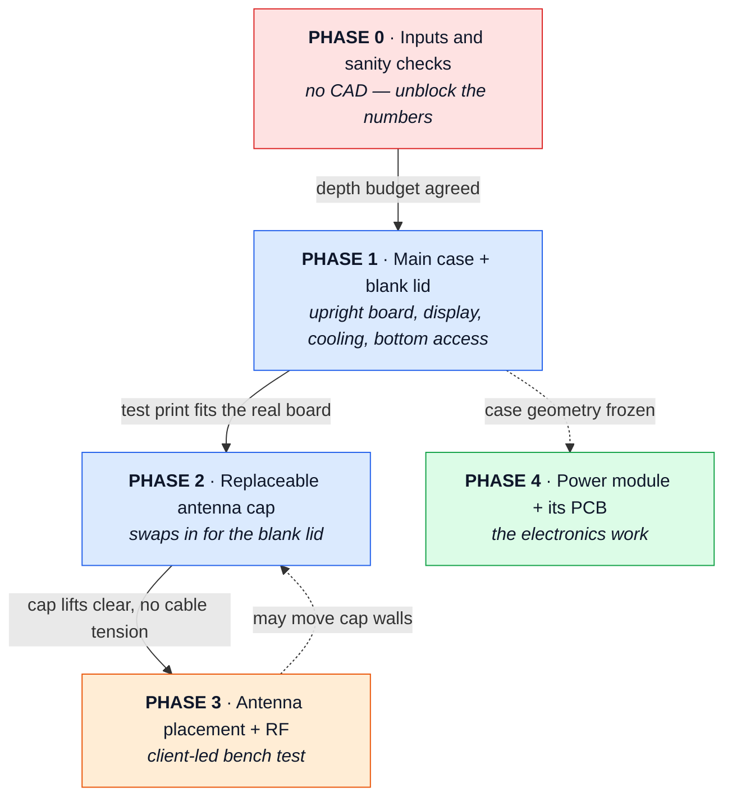

<div align="center">

# Vezha — Enclosure & PCB Handoff

### Upright Orange Pi 5 Plus handheld · replaceable antenna cap · detachable power module

**A phased plan for the mechanical and PCB design work.**

[](#phase-1--main-case-and-blank-lid)
[](#phase-2--the-replaceable-antenna-cap)
[](#phase-3--antenna-placement-and-rf-validation)
[](#phase-4--the-lower-power-module-and-its-pcb)
[](#phase-0--inputs-and-sanity-checks)

</div>

---

## What this is

Vezha is a **two-piece handheld travel router**. This folder is the handoff for
the physical design: an **upright Orange Pi 5 Plus enclosure with a front
display and a replaceable antenna cap**, and later a **detachable power module**
that mates at the bottom.

**You are picking up the mechanical work first.** The PCB work is real and
specified, but it is [Phase 4](#phase-4--the-lower-power-module-and-its-pcb) —
the case comes first because the client has the board in hand and the power
module's shape depends on the case it bolts to.

> [!IMPORTANT]
> **Everything in this folder is self-contained enough to work from.** The
> wider repo in [`../docs/`](../docs/) has the reasoning behind every decision
> and is linked throughout — read it when you want to know *why*, not to find
> out *what*. Two documents are worth reading before you start:
> [01 · Architecture](../docs/01-architecture.md) for the system split, and
> [02 · Enclosure A](../docs/02-enclosure-a-upper.md) for this box in detail.

### Files here

| File | What it is |
|---|---|
| **README.md** ← you are here | The phased plan. Start here |
| [01 · Brief — upright case](01-brief-upright-case.md) | The original brief, verbatim |
| [02 · Brief — antenna cap](02-brief-antenna-cap.md) | The cap follow-up, verbatim |
| [03 · Parts, dimensions and links](03-parts-and-dimensions.md) | **Every number, tagged with its provenance.** Your working reference |

---

## The shape of the thing

A Game Boy-style upright handheld. Display at the front, board standing
vertically behind it, cooling behind that, antenna cap on top, power module
later at the bottom.

```
        ┌────────────────────────┐
        │   ANTENNA CAP          │  ← hollow, replaceable, nonmetallic
        │   (lift off, 2 × M3)   │     Phase 2
        ╞════════════════════════╡  ← cap seam · cable passage
        │   ┌────────────────┐   │
        │   │                │   │
        │   │    DISPLAY     │   │  ← 3.7" e-paper, front face
        │   │                │   │     behind it: Orange Pi on edge,
        │   └────────────────┘   │     40-pin header at the bottom,
        │                        │     heatsink + fan to the rear
        │   space reserved       │
        ╞════════════════════════╡  ← bottom opening, header access
        │   POWER MODULE         │     Phase 4
        │   (later, detachable)  │
        └────────────────────────┘
```

**Style reference:** the
[Lilygo T-Beam SUPREME TS1 case by Alley Cat](https://www.printables.com/model/705817-lilygo-t-beam-supreme-ts1-case-by-alley-cat)
— specifically its **curved features, strap slots and textured surface
lines.** A visual language reference, not a geometry one.

---

## Phases at a glance



**Phases 1 and 4 can overlap** once the case geometry is frozen. Phase 3 can
send you back to Phase 2 — that is expected, and it is why the cap is a
separate replaceable part in the first place.

---

## Ground rules

These are the project's standing rules. They exist because of specific past
near-misses, not as boilerplate.

1. **Measure mated hardware.** Size around connectors *with* their cables, not
   around footprints.
2. **Drawings, not nominals.** A published body size is never a cutout
   dimension. [03](03-parts-and-dimensions.md) tags every figure with its
   provenance — check the tag before you design to the number.
3. **Check the vendor's repository before scheduling a measurement.** This
   project burned time planning to measure a module whose KiCad and STEP files
   had been public the whole time.
4. **Freeze the enclosure last.** The RF test in
   [Phase 3](#phase-3--antenna-placement-and-rf-validation) can still move
   antenna positions, and antenna positions move walls.
5. **Coupons before cases.** Print the skirt-fit and heat-set-insert coupons
   in the final material and orientation before committing a whole shell.
6. **If a number is tagged 🔴, ask.** The client has the board in hand with
   the Wi-Fi cards installed and can measure on request. That is faster and
   cheaper than a reprint.

---

## Phase 0 · Inputs and sanity checks

**No CAD in this phase.** Three numbers need to be unblocked first, and one of
them says the proposed envelope does not close.

### 0.1 · Retrieve the board drawing — blocking

The authority for the hole pattern, connector positions and component heights
is a file nobody has opened yet:

**[Orange Pi 5 Plus mechanical files](https://drive.google.com/file/d/1rW0tlabPHQ-_rhFcBBpHRGK9TQmT1JEP/view)**

The brief says to *"support the board using its actual mounting holes"* and
*"place port openings from the actual board CAD / measurements."* Neither is
possible without this. **If the link needs sharing permissions, ask on day
one** — it blocks everything downstream.

Useful secondary references while you wait:
[CNX Software on the M.2 sockets](https://www.cnx-software.com/2023/05/10/orange-pi-5-plus-sbc-switches-to-rockchip-rk3588-soc-brings-dual-hdmi-2-1-dual-2-5gbe-m-2-pcie-sockets/) ·
[CircuitPython Blinka board listing](https://circuitpython.org/blinka/orange_pi_5_plus/)

### 0.2 · Resolve whether the heatsink and fan stack — blocking

> [!CAUTION]
> **This is the largest single uncertainty in the design, and it is one
> question to the client.**
>
> The heatsink is **50 × 46 × 12.6 mm**. The fan is **40 × 40 × 12 mm**
> installed. Nobody has said whether the fan bolts *on top of* the heatsink or
> whether 12.6 mm already describes a finned assembly with the fan in it.
>
> - **If they stack:** the thermal block is **24.6 mm** deep.
> - **If 12.6 mm is the whole thing:** it is **12.6 mm**.
>
> That is a 12 mm swing in a case whose proposed depth is 30 mm.

### 0.3 · Run the depth budget — it does not currently close

Front to back, with every term's provenance. Both columns assume the display
is at the front and the cooling at the rear, per the
[side section](01-brief-upright-case.md).

| Term | Low case | High case | Provenance |
|---|---:|---:|---|
| Front wall | 2.0 | 2.0 | 🟢 Spec |
| Display panel | 1.0 | 1.0 | 🟡 GDEY037T03 outline |
| Panel mount + air gap | 2.0 | 3.0 | 🔴 Allowance |
| **Front-face M.2 stack** (adapter + card + mated plugs + coax bend) | 15.9 | 15.9 | 🔴 **Four stacked guesses** |
| Orange Pi PCB | 1.6 | 1.6 | 🔴 Typical FR4 |
| **Heatsink** | 12.6 | 12.6 | 🟠 Supplied |
| **Fan** — *only if it stacks* | 0.0 | 12.0 | 🟠 Supplied |
| Rear clearance + service panel | 2.0 | 3.0 | 🔴 Allowance |
| **Total depth** | **≈ 37 mm** | **≈ 51 mm** | |

**The brief proposes 30 mm.** The budget says **37 mm at best and 51 mm at
worst** — between 7 and 21 mm over.

> [!IMPORTANT]
> **This is not a reason to stop; it is a reason to agree the real number
> before cutting CAD.** The cap brief already says *"match the final
> width/depth to the main enclosure"* — so the cap follows the case, and the
> case is deeper than the placeholder. What needs deciding is whether ~37–51 mm
> is acceptable for a handheld, or whether something gives.
>
> **The two levers, in order of size:**
>
> 1. **The front-face M.2 stack at 15.9 mm** is the biggest term and the
>    least trustworthy — it is four guesses multiplied together. The client
>    has the board with cards installed. **Ask for this measurement**;
>    procedure is in
>    [10 · Measurement protocol](../docs/10-measurement-protocol.md#1--underside-m2-stack).
>    A real figure here could move the total several mm in either direction.
> 2. **Whether the fan stacks** — 12 mm, per [0.2](#02--resolve-whether-the-heatsink-and-fan-stack--blocking).
>
> For scale: an original Game Boy was 32 mm deep. At 51 mm this is a
> noticeably chunky object, and that is a product decision the client should
> make knowingly rather than discover at first print.

**Width and height close fine.** Board 100 mm + 2 × 2 mm walls + clearance sits
comfortably inside the proposed **110 mm** cap width. Board height 75 mm plus
bottom header access puts the main case near **95 mm**, with the **60 mm** cap
above it.

### 0.4 · Confirm the display model

Three candidates, all 3.7" GooDisplay e-paper, all SPI on a 24-pin 0.5 mm FPC.
Full table in [03](03-parts-and-dimensions.md#display).

**[GDEY037T03](https://www.good-display.com/product/437.html) is the
defensible default** — mono, 416 × 240, 2 s full refresh, **0–50 °C**. The
four-colour option drops to **0–40 °C** and 20 s refresh, which is a bad trade
inside a warm box.

You need from the client: **the chosen model**, and whether they want a bare
panel plus a [DESPI-C02](https://www.good-display.com/product/516.html)
adapter board (41 × 22 mm) or an integrated module.

### 0.5 · Confirm the 40-pin header's pin direction

The brief is explicit that a bottom access opening **does not imply the stock
pins point downward.** Mating direction decides whether the future power
module needs a ribbon, a right-angle adapter, or a direct connector — and it
changes the bottom opening's geometry. **Confirm before Phase 1 closes**, not
before it starts.

### Phase 0 exit criteria

- [ ] Board mechanical drawing in hand, hole pattern extracted
- [ ] Heatsink/fan stacking answered
- [ ] Real front-face M.2 stack measurement requested or received
- [ ] Case depth agreed with the client, in writing
- [ ] Display model chosen
- [ ] Header pin direction confirmed

---

## Phase 1 · Main case and blank lid

**The deliverable the client asked to start with.** An upright enclosure for
the Orange Pi 5 Plus with a **plain removable lid** on the edge opposite the
40-pin header.

> [!TIP]
> **Design the lid's interface as if it were the antenna cap, because it
> is.** The client's intent is that the blank lid is *later replaced* by the
> cap. If the skirt geometry, seam ledge, cable passage and the two M3 ear
> positions are fixed now, Phase 2 is a new top part against an unchanged
> main case. If they are not, Phase 2 reopens Phase 1.
>
> **Build the cap interface in Phase 1. Build the cap in Phase 2.**

### Scope

**Main case**
- Orange Pi 5 Plus **standing vertically**, 40-pin header at the bottom edge,
  supported on its **actual mounting holes**
- Clearance on **both board faces** — one M.2 card per face, one of them on an
  adapter. Neither face is flat
- **Cooling volume** for the heatsink and fan, with ventilation. Needs an
  **inlet and an exhaust on different faces** so the fan does not
  short-circuit its own airflow
- **Display mounted to the front face**, window cut to the **active area**
  (81.54 × 47.04 mm), bezel covering the margin and the flex tail
- **Bottom opening** for 40-pin header access and mating-connector clearance,
  kept clear for the future power module
- **Removable rear service panel**
- **Port openings from the actual board CAD** — not from the 100 × 75 mm
  outline
- Two **reinforced rear shoulder pockets** below the cap seam carrying the M3
  heat-set inserts, with straight soldering-iron access while the case is bare
- Styling per the
  [reference](https://www.printables.com/model/705817-lilygo-t-beam-supreme-ts1-case-by-alley-cat):
  curves, **strap slots**, textured lines

**Blank lid**
- Same locating skirt, seam ledge and two M3 ears the cap will use
- Closed top, no antenna features, no cable passage features beyond the
  opening itself

**Coupons**
- Skirt-fit coupon
- Heat-set insert coupon

### Watch items

> [!WARNING]
> **The fan pocket is 12 mm, not 10 mm.** The model name says
> `NF-A4x10` and the client's note says 10 mm. The part is **11 mm bare and
> 12 mm with its anti-vibration pads.** Pocket at **12 mm**. Dropping the pads
> to recover 1 mm puts vibration straight into a printed shell held in the
> hand.

> [!WARNING]
> **The display is the most heat-sensitive part in the box.** It is rated
> **0–50 °C** — below the SoC, the radios and the antennas (−40 to +85 °C).
> It sits on the front face with a heatsink and fan behind it. **Route the
> exhaust away from the panel**, and do not make the display cavity the path
> of least resistance for warm air.

> [!NOTE]
> **The sealed-shell assumption is gone.** Earlier revisions of this project
> treated the box as a closed form broken only by a power inlet. With a fan it
> is a ventilated box: dust ingress, acoustic leakage, and an airflow path
> that has to actually cross the heatsink.

> [!NOTE]
> **No controls in this revision.** The front view reserves a control area
> below the display. **Reserve the space; do not populate it.** Keys, a nav
> wheel, a toggle and indicator LEDs were all specified and then cut —
> [the scope cut](../docs/01-architecture.md#the-v1-scope-cut) has the
> reasoning, and [the retired front-panel work](../docs/retired/pcb-1-front-control.md)
> is kept should they return.

### Deliverables

Editable parametric CAD plus printable files for: **main enclosure** (with
receiving shoulders and insert bosses), **blank lid**, **rear service panel**,
**skirt-fit coupon**, **heat-set insert coupon**.

### Phase 1 exit criteria

- [ ] Test print fits the **real board with cards and heatsink installed**
- [ ] All port openings line up against the physical board
- [ ] Inserts install cleanly with straight tool access
- [ ] Rear panel removes and refits without tools fouling
- [ ] Display window aligns to the active area
- [ ] Fan clears at 12 mm with pads fitted

---

## Phase 2 · The replaceable antenna cap

**Swap the blank lid for a hollow antenna chamber.** Full spec in
[02 · Brief — antenna cap](02-brief-antenna-cap.md); it is detailed and worth
reading in full. Summary of what matters:

### Scope

- **Hollow, open-bottom, closed-top cap**, nonmetallic, interior front and
  rear walls **flat and unobstructed**
- Initial envelope **110 W × 60 H × 30 D**, 2 mm wall — **but match width and
  depth to the Phase 1 case**, which [the budget](#03--run-the-depth-budget--it-does-not-currently-close)
  says is deeper than 30 mm
- **Locating skirt 4–5 mm deep**, 0.25–0.35 mm sliding clearance per mating
  side, lead-in edges, positive seating ledge
- **Two rear-access M3 screws** into the main case's heat-set inserts. Ears
  below the seam, flush with the rear surface, recessed pockets
- **Generous radiused cable passage**, sized for the **connectors and the
  number of cables**, not for bare coax diameter
- **Strain relief below the seam.** Do not clamp or sharply bend micro-coax
- **A temporary service position**: the cap loosens and tilts far enough to
  reach the connectors without tension on the cards
- **Reserve smooth front and rear wall area** for later antenna trials — no
  ribs, bosses, embossed labels or cable clips through those zones
- **No metal anywhere in the chamber.** No foil liner, conductive coating or
  metal decorative trim. **No carbon-filled filament**

### Watch items

> [!CAUTION]
> **The 100 mm leads probably do not let the cap come fully free while
> connected.** The brief says not to assume they do. The antennas have
> **100 ± 3 mm** cables, the radios sit on **opposite faces** of a board
> standing on edge, and the far-face lead has to cross the board thickness
> *and* reach the cap. **Mock up every lead before fixing cap and card
> positions.**
>
> The agreed workflow is that cables are **disconnected by hand** before the
> cap is exchanged. No blind-mate system is wanted. So the service position
> matters more than full-separation reach.

> [!NOTE]
> **Design to the connector, not the antenna film.** The Taoglas datasheet
> **does not give a body thickness** — the spec table's field is blank and the
> drawing has no callout. The mated **MHF4 connector is 2.1 ± 0.4 mm**, which
> is dimensioned and an order of magnitude larger than any candidate film
> thickness. That plus the 3M 467 adhesive is what sets clearance behind the
> cap wall. Details:
> [03 · Antennas](03-parts-and-dimensions.md#antennas).

> [!IMPORTANT]
> **Do not place antennas in this phase.** Positions are a Phase 3 outcome.
> Leave clean wall area and nothing else.

### Deliverables

Editable parametric CAD plus a printable **antenna cap** with locating skirt
and mounting ears. Updated main case if the receiving geometry moved.

### Phase 2 exit criteria

- [ ] Cap lifts straight off after two screws, **without removing the rear
      service panel**
- [ ] No cable pinch, no tension, no sharp coax bends during removal
- [ ] Service position reachable with the unit assembled
- [ ] Screwdriver access with the device fully built
- [ ] No collision with display frame, heatsink, board or ports

---

## Phase 3 · Antenna placement and RF validation

**Client-led, but it can send CAD back to Phase 2.** Four
[Taoglas FXP830.24.0100B](https://www.taoglas.com/datasheets/FXP830.24.0100B.pdf)
flex dipoles, 42 × 7 mm each, adhered to the cap's inside faces.

The hard requirement this validates: **two independent Wi-Fi radios, both on
5 GHz, at the same time** — a 5 GHz uplink *and* a 5 GHz private AP,
concurrently. Full test plan and pass criteria:
[04 · Antennas](../docs/04-antennas.md).

> [!WARNING]
> **Putting all four elements in one cap is the specific risk this phase
> tests.** An earlier layout deliberately spread them around the walls to keep
> the two radios physically separated. Concentrating them in the cap is the
> current plan, and **inter-radio isolation is what could fail.** Expect the
> possibility of moving walls, and do not freeze the cap before this passes.

Your involvement is to **respond to the results**: adjust wall geometry,
spacing or orientation, and reprint the cap. Because the cap is a separate
cheap part, this loop is deliberately inexpensive — that is the whole reason
for the architecture.

---

## Phase 4 · The lower power module and its PCB

**This is where the PCB work is**, and it is specified in detail already.
It mates at the bottom opening and is **detachable**.

| | |
|---|---|
| **Enclosure** | [03 · Enclosure B](../docs/03-enclosure-b-lower.md) — contents, sizing, wall openings |
| **PCB requirements** | [05 · Power board](../docs/05-power-board.md) — what the board must do, and the rules that must survive layout |
| **Net-by-net schematic** | [06 · Power board schematic](../docs/06-power-board-schematic.md) — every passive calculated or simulated, with a Pico 2 pin map |
| **BOM** | [07 · BOM](../docs/07-bom.md) — part numbers, JLCPCB codes, what is unresolved |
| **Sourcing** | [08 · Sourcing](../docs/08-sourcing.md) — the LCSC/JLCPCB lookup method |
| **Simulations** | [`../sim/`](../sim/) — ngspice decks backing the schematic |

**What the module does:** negotiates USB-C Power Delivery with a
[CentyLab RotoPD Pro](https://github.com/CentyLab/RotoPD_Pro), regulates to
5 V through a Pololu buck, and hands that 5 V to the router over a short
USB-C cable. A Raspberry Pi Pico 2 sits beside that path — not in it —
validating the PD contract before enabling the rail. It also carries the
product's only controls: an OLED and a push encoder.

> [!CAUTION]
> **One open electrical problem you should know about before laying anything
> out.** The 5 V seam has a **25 mΩ round-trip resistance budget**, and a
> single mated USB-C pair is **30–40 mΩ on its own.** The regulator cannot
> absorb it, because the Orange Pi's USB-C input takes a fixed 5 V and its
> vendor warns that anything higher damages the board. This is the project's
> biggest live technical item and it is **a decision, not a measurement.**
>
> The levers and their costs are laid out in
> [06 · What is actually left to pull on](../docs/06-power-board-schematic.md#what-is-actually-left-to-pull-on).
> One of them — moving the regulator into the upper case — **would change the
> enclosure**, so it is worth reading before Phase 1 geometry is frozen even
> though the PCB itself is Phase 4.

---

## What not to guess

A short list of things where a wrong assumption is only discovered after a
case has been printed or a board fabricated. **Ask instead — the client has
the hardware on the desk.**

| Don't guess | Why | Where |
|---|---|---|
| **The board's mounting holes and port positions** | The 100 × 75 mm outline tells you neither | [0.1](#01--retrieve-the-board-drawing--blocking) |
| **Whether the fan stacks on the heatsink** | 12 mm swing in a 30 mm envelope | [0.2](#02--resolve-whether-the-heatsink-and-fan-stack--blocking) |
| **The installed M.2 stack height** | Currently four stacked guesses at 15.9 mm, and it is the largest term in the depth budget | [10 · Measurement protocol](../docs/10-measurement-protocol.md#1--underside-m2-stack) |
| **The 40-pin header's pin direction** | Decides the whole lower-module interface | [0.5](#05--confirm-the-40-pin-headers-pin-direction) |
| **Antenna recess depth** | The datasheet has no thickness figure at all. Use the connector | [03](03-parts-and-dimensions.md#antennas) |
| **Heat-set insert bore size** | "M3" does not specify a bore. Use the chosen insert's drawing | [Prusa guidance](https://www.prusa3d.com/product/heat-set-inserts-m3-standard-100-pcs/) |
| **Mated USB-C plug clearance** | Plug body *and* cable bend radius, measured with the cable actually being used | [10 · Measurement protocol](../docs/10-measurement-protocol.md#3--mated-usb-c-plug-and-bend-radius) |
| **Whether the Orange Pi 5 is a substitute for the 5 Plus** | Probably not socket-compatible — it would break the radio design | [03](03-parts-and-dimensions.md#alternate-board--not-a-drop-in) |

---

## Questions worth asking on day one

Batched so they can be answered in one go:

1. Can you share the **Google Drive mechanical files** — is the link
   permissioned for me?
2. Does the **fan mount on top of the 12.6 mm heatsink**, or is 12.6 mm the
   whole cooling assembly?
3. Can you **measure the installed M.2 stack** on the board you have — adapter
   + card + mated antenna plugs + coax bend, from the board face to the lowest
   point?
4. **~37–51 mm case depth** is where the budget lands against the 30 mm
   placeholder. Is that acceptable, or should we hunt for depth?
5. Which **display model**, and bare panel + adapter board or integrated
   module?
6. Which way do the **40-pin header pins** face?
7. How many **antennas were actually ordered**? The plan says four; the order
   quantity was not recorded.
8. Any constraint on **print material** — the inserts and the case temperature
   both bear on it, and no case temperature has been measured yet.

---

*Licensed under the [Blue Oak Model License 1.0.0](../LICENSE.md). Blue Oak
covers software; once STLs and PCB files exist, a hardware license such as
CERN-OHL-S or CERN-OHL-P would suit those better, scoped by directory.*
